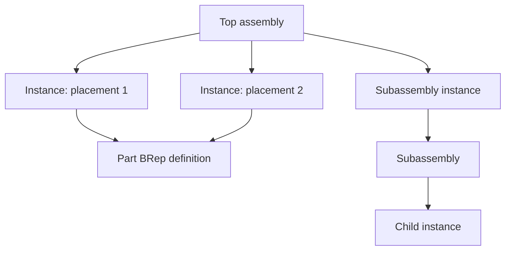
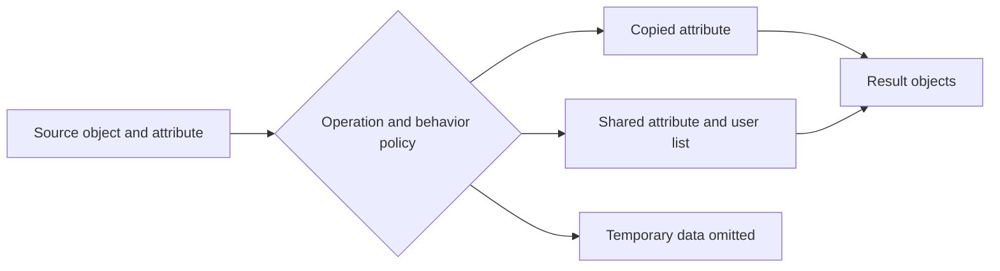

# Assemblies, instances, attributes, and topology identity

Source baseline: upstream `3fd5b9548d19aa8c12c29bc9637a96d42a06f8a5`.
The object relationships are source-backed. Application selection/history
workflows are design guidance, not claims of a built-in parametric document system.

## 1. Shape definition versus occurrence

An assembly describes components and their placements. A reusable part definition
and a particular occurrence of that part are different identities. Moving one
instance should not automatically deform the shared part geometry; editing the
definition may affect all instances that reference it, depending on the ownership
and sharing policy actually chosen.

For nested placements,

$$
T_{\rm world}=T_0T_1\cdots T_k
$$

under a consistent column-vector convention. The library's actual matrix
convention must be respected when implementing this composition; reversing
multiplication order changes the result.

## 2. SMLib assembly structure

[SmAssembly.h](../source/SMLib/inc/SmAssembly.h) describes hierarchical assembly
trees whose leaf shapes are BReps. Components are `SmAssemblyInstance` objects,
representing placed, rotated and optionally mirrored occurrences of a BRep or
subassembly. Assemblies carry names and component lists.



This diagram illustrates sharing; inspect the selected constructors and lifetime
implementation before assuming a specific copy/reference policy. The important
sources are [SmAssemblyInstance.h](../source/SMLib/inc/SmAssemblyInstance.h),
[SmAssembly.cpp](../source/SMLib/src/SmAssembly.cpp), and
[SmAssemblyInstance.cpp](../source/SMLib/src/SmAssemblyInstance.cpp).

In the inspected constructors, the instance stores its placement, scale and
mirror flag, registers itself through the owning assembly's `AddInstance`, and
stores the supplied component pointer. It does not deep-copy that component.
The instance destructor frees its name and removes itself from its parent; it
does not explicitly delete `m_pComponent`. The assembly destructor removes its
listed instances. Do not infer a shared-component reference-counting/deletion
contract merely from ownership wording in a comment; arrange explicit component
and occurrence lifetimes when using these kernel classes.

The drawing implementation also has unfinished integration: the instance's
BRep graphics branch emits a debug message, while the assembly graphics code
contains open placement/reuse questions. The data model is useful architecture
evidence, but these functions are not a finished instanced viewport renderer.

The hierarchy does not by itself solve mating constraints, motion, interference
policy, or a persistent product structure in an external CAD document.

## 3. Mirroring and orientation

A transform with negative determinant reverses handedness. A mirrored instance
therefore needs consistent treatment of winding, normals, and material-side
interpretation when flattened or exported. Reusing vertex coordinates without
the corresponding orientation policy can create an inside-out result.

Distinguish instance placement from baking a transform into the BRep. The former
preserves an occurrence relationship; the latter modifies or copies geometric
data. A consumer that only accepts flattened meshes needs an explicit conversion
policy for both geometry and metadata.

## 4. Attribute behavior is explicit

[SmAttribute.h](../source/SMLib/inc/SmAttribute.h) defines behaviors including:

| Behavior | Meaning in the declared model |
| --- | --- |
| `SM_AB_COPY` | Copy the attribute, maintaining a one-to-one owner relationship |
| `SM_AB_REFERENCE` | Share the attribute and track its users |
| Standalone copy/reference variants | Alter automatic deletion behavior |
| `SM_AB_TEMP` | Session marking: not persistent and not copied |

An attribute's ID alone does not determine propagation through every operation.
Copying, splitting, merging, and conversion can invoke different policies or
special handling. Temporary analysis marks should not be mistaken for persistent
application identifiers.



## 5. Tracking topology changes

[SmTrackTopologyChanges.h](../source/SMLib/inc/SmTrackTopologyChanges.h) and
[SmCopyBrepMap.h](../source/SMLib/inc/SmCopyBrepMap.h) provide mechanisms relevant
to change/copy correspondence. They do not imply a universal stable face name
across arbitrary modeling operations.

After splitting an edge, one old entity can map to several new ones. After
merging faces, several old entities can map to one. After deleting a feature,
an entity may have no successor. A persistent selection system must represent
these possibilities and resolve design intent rather than compare pointers.

```text
record occurrence path separately from part/entity identity
perform copy/edit using supported tracking mechanisms where available
collect old-to-new correspondences and deletion/split events
resolve application selections under explicit ambiguity rules
propagate attributes according to their semantic ownership
rebuild display and export mappings for accepted results
```

## 6. CAD scenario: repeated fasteners

A bracket assembly may contain many instances of one fastener definition.
Changing an instance placement is different from changing the fastener's thread
geometry. A color or inspection result can belong to the shared part, one
occurrence, or one face. Store it at the intended level rather than relying on
accidental sharing.

For interference inspection, evaluate each occurrence in the correct world
frame. Two identical local BReps in different placements should not be queried
as if both occupied the origin. For export, decide whether to preserve instancing
or flatten it, and verify the chosen bridge's supported metadata mapping.

## 7. Verification and limitations

Test nested transforms, repeated instances, mirroring, copying with attributes,
and topology split/merge events. Verify that deleting one owner does not destroy
shared data still in use, and that temporary attributes do not leak into persistent
output under the selected contract.

The code establishes assembly and attribute facilities, not an entire CAD
assembly-constraint solver or persistent naming system. Continue with
[runtime](runtime.md), [editing](editing.md), [native I/O](native-io.md), and
[USD interchange](usd-interchange.md). Native and USD instance/metadata models
must be mapped explicitly rather than assumed equivalent.
