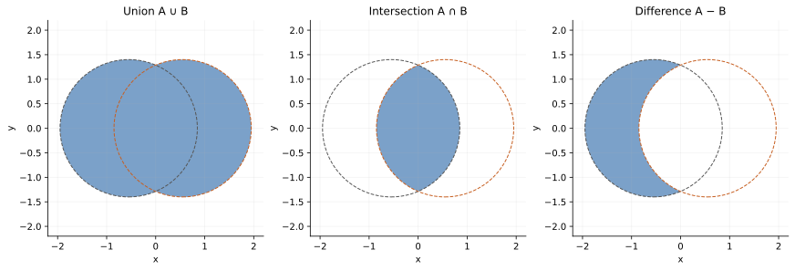
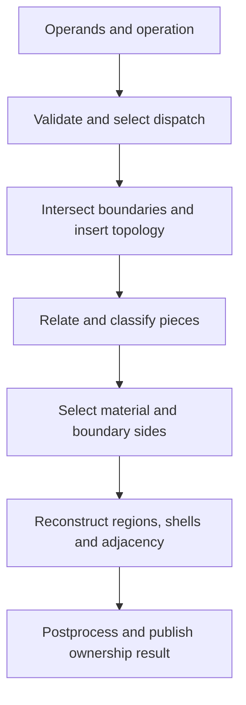
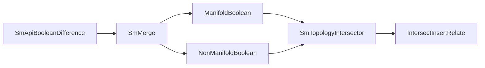

# Solid booleans: intersection, classification, and reconstruction

Source baseline: upstream `3fd5b9548d19aa8c12c29bc9637a96d42a06f8a5`.
The complete native example linked below was not rerun for this guide. Diagrams
describe the mathematical stages and verified executive relationships.

## 1. Set operations and regularized solids



These sampled planar sets illustrate selection logic, not SMLib boolean output.

Union keeps material in either operand, intersection keeps material in both,
and difference keeps material in A but not B. In solid modeling, regularization
is commonly expressed as

$$
r(X)=\overline{\operatorname{int}(X)}.
$$

It removes lower-dimensional remnants from a volumetric set result. This is
useful theory for regular solid operations, but SMLib also supports non-manifold
and merge workflows whose purpose is not identical to regularized set algebra.
Check the selected operation and dispatch rather than imposing one interpretation
on every result.

| Inside A | Inside B | Union | Intersection | A minus B |
| --- | --- | --- | --- | --- |
| No | No | No | No | No |
| Yes | No | Yes | No | Yes |
| No | Yes | Yes | No | No |
| Yes | Yes | Yes | Yes | No |

This table classifies volume regions. Boundary orientation and coincident faces
need additional decisions; selecting triangles by this table is not a BRep boolean.

## 2. Why boundary intersections are only the beginning

An operation must discover where boundaries meet, split topology so those events
are represented, classify fragments/regions, select the result, and reconstruct
consistent adjacency. A cutter wholly contained inside stock creates a cavity
without a transverse stock-boundary intersection. Disjoint union produces
multiple material components. Touching inputs can create lower-dimensional
contact requiring manifold/non-manifold policy.



Geometry can remain analytic or NURBS throughout, but intersections and fitted
boundary curves can use numerical tolerances and approximation. “Exact BRep”
does not mean the complete boolean introduces no numerical approximation.

## 3. Public wrapper and executive dispatch

`SmApiBooleanDifference` in [SmApiBrep.cpp](../source/SM_API/src/SmApiBrep.cpp)
validates operands, obtains the API context, creates `SmMerge`, and checks both
operands with `IsManifoldSolid`. It selects `ManifoldBoolean` when both satisfy
that predicate and `NonManifoldBoolean` otherwise.

The deeper source path is [SmMerge.cpp](../source/SMLib/src/SmMerge.cpp), with
[SmTopologyIntersector.cpp](../source/SMLib/src/SmTopologyIntersector.cpp)
providing `IntersectInsertRelate`. This shared stage also appears in other
topology-changing operations, including filleting.



The diagram identifies major relationships, not every conditional branch.
The manifold path still requires careful region, coincident-face and degeneracy
handling. The non-manifold path is not simply a fallback that guarantees success
for arbitrary invalid input.

## 4. Intersection insertion and relationship data

Splitting a geometric curve is insufficient: all relevant edgeuses and loopuses
must agree on new vertices and intervals. Shared intersection geometry must
produce compatible topology on the interacting boundaries. Classification then
determines which sides separate retained material from excluded space.

The intersector's name is instructive: **intersect**, **insert**, and **relate**
are coupled responsibilities. Reusing old relationship marks after another
mutation is not generally valid. [topology.md](topology.md) explains the use graph;
[intersections.md](intersections.md) explains the underlying geometry.

The inspected `IntersectInsertRelate` implementation has a concrete staging
boundary. It creates `SmProtoTopologyManager`, calls `IntersectTopology`, then
`ResolveIntersections`, then `ImprintIntersections`, and finally
`SetRelationships`. The first stages collect and reconcile provisional topology;
imprinting is the stage explicitly identified as modifying the operand BReps.
The provisional manager is deleted after relationships have been established.

Its candidate capture distance starts at `0.01` and is raised to at least
`2000 * GetThisApproxTol3d()`. This is a **candidate-grouping policy**, not an
allowable final geometric error or an instruction to merge all points inside
that radius. The source explains that resolution may produce one or several
actual vertices from a provisional vertex group.


The routine propagates errors at several boundaries, but its imprint error
handling and later relationship call are not a transaction/rollback mechanism.
Inspect where an error originated and the resulting operands before reuse.

Coincident supports require more than checking normal directions. Their modeled
trim domains may overlap only partially, and material can lie on different sides.
Tangency can produce no volumetric overlap even when boundaries touch.

## 5. Ownership is part of the algorithm contract

The native [Boolean/bounds example](../Examples/SM_API/boolean_bounds.cpp)
documents the selected difference contract: success reuses the modified primary
operand and deletes the tool; failure leaves both allocated, possibly modified.
Do not translate the Python “consumes inputs” description into a rule that native
callers always delete both inputs after the call.

For the example's contract, the ownership sequence is conceptually:

```text
hold separate owners for workpiece A and tool B
call SmApiBooleanDifference(A, B, result)
on failure: retain both owners for cleanup; do not assume unchanged geometry
on success: release B's owner because the operation deleted B
keep A's owner for the returned modified primary object
discard stale child selections and reacquire from the result
```

Use the complete example for executable C++ rather than copying this pseudocode
to another overload. Options such as keeping the other BRep change ownership.
Copies are appropriate when an application must preserve design inputs or support
transactional undo after a failure that can partially mutate operands.

## 6. Variants and their meaning

The API includes union/difference/intersection, merge, options, list/tree forms,
2D operations, and workflows involving supplied curves. These deserve separate
contracts even when they share infrastructure.

Imprinting preserves or adds intersection topology without necessarily removing
material. Merge can retain non-manifold structures that a regularized union
would not represent the same way. A Boolean tree encodes operation order;
difference is noncommutative. The documented list workflow evaluates in a
last-to-first order, so inspect its contract rather than assuming a left fold.

Do not use solid BRep boolean descriptions for `SmPolyBrep` operations. Their
representation and numerical failure modes are covered in [polygon-brep.md](polygon-brep.md).

## 7. CAD scenario: a perforated plate

Start with stock dimensions and cutter placements that have independent expected
results. For disjoint cylindrical through-holes fully inside a plate of thickness
$h$, the ideal removed volume is

$$
\Delta V=\sum_i\pi r_i^2h.
$$

This formula needs adjustment for overlapping holes, partial penetration, or
cutters intersecting the stock boundary. It is a useful check only under its
stated assumptions.

The native example separates optional bounding-box cost from boolean cost.
Do not request tight bounds after every cut unless the application needs them.
Validate result volume, material interpretation, manifold status under the
intended input class, and relevant clearances. Face count can change with valid
partitioning and is not a universal acceptance test.

## 8. Robustness and diagnostic sequence

Preserve a failing pair before mutation. Record units, tolerances, operand
validity, operation flags, and whether the failure occurs before or after
intersection insertion. Inspect the earliest inconsistent stage rather than
healing the final result indiscriminately.

Use separate cases for disjointness, containment, transverse crossing, touching,
coincidence, and tiny features. Never silently move the cutter to avoid tangency:
that changes the requested part. A diagnostic perturbation must be reported as
such and compared against the original.

The relevant reading order is public contract → `SmMerge` dispatch →
`IntersectInsertRelate` → classification/reconstruction → ownership cleanup.
Continue with [fillets](blend.md), [tolerances](tolerances.md),
and [validation](validation-diagnostics.md).
