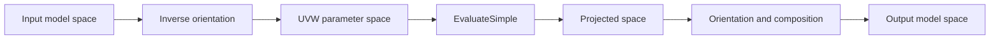
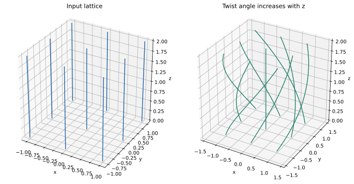

# Spatial deformation, B-spline volumes, bending, and twisting

Source baseline: upstream `3fd5b9548d19aa8c12c29bc9637a96d42a06f8a5`.
These are primarily kernel-level facilities. The guide does not imply matching
stable `SmApi*` wrappers for every class, and no deformation example was run here.

## 1. A deformation volume is a map

In this subsystem, “volume” describes a mapping from three parameters to three
coordinates, not a BRep material region or a scalar volume measurement:

$$
\mathbf x'=F(\mathbf x).
$$

A curve becomes $F(\mathbf C(t))$ and a surface becomes $F(\mathbf S(u,v))$.
This can preserve a useful procedural construction before any approximation
to ordinary spline geometry is performed.

## 2. Tensor-product spline volumes

A rational tensor-product map has the form

$$
\mathbf V(u,v,w)=
\frac{\sum_{i,j,k}N_{i,p}(u)M_{j,q}(v)L_{k,r}(w)
\omega_{ijk}\mathbf P_{ijk}}
{\sum_{i,j,k}N_{i,p}(u)M_{j,q}(v)L_{k,r}(w)\omega_{ijk}}.
$$

It extends the surface control net into a three-dimensional control lattice.
Moving lattice controls changes the mapped region. It does not directly create
the oriented boundary topology of a solid.

[SmBSplineVolume.h](../source/SMLib/inc/SmBSplineVolume.h) stores `gw_VOLUME`
data and documents the relation between its axis-aligned parameter box and
oriented input-space box. The lower numerical representation is described in
[NL_Nurbsdef.h](../source/SMLib/inc/NL_Nurbsdef.h).

## 3. The four-space architecture

[SmVolume.h](../source/SMLib/inc/SmVolume.h) separates input/output world spaces
from the map's parameter/projected spaces. Orientation maps position the
deformation relative to the model; the derived class supplies the simple map.



The base class also supports concatenation through a next-map relationship and
ownership flags. This avoids making every derived map independently implement
all orientation and composition logic. `SmBSplineVolume` implements the simple
evaluation family while inheriting those broader responsibilities.

For a composite map $F=F_2\circ F_1$,

$$
J_F(\mathbf x)=J_{F_2}(F_1(\mathbf x))J_{F_1}(\mathbf x).
$$

Derivative transformation must follow the same composition order as point
transformation. Reversing the order changes the deformation.

The concrete [SmVolume.cpp](../source/SMLib/src/SmVolume.cpp) implementation
distinguishes `Map`, which accepts an input-world-space point, from `Evaluate`,
which accepts a parameter-space point. `Evaluate` checks the requested derivative
order (at most three), calls `EvaluateSimple`, optionally evaluates the orientation
map, and combines derivatives with `smvol_ConcatEvals`. If compounding is enabled
and a next map exists, it calls that map's `Map` and concatenates derivatives
again. Using `Evaluate` on an unconverted world point can bypass the intended
input placement.

For highest derivative order $d$, allocate $(d+1)^3$ vector entries; the storage
index is $i(d+1)^2+j(d+1)+k$. Only the requested total-order derivatives should
be interpreted, rather than every cell in that cubic allocation. At first order,
the Jacobian columns are the U, V and W derivatives. Disable tangent substitution
when measuring their magnitudes or determinant: a repaired direction vector is
not the raw derivative needed for an invertibility diagnostic.

## 4. Regularity and invertibility

If $\det J_F=0$, a local dimension collapses. A negative determinant reverses
orientation relative to a positive one; a determinant crossing zero indicates
a fold or singularity. Nonzero determinant everywhere locally does not by
itself prove global injectivity over an arbitrary domain.

For a mapped surface,

$$
\mathbf S'_u=J_F\mathbf S_u,\qquad
\mathbf S'_v=J_F\mathbf S_v.
$$

Normals follow the transformed tangent plane, or the inverse-transpose relation
when the Jacobian is invertible. Transforming a unit normal as an ordinary point
is incorrect. Approximation after mapping introduces another error source.

## 5. Twist, bend, and unbend components



The figure preserves each line's radial distance from the twist axis. It
illustrates the formula below and does not execute the SMLib deformation classes.

[SmTwistVolume.h](../source/SMLib/inc/SmTwistVolume.h) describes a twist map;
[SmBendVolume.h](../source/SMLib/inc/SmBendVolume.h) and
[SmUnbendVolume.h](../source/SMLib/inc/SmUnbendVolume.h) describe bend-related
maps. [SmSpaceBend.h](../source/SMLib/inc/SmSpaceBend.h) directs bending of a
sheet-metal BRep, while [SmSpaceUnbend.h](../source/SMLib/inc/SmSpaceUnbend.h)
provides the related unbending orchestration.

A simple twist theory rotates $(x,y)$ by an angle $\theta(z)$ while retaining $z$:

$$
\begin{bmatrix}x'\\y'\end{bmatrix}=
\begin{bmatrix}\cos\theta&-\sin\theta\\\sin\theta&\cos\theta\end{bmatrix}
\begin{bmatrix}x\\y\end{bmatrix},\qquad z'=z.
$$

This explains the geometry but does not specify every domain, unit, or orientation
argument of the actual twist constructor. Consult its declarations before using
the formula to populate kernel parameters.

## 6. Mapped curves, surfaces, and approximation

[SmCrvInVolume.h](../source/SMLib/inc/SmCrvInVolume.h) and
[SmSrfInVolume.h](../source/SMLib/inc/SmSrfInVolume.h) represent geometry through
a volume map. Their procedural form, approximation path, source ownership, and
domain behavior need to be considered together.

```text
choose the map and its input-space placement
establish the affected domain and ownership of source geometry/map
evaluate mapped geometry and inspect local Jacobian behavior
approximate only when a consuming operation requires another representation
update boundary relationships and dependent caches through the owning operation
validate topology, gaps, orientation and application dimensions
```

Changing control lattices through raw pointers bypasses object notifications.
Likewise, mapping each face independently can leave formerly shared boundaries
with incompatible approximations if no common policy is maintained.

## 7. CAD scenario and physical limits

For a bent sheet, distinguish geometric bending from a manufacturing process
model. Neutral-axis placement, thickness change, bend allowance, springback and
material strain are not automatically solved merely because a class can bend
the geometry. State which of those are application inputs or outside scope.

Test a straight strip under a simple bend, compare known mapped points and
orientation, and inspect the transition between deformed and undeformed regions.
For a twist, test the chosen axis and a full-period landmark. For a spline volume,
begin with an identity lattice before perturbing controls.

## 8. Verification and limitations

Check sampled Jacobians, curve/face boundary agreement, self-intersection, and
approximation residuals. Sampling detects many defects but does not prove global
invertibility. An inverse solve can fail or choose a branch when the map folds.

Read [geometry](geometry.md), [evaluation](evaluation.md), [editing](editing.md),
and [tolerances](tolerances.md) alongside the relevant map implementation.
Kernel presence is evidence of a facility to investigate, not a guarantee of
complete sheet-metal design or physics support through the public API.
