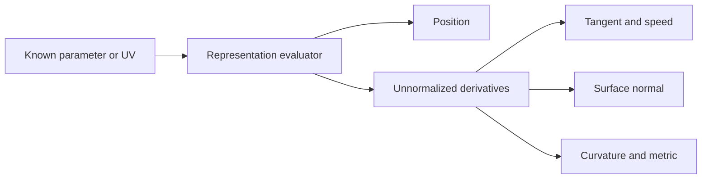

# Evaluation: parameters, derivatives, normals, and curvature

Source baseline: upstream `3fd5b9548d19aa8c12c29bc9637a96d42a06f8a5`.
The native snippet follows the existing STEP derivative example; it was not
compiled or run for this guide. Source examples have their own documented checks.

## 1. Evaluation is not a search

Evaluation receives a known curve parameter or surface UV and computes geometric
values. Closest-point queries instead search for suitable parameters; intersection
algorithms solve for several objects' parameters simultaneously. Good evaluation
is a prerequisite for those operations but does not perform their search.

For a curve $\mathbf C(t)$, outputs can include position, first derivative, and
higher derivatives. For a surface $\mathbf S(u,v)$, outputs form a derivative
table indexed by U and V order. A normalized tangent or normal is a derived
quantity and must not be substituted for an unnormalized derivative.

## 2. Differential geometry used by CAD

For a regular curve:

$$
v=\|\mathbf C'\|,\qquad
\mathbf T=\mathbf C'/v,\qquad
\kappa=\frac{\|\mathbf C'\times\mathbf C''\|}{v^3}.
$$

For a regular surface, let $\mathbf a=\mathbf S_u$ and $\mathbf b=\mathbf S_v$:

$$
\mathbf n=\frac{\mathbf a\times\mathbf b}{\|\mathbf a\times\mathbf b\|},
\qquad
E=\mathbf a\cdot\mathbf a,\quad F=\mathbf a\cdot\mathbf b,\quad
G=\mathbf b\cdot\mathbf b.
$$

The first fundamental form measures local parameter-space lengths:

$$
ds^2=E\,du^2+2F\,du\,dv+G\,dv^2.
$$

With $e=\mathbf n\cdot\mathbf S_{uu}$, $f=\mathbf n\cdot\mathbf S_{uv}$,
and $g=\mathbf n\cdot\mathbf S_{vv}$, principal curvatures solve
$\det(II-kI)=0$. Near $EG-F^2=0$, the parameterization is singular and ordinary
normal/curvature formulas need a limiting or specialized treatment.



## 3. Parameter changes require the chain rule

For $t=\phi(s)$:

$$
\mathbf C_s=\mathbf C_t\phi',\qquad
\mathbf C_{ss}=\mathbf C_{tt}(\phi')^2+\mathbf C_t\phi''.
$$

Second derivatives need more than multiplying by a constant unless the parameter
map is affine. Surface conversions similarly require a Jacobian and, for second
orders, derivatives of that map.

SMLib's documented analytic `EvaluateSTEP` surface parameters use degrees for
angular coordinates. Ordinary `EvaluatePoint`/`Evaluate` and the `SmApiEvaluateSurface*`
wrappers use ordinary surface parameters. These are not automatically angles.
The [native derivative example](../Examples/SMLib/README.md) explicitly compares
the two parameterizations and documents the corrected derivative-unit contract.

For a cylinder of radius $r$ with U in degrees and V axial distance,

$$
\|\mathbf S_u\|=r\pi/180,\qquad \|\mathbf S_v\|=1.
$$

The kernel already supplies the degree factor for that STEP evaluator. Applying
the old workaround again scales the derivative incorrectly. If an application
deliberately wants derivatives per radian, that is a different conversion.

## 4. Dispatch and implementation

| Layer | Responsibility |
| --- | --- |
| `SmApiCurves` / `SmApiSurfaces` | Stable calls and result/status translation |
| `SmCurve` / `SmSurface` | Virtual evaluation contract |
| Analytic subclass | Specialized parameterization or implementation |
| `SmBSplineCurve` / `SmBSplineSurface` | Spline object policy and numerical calls |
| `sm_*` / `N_*` routines | Basis, weighted accumulation and derivative arithmetic |

The curve path uses `sm_CrvEval` and `sm_CrvDerivs` in
[SmNurbsCrv.cpp](../source/SMLib/src/SmNurbsCrv.cpp). Surface NURBS evaluation
uses `N_SrfEvalPt`/`N_SrfDerivs` through
[SmBSplineSurfaceNLib.cpp](../source/SMLib/src/SmBSplineSurfaceNLib.cpp).
See [nurbs.md](nurbs.md) for their basis and rational derivative derivations.

Two important policies occur outside the raw formulas. Curve evaluation normally
clamps according to its out-of-bounds setting; base surface point evaluation has
a disabled clamping block while `EvaluateSimple` clamps ordinary NURBS inputs.
Also, the curve `bNonZeroTangents` option can repair near-zero tangents for
direction-oriented consumers. A caller needing raw derivative magnitude must
select the appropriate contract rather than assuming all results are untouched.

## 5. Derivative storage and one-sided values

For a rectangular derivative allocation, the flat index is

$$
\operatorname{index}(i,j)=i(d_v+1)+j.
$$

Allocation size does not imply every entry is computed. The analytic STEP
example requests equal orders and obtains the triangular set $i+j\leq d$.
With order one, the mixed derivative is not populated; request order two for it.

```cpp
// Kernel-direct fragment: surface and stepUV are supplied by the caller.
SmVector3d derivatives[3][3];
SmStatus status = surface->EvaluateSTEP(
    stepUV, 2, 2, TRUE, TRUE, TRUE, &derivatives[0][0]);
if (status != SM_SUCCESS)
{
    return status;
}
const SmVector3d& du = derivatives[1][0];
const SmVector3d& dv = derivatives[0][1];
const SmVector3d& duv = derivatives[1][1];
```

The snippet belongs inside a status-returning function with the appropriate
kernel headers; the complete standalone implementation is
[step_derivatives.cpp](../Examples/SMLib/step_derivatives.cpp).
Do not read the unused rectangle entries. Do not generalize this triangular
contract to every ordinary evaluator without inspecting its flags.

At repeated knots or piece boundaries, derivatives can be one-sided. A left/right
flag must be understood in the callee's convention. At a geometric corner there
may be no unique tangent. At a seam, distinct parameters can share a position
while the chosen branch still matters to derivative and trimming computations.

## 6. Numerical verification

A central difference provides an independent check at a smooth interior point:

$$
\mathbf S_u(u,v)\approx
\frac{\mathbf S(u+h,v)-\mathbf S(u-h,v)}{2h}.
$$

The step $h$ is in the evaluator's input units. Too large a step increases
truncation error; too small a step increases cancellation. Compare several
reasonable steps and verify both vector direction and magnitude. At a knot,
use a one-sided check consistent with the requested derivative.

For a sphere or torus with two angular STEP axes, a mixed derivative carries
two angular differentiation factors. For a general surface of revolution, V can
be the generator's parameter rather than an angle. Infer units from the actual
surface contract, not periodicity alone.

## 7. CAD use and failure diagnosis

A sweep frame uses tangent direction; feed scheduling uses speed; surface shading
uses a normal; curvature combs use second derivatives. Each consumer needs a
different combination of quantities. Renormalizing everything can make a viewer
look correct while leaving length or curvature calculations wrong.

When a normal fails, inspect whether the sample lies at a pole or trim boundary,
whether the correct parameter convention was used, and whether the selected face
orientation reverses the support normal. A support normal is not automatically
the outward normal of a material boundary.

Check [geometry](geometry.md), [queries](queries.md), and
[tolerances](tolerances.md) before attributing a search failure to evaluation.
This guide verifies source contracts; it does not report a fresh execution of
the native example or a proof of all evaluator branches.
