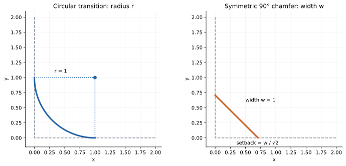
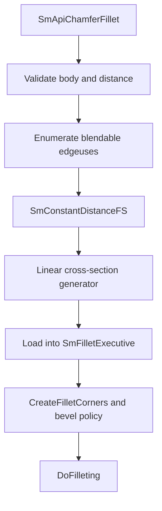

# Fillets, chamfers, and blends

Source baseline: upstream `3fd5b9548d19aa8c12c29bc9637a96d42a06f8a5`.
This chapter distinguishes construction theory, actual executive roles, and
application workflows. No new native fillet example was executed here.

## 1. Three operations sharing a transition problem

A fillet commonly inserts a rounded transition with a circular cross-section.
A chamfer inserts a bevel, often with a linear cross-section. A blend is a
broader transition construction whose section and continuity can be controlled.
Replacing a solid edge includes trimming and topology reconstruction; creating
a standalone blend surface does not perform all of that work.

The user-visible “radius” or “distance” may have different meanings across these
operations. Selecting a linear cross-section in a radius-based solver is not
necessarily equivalent to selecting the dedicated constant-distance chamfer
solver.

## 2. Rolling-ball and offset interpretation



These idealized planar sections illustrate the dimensions independently of the
kernel; they do not depict a completed SMLib corner blend.

For a regular constant-radius contact on oriented supports, a ball center can
be written locally as

$$
\mathbf c=\mathbf S_1(u,v)+s_1r\mathbf n_1
=\mathbf S_2(a,b)+s_2r\mathbf n_2,
$$

where the signs select offset sides. Intersecting the appropriate offsets gives
a candidate center locus or spine; contact points on the original supports
define transition boundaries. This is a geometric model, not a statement that
every SMLib fillet branch explicitly constructs two complete offset surfaces.

For two perpendicular planes with a symmetric chamfer whose cross-section
width is $w$, the setback along each plane is $w/\sqrt2$. A circular fillet's
radius is a different quantity. A field labeled “radius” in a generic UI should
not conceal that difference.


## 3. Continuity conditions

$G^0$ means matching position; $G^1$ requires compatible tangent planes; $G^2$
adds geometric curvature compatibility. Parametric $C^k$ requirements are
stronger in a different sense because derivatives must agree under the selected
parameterizations. Equal endpoint positions alone do not give a smooth highlight.

For curves, one way to express regular $G^1$ matching is

$$
\mathbf C_1'(1)=\lambda\mathbf C_2'(0),\qquad\lambda>0.
$$

For surfaces, the shared tangent plane and appropriate cross-boundary behavior
matter. A circular section can provide tangent continuity while curvature still
jumps across the join. Higher continuity settings must be interpreted for the
supported blend generator, not assumed to apply to every circular fillet.

## 4. SMLib architecture

Public entries are split between [SmApiFillets.h](../source/SM_API/inc/SmApiFillets.h)
and [SmApiBrep.h](../source/SM_API/inc/SmApiBrep.h). The all-edge convenience
wrappers are in [SmApiFillets.cpp](../source/SM_API/src/SmApiFillets.cpp).

| Component | Responsibility |
| --- | --- |
| `SmFilletExecutive` | Collect solvers, organize corners, coordinate modeling stages |
| `SmFilletSolver` and subclasses | Solve contact/spine problems under the chosen sizing policy |
| Surface generators | Construct linear, circular or blend sections/surfaces |
| `SmFilletCorner` | Coordinate transitions at vertices and multi-edge junctions |
| `SmFilletIntersector` / topology intersector | Resolve intersections and integrate replacement geometry |
| `SmFilletRemoval` | Separate removal/reconstruction workflow |

The principal sources are [SmFilletExecutive.cpp](../source/SMLib/src/SmFilletExecutive.cpp),
[SmFilletStandardSolver.h](../source/SMLib/inc/SmFilletStandardSolver.h),
[SmFilletGeom.h](../source/SMLib/inc/SmFilletGeom.h), and
[SmFilletCorner.cpp](../source/SMLib/src/SmFilletCorner.cpp).

## 5. A traced chamfer path

`SmApiChamferFillet` first checks the body and requested distance through
`SmFilletExecutive::IsRadiusSupported`. It creates a linear cross-section
generator, a self-intersection handler, and a fillet executive with global merge
enabled. It traverses the body's edges and uses `GetBlendEdgeuse` to select
eligible edge incidence; an edge without such an incidence is skipped.

For each eligible edge it creates `SmConstantDistanceFS`, assigns the linear
generator, and loads the solver into the executive. It then creates corners,
sets their bevel behavior, and calls `DoFilleting`.



This is more precise than “all edges always receive a bevel.” The executive's
`DoFilleting` also contains a global merge path invoking `IntersectInsertRelate`.
Fillet construction consequently depends on the same topology/intersection
foundations as booleans, not only on generating a visually smooth patch.

### Circular fillets and selected-edge blends

`SmApiCircularFillet` shares the executive and corner stages, but uses
`SmConstantRadiusFS` with `SmCircularCrossSectionFSG`. After `DoFilleting`, the
wrapper calls `StitchAndOrient`; this call's status is not propagated in the
inspected wrapper. Independent validation remains necessary even when the
earlier executive returned success.

`SmApiFilletEdges` in [SmApiBrep.cpp](../source/SM_API/src/SmApiBrep.cpp)
uses `SetFilletParameters` followed by `DoFillet`. Its section selector maps
0 to linear, 2 to blend-curve, and otherwise to circular. Crucially, it still
selects `SM_FS_CONST_RADIUS`; changing the section to linear does not switch
to the dedicated chamfer wrapper's `SmConstantDistanceFS`. Per-edge radii in
`SmApiFilletEdgesPerEdge` mean different constant radii on different edges;
that alone is not a continuously varying radius along one edge.

`SmApiCreateBlendPrimitive` in
[SmApiPrimitives.cpp](../source/SM_API/src/SmApiPrimitives.cpp) is another
distinct path. It supplies two boundary edges, their support faces, and a
same/opposite correspondence flag to `SmPrimitiveCreation::CreateBlendPrimitive`.
It inserts the resulting face into the supplied BRep. The returned face is
body-owned; the function is not a pure standalone-surface producer.

### Removal reconstructs the retained supports

`SmApiRemoveFillet` first identifies faces with tangent rail edges, then attempts
`DeleteFilletFace` on each. Successful deletions remain applied; after any
deletion, the wrapper checks the result of `StitchAndOrient`. If some fillets
remain, `sm_DefeatureFillets` works on a copy, adds qualifying rounded corners,
groups connected feature faces, and runs `SmFeatureExecutive::DoDefeature`.

The fallback checks reconstruction, removes redundant topological edges/vertices,
and validates the working body before replacing the original topology. Replacement
has a backup and best-effort restoration. This does **not** make the whole public
call atomic: earlier successful fillet deletions can already have changed the
input, and restoration itself is not guaranteed.

| Entry family | Explained path | Important boundary |
| --- | --- | --- |
| All-edge chamfer | Constant-distance solver, linear section, bevel corners | Eligible edgeuses only |
| All-edge circular fillet | Constant-radius solver, circular section, executive and stitch | Validate after post-processing |
| Selected-edge fillet/blend | Parameter setup, section selection, `DoFillet` | Section type and sizing policy are separate |
| Blend primitive | Boundary-edge correspondence and primitive insertion | Mutates supplied BRep |
| Fillet removal | Direct deletion, then grouped feature reconstruction | Partial mutation can survive failure |

## 6. Radius feasibility and variable size

A radius is feasible only if contact geometry, available face domains, corner
construction, self-intersection avoidance, and retained material all cooperate.
There is no general rule that “radius smaller than the smallest adjacent face
dimension” is sufficient. A narrow region, concavity, nearby unrelated face, or
poor parameterization can invalidate that shortcut.

For a variable-radius law $r(s)$, the meaning of $s$ matters: edge parameter,
normalized parameter and arc length are different. Endpoint values do not
fully specify every interpolation/continuity policy. Inspect the chosen solver
and API rather than assuming linear variation in physical distance.

Several selected edges meeting at a corner must be solved together. Independently
filleting each edge can produce different topology or fail after the first edit
invalidates later selections. Reacquire edges after a mutation unless the operation
explicitly processes the whole selection in one call.

## 7. Application workflow and ownership

```text
copy the body if cancellation/undo must preserve the original
select edges by geometric/topological criteria, not array position
verify all selected edges belong to the target body
choose solver semantics, section, continuity and size law
run the operation and check status plus any diagnostics
reacquire topology; inspect boundaries, corners and material validity
publish the edited body only after application acceptance checks
```

Common wrappers mutate the supplied BRep. Do not assume failure rolls back all
intermediate work. The exact selected wrapper governs its input validation and
ownership. A standalone blend or preview result has a different contract from
in-place edge replacement.

For a bracket, begin with one isolated edge at a conservative design radius,
verify tangency and material side, then add the connected corner network. This
sequence is diagnostic; the final model should still use the intended design
radius and edge set rather than silently reduced settings.

## 8. Verification and failure localization

Check contact positions, tangent-plane continuity, trim agreement, corner closure,
and the resulting solid. A smooth tessellated highlight can hide a small gap or
an incorrectly oriented face. Conversely, coarse tessellation can make a valid
transition appear faceted.

Classify failures by edge eligibility, spine solve, contact tracing, section
generation, self-intersection, corner construction, or global insertion/merge.
Use the first failing stage to choose the next diagnostic. Raising tolerances
or suppressing corner checks without measuring their effect changes the model's
quality contract.

Related guides: [solvers](solvers.md), [booleans](booleans.md),
[offsets/shells](offsets-shells.md), and [tessellation](tessellation.md).
