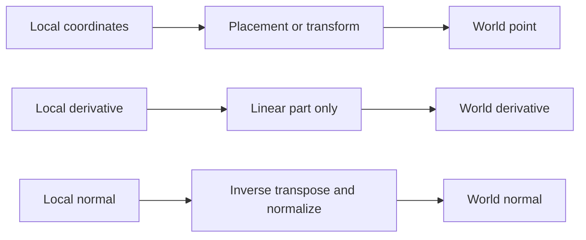
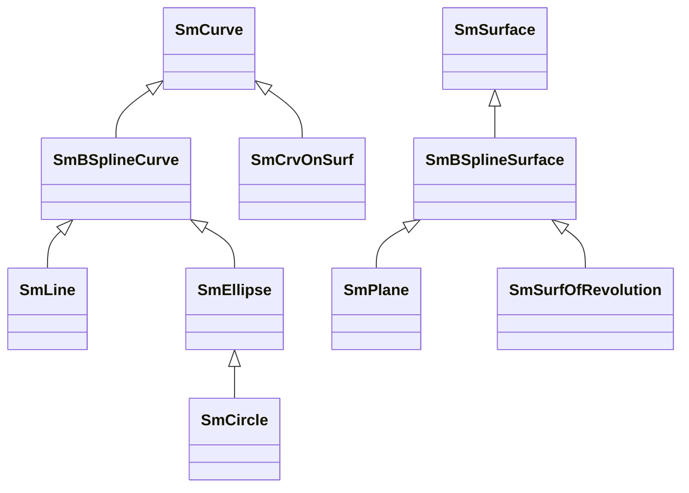

# Geometry representations, coordinates, and dispatch

Source baseline: upstream `3fd5b9548d19aa8c12c29bc9637a96d42a06f8a5`.
This is a source-backed representation guide. Workflow blocks are conceptual,
not executable programs or promises of stable wrapper coverage.

## 1. The geometric object is more than its visible shape

The same visible circle can be an analytic circle, a rational quadratic spline,
or part of a composite curve. These representations can differ in parameter
range, ownership, exactness of conversion, specialized intersection paths, and
available edits. A CAD application should preserve the representation contract
as well as the point set.

Three layers must be distinguished: the geometric locus, its parameterization,
and its topological use. A full cylinder support is not the same object as a
trimmed cylindrical face, and a curve's natural domain need not equal an edge's
modeled interval. See [topology.md](topology.md).

## 2. Parametric and implicit descriptions

A parametric curve is $\mathbf C(t)$; a surface is $\mathbf S(u,v)$. An implicit
surface is the zero set $F(x,y,z)=0$. A sphere, for example, satisfies

$$
F(\mathbf x)=\|\mathbf x-\mathbf c\|^2-r^2=0.
$$

An analytic object may support specialized calculations derived from such
equations while also exposing parametric evaluation. This does not mean every
generic curve or surface has a simple implicit polynomial representation.

Analytic primitives have compact parameters: origin, axes, radii, angles, and
lengths. NURBS use control arrays, knots, and weights. Procedural geometry can
evaluate a composition without immediately reducing it to one spline.

| Representation | Useful property | Important limitation |
| --- | --- | --- |
| Analytic line/conic/quadric | Compact defining data and specialized operations | Arbitrary edits may leave the analytic family |
| B-spline/NURBS | Uniform evaluation/editing machinery | More coefficients; arbitrary conversion may be approximate |
| Composite curve | Preserves a sequence of pieces | Junction continuity and global parameter mapping require care |
| Curve on a surface | Maintains an explicit parameter-space construction | Its 3D spline approximation can have a different parameterization |
| Offset or swept support | Retains a constructive description | Singularities and expensive evaluation can occur |

## 3. Frames and transformations

A local frame maps coordinates into world space:

$$
\mathbf x=\mathbf o+x_1\mathbf e_1+x_2\mathbf e_2+x_3\mathbf e_3.
$$

For rigid transforms, the orthonormal frame preserves lengths and angles.
General affine transforms use $\mathbf x'=A\mathbf x+\mathbf b$; derivatives
transform with $A$, while a regular normal transforms proportionally to
$A^{-T}\mathbf n$. Applying the point transform directly to a normal is wrong
under nonuniform scaling.



Inspect [SmAxis2Placement.h](../source/SMLib/inc/SmAxis2Placement.h),
[SmTransform.h](../source/SMLib/inc/SmTransform.h), and
[SmApiGeneral.h](../source/SM_API/inc/SmApiGeneral.h). Their interfaces distinguish
rigid placement from scale operations. A nonuniformly scaled circle is generally
an ellipse; preserving a dynamic circle type cannot be assumed.

## 4. Actual SMLib class structure

`SmCurve` and `SmSurface` are the main polymorphic interfaces. The hierarchy is
not a simple separation between unrelated analytic and spline classes:



Analytic subclasses can specialize evaluation or lazily materialize NURBS data.
Dispatch therefore depends on dynamic type, method, and representation state.
Do not infer that all operations use control points merely from inheritance.
See [SmCurve.h](../source/SMLib/inc/SmCurve.h),
[SmSurface.h](../source/SMLib/inc/SmSurface.h), and the hierarchy discussion in
[nurbs.md](nurbs.md).

## 5. Composed geometry and approximation

A surface curve combines a UV curve and a support:

$$
\mathbf C(t)=\mathbf S(u(t),v(t)),\qquad
\mathbf C'=\mathbf S_u u'+\mathbf S_v v'.
$$

[SmCrvOnSurf.h](../source/SMLib/inc/SmCrvOnSurf.h) stores the UV curve, support,
ownership policy, and a lazily generated B-spline approximation. Its
`m_bParametrizationMatches` flag is an important clue: an approximation that
follows the same locus need not preserve the original parameter mapping.
Its constructor's ownership flag distinguishes borrowing, copying selected
inputs, and adopting inputs. Those choices are not interchangeable.

[SmCompositeCurve.h](../source/SMLib/inc/SmCompositeCurve.h) represents piecewise
geometry; [SmIsoCurve.h](../source/SMLib/inc/SmIsoCurve.h) and
[SmProjectedCurve.h](../source/SMLib/inc/SmProjectedCurve.h) describe further
specialized forms. Use their current declarations and actual consuming methods;
commented-out classes in a header are not active capabilities.

A generic conversion workflow is:

```text
identify dynamic type and modeled domain
determine whether conversion is exact or approximate
choose approximation tolerance if required
create/obtain converted representation through its owning API
check position agreement and parameter correspondence separately
refresh dependent topology, caches, and borrowed views as required
```

An exact circle has an exact rational quadratic representation. A general offset
or helix need not have a finite exact NURBS representation of the same kind.
Never describe all `turn to NURBS` operations as lossless without tracing the case.

## 6. Evaluation conventions

Analytic STEP evaluation and ordinary NURBS evaluation are separate contracts.
SMLib's STEP angular parameters are degrees for the documented analytic surface
evaluators. Ordinary evaluation is not automatically degree-based, even on a
circle or cylinder. Domain conversion may be nonlinear and can affect axis order.

For a reparameterization $t=\phi(s)$,

$$
\frac{d\mathbf C}{ds}=\frac{d\mathbf C}{dt}\phi'(s).
$$

Equal positions do not imply equal derivatives. A normalized tangent can hide
a speed-unit error. [evaluation.md](evaluation.md) develops the derivative
contracts and finite-difference checks.

## 7. CAD example: a cylindrical opening

Keep an analytic cylinder when it represents the desired design intent. A face
on that cylinder carries its own trimmed region. A circular boundary may have
different ordinary curve parameters from the cylinder's angular STEP parameter.
Projecting that boundary into UV must account for the seam rather than treating
the UV plane as globally one-to-one.

For a viewer, evaluate or tessellate the modeled face. For free-form editing,
create a suitable editable representation and preserve or reconstruct its
boundary relationships. For interchange, preserve units, interval endpoints,
orientation, and the exact/approximate conversion status.

Check a few analytically known points, endpoint direction, regular derivatives,
and both sides of a seam. Also compare the modeled interval with the support's
natural domain. Bounding-box similarity alone is weak evidence of a correct
conversion: reversed parameters can yield the same box.

## 8. Reading and validation scope

Start with the base interface, then inspect the specific subclass override and
its `MakeNurb` or approximation path. Follow ownership through constructors and
destructors, not just through factory names. The linked source establishes these
representation families; this chapter does not claim every subclass has every
stable `SmApi*` operation.

Continue with [tolerances](tolerances.md), [evaluation](evaluation.md),
[deformation](deformation.md), and [projection/trimming](projection-trimming.md).
