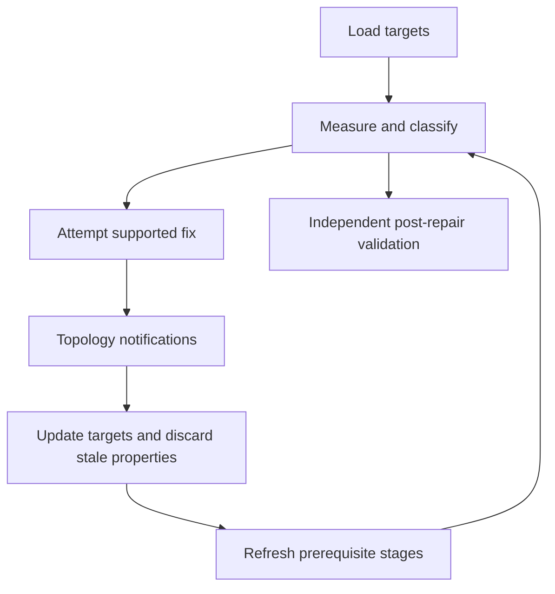

# Healing and stitching: diagnose, repair, and verify

Source baseline: upstream `3fd5b9548d19aa8c12c29bc9637a96d42a06f8a5`.
This guide follows the healer's source architecture and wrapper contracts.
Repair scenarios are diagnostic workflows, not fresh kernel test results.

## 1. Different problems require different repairs

Stitching connects compatible boundaries into shells or solids. Healing attempts
selected repairs to an existing BRep, including topology organization, degeneracy,
seams and tolerances. Neither operation should be described as an unlimited
“make any CAD model valid” command.

Distinguish three kinds of evidence:

| Evidence | Example | Possible response |
| --- | --- | --- |
| Structural defect | Inconsistent incidence/backpointer | Diagnose graph construction; do not blindly deep-traverse |
| Geometric discrepancy | Edge curve differs from adjacent support | Measure and choose an actual geometry repair or justified tolerance policy |
| Derived-data defect | Incorrect UV trim on otherwise consistent defining geometry | Regenerate/repair derived data and recheck |

Coincident coordinates do not establish shared topology. Raising tolerance does
not geometrically close a gap.

## 2. Measuring gaps before changing them

For corresponding boundaries, one diagnostic is

$$
g(t)=\|\mathbf C_1(t)-\mathbf C_2(\phi(t))\|.
$$

The correspondence $\phi$ matters; opposite traversal can make equal-parameter
comparison misleading. Check endpoint pairings in both directions, local feature
size, and the gap's distribution. A single maximum sample does not establish a
global bound or identify the correct repair.

The application must decide what geometry is authoritative. Moving an edge to
one face may increase its gap to another. Sewing unrelated nearby components
can destroy intended separations.

## 3. Healer architecture

`SmApiHealBrep` in [SmApiHeal.cpp](../source/SM_API/src/SmApiHeal.cpp) rejects
null input and requests `SM_HO_ALL` through `SmBrep::HealBrep`. The deeper engine
is [SmHealData.cpp](../source/SMLib/src/SmHealData.cpp), supported by property
and problem arrays.

The [healer architecture reference](../.agents/skills/smlib-kernel-healing/references/architecture.md)
maps the actual sequence. `SmHealData` holds repair-session state, not ownership
of the repaired BRep. Cache stages measure/classify; fix stages can add, remove,
split or merge topology. Notifications identify affected objects so earlier
properties can be rebuilt before later stages use them.



A selected target set is not necessarily an isolation boundary: connected
topology can change as part of a repair.

## 4. Implemented stages and limits

The sequence includes measuring edge/vertex/face properties, adjusting tolerance
sizes, merging coincident vertices, removing selected degenerate faces/edges,
classifying seams/poles, moving seams, splitting seam-related edges/faces, and
selected sheet/region organization repairs.

Several names in the stage enumeration do not imply working general repair:
coincident-edge and missed-edge-intersection repair are unfinished; bad-gap
repair is not a general gap-closure engine; broken-loop repair is disabled in
the ordinary sequence. Optional UV trim generation is also not automatically
requested by the simple heal wrapper.

The inspected `SmBrep::HealBrep` path does not propagate the nested healer status
as a complete repair-success certificate; the architecture reference documents
this limitation. Inspect result validity and problem evidence even after a
successful public return. Do not infer that all stages ran because an enum value
or method exists.

## 5. Stitching contracts and diagnostics

`SmApiStitchIntoSolid` and `SmApiStitchIntoShell` in
[SmApiBrep.cpp](../source/SM_API/src/SmApiBrep.cpp) wrap `SmStitch` operations.
The solid-targeted call reports whether a solid was produced, stitched-edge count,
and maximum vertex/edge gaps. A successful call and `producesASolid == true` are
different observations and should both be retained.

```text
collect compatible faces/shells under the intended stitch API
record original free boundaries and gap measurements
run the goal-directed stitch
inspect status, produced-solid flag, stitched count and gap reports
validate regions, orientation and remaining free boundaries
accept only if the application's intended topology and geometry are met
```

Read [SmStitch.h](../source/SMLib/inc/SmStitch.h) for lower-level controls.
Do not assume all stitch overloads have the same ownership or keep-input policy.

## 6. Import healing is an explicit transformation

Import can reconstruct topology, normalize representation, regenerate trims,
and optionally heal. These effects should be distinguished when comparing an
imported model to its source. Native healer-version gates and USD provenance
paths are not automatically equivalent.

The current bridge's healing defaults differ between the C and Python entry
surfaces, and the CAD-source marker is not an effective universal skip mechanism.
Verify the exact import flags and version arguments in
[usd-interchange.md](usd-interchange.md) rather than assuming SMLib-authored files
are always exempt from healing.

## 7. CAD scenario: disconnected imported panels

Start from a preserved copy and classify the problem: are boundaries geometrically
close but unshared, wrongly oriented, genuinely separated, or incorrectly
parameterized at a seam? Stitch compatible boundaries when connection is intended.
Use healing for its supported defects, not as a substitute for deciding which
parts should connect.

After repair, compare dimensions, region/material counts, boundary gaps, and
topology class. Record removed small features and changed tolerances. A lower
face count can indicate either useful simplification or lost design detail.

## 8. Verification and diagnostic order

For trusted runtime objects, establish traversability before deep validation.
Then inspect graph consistency, geometric agreement, and derived UV quality
separately. Healing mutates state and is not a transaction with guaranteed
rollback; application undo should preserve an earlier accepted model.

Use [validation-diagnostics](validation-diagnostics.md), [topology](topology.md),
and [tolerances](tolerances.md) for interpreting reports. A repair is accepted
because its observed result meets the required contract, not because a function
named `Heal` returned successfully.
