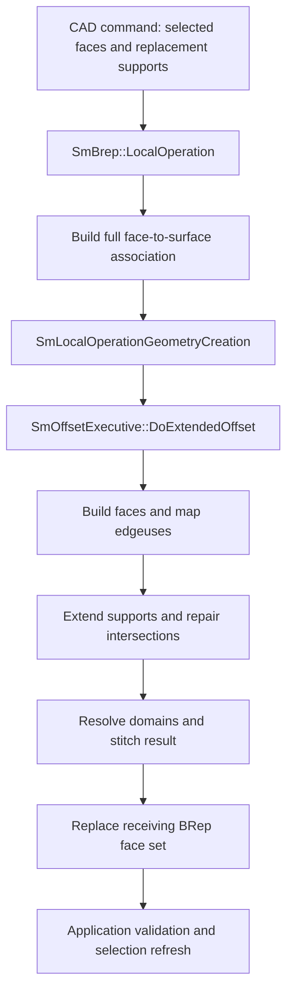
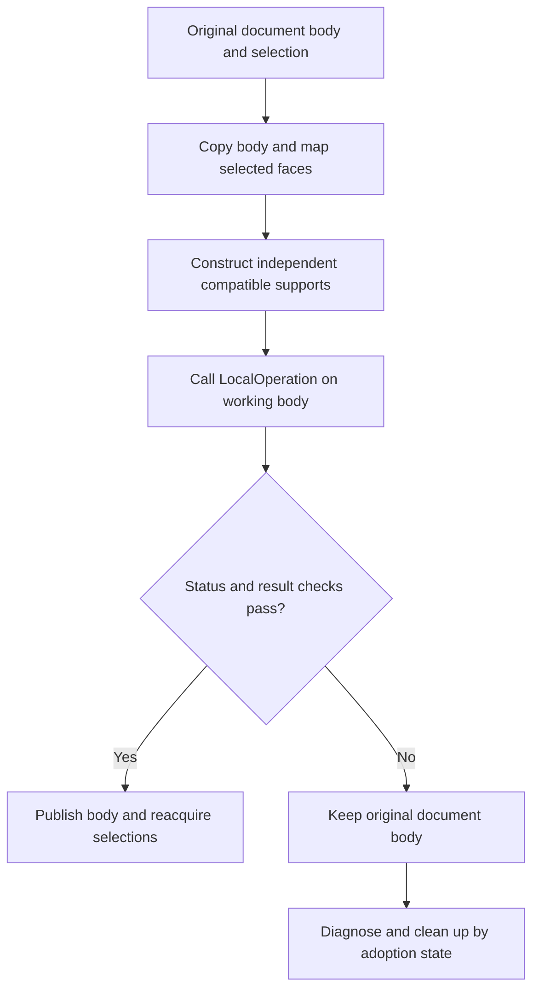
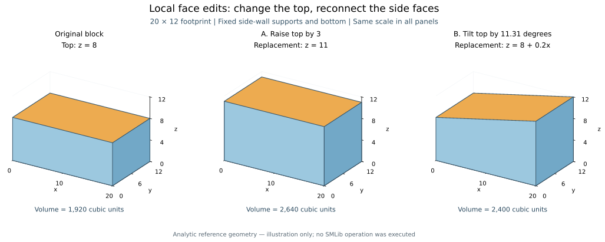

# Local operations: replacing faces and rebuilding a solid

Source baseline: upstream `3fd5b9548d19aa8c12c29bc9637a96d42a06f8a5`.
This guide separates mathematical constructions, verified kernel control flow,
and application design. The illustrated solids are analytic examples, not
captured SMLib execution results. Native declarations and call fragments are
source-reviewed; they have not been compiled or executed for this chapter.

## 1. What LOP means here

A local operation changes selected boundary geometry while reconnecting it to
the surrounding body. Typical CAD intentions are moving a face, tilting a wall,
changing a cylindrical hole radius, or replacing a free-form support surface.
The difficult part is reconstructing the edges, vertices, and trimmed regions
that make the changed boundary a valid solid.

[Euler operations](euler.md) explain the lower-level connectivity edits used
in boundary reconstruction, including edge subdivision, face splitting, and
loop joining. They complement the surface-replacement workflow described here.

SMLib has an explicit kernel entry point in
[SmBrep.h](../source/SMLib/inc/SmBrep.h):

```cpp
SmStatus LocalOperation(
    SmTArray<SmFace*>& rFaces,
    SmTArray<SmSurface*>& rNewSurfaces);
```

The arrays associate selected faces with replacement surfaces. The operation
mutates the receiving `SmBrep`. At the reviewed baseline there is no direct
`SmApiLocalOperation` wrapper or `_omni_solid.local_operation` binding in
[SM_API](../source/SM_API/) or [SmPyLib](../source/SmPyLib/).
Using this particular operation from C++ therefore requires kernel integration.

“Local” describes the requested geometric change. This implementation visits
every face and eventually replaces the receiving body's entire face set.
It does not promise bounded work, preserved face pointers, automatic feature
recognition, or a complete direct-modeling constraint system.

| Related operation | Difference from explicit surface replacement |
| --- | --- |
| [Rigid transform](editing.md) | Moves the entire selected object without solving new internal boundary intersections |
| [Offset/shell](offsets-shells.md) | Constructs geometry from normal distances and opening choices; shares reconstruction machinery with LOP |
| [Boolean](booleans.md) | Combines material regions of operands and classifies their boundary fragments |
| [Fillet/chamfer](blend.md) | Constructs transition faces with contact/radius constraints |
| [Feature removal](editing.md) | Removes a face set and reconstructs the remaining boundary through a separate feature executive |
| [NURBS editing](nurbs.md) | Changes spline representation or coefficients; surrounding BRep consistency is a separate responsibility |

## 2. Theory: a face is a trimmed support surface

Write a face as a surface restricted to a trimmed parameter region:

$$
F_i=\{\mathbf S_i(u,v):(u,v)\in\Omega_i\}.
$$

Replacing $\mathbf S_i$ by $\mathbf S_i'$ does not determine the new region
$\Omega_i'$ by itself. Adjacent support surfaces must meet along new boundary
curves. For a changed face and an unchanged neighbor, solve

$$
\mathbf S_i'(u,v)-\mathbf S_j(s,t)=\mathbf 0.
$$

There are three scalar equations and four parameters. At a regular transverse
intersection this describes a one-dimensional curve. Its spatial tangent is
parallel to $\mathbf n_i'\times\mathbf n_j$. Near tangency, that cross product
approaches zero and ordinary intersection tracing becomes poorly conditioned.
Coincident supports require overlap reasoning rather than an ordinary curve.
See [intersections](intersections.md) and [solvers](solvers.md).

The resulting 3D edge curve $\mathbf c(\tau)$ and its two UV representations
should agree with both supports within the chosen geometric tolerances:

$$
\|\mathbf c(\tau)-\mathbf S_i'(\mathbf q_i(\tau))\|\leq\varepsilon_i,
\qquad
\|\mathbf c(\tau)-\mathbf S_j(\mathbf q_j(\tau))\|\leq\varepsilon_j.
$$

The trim representations are derived data; in SMLib the edge's 3D geometry and
interval, face support, and topology define the boundary. A bad UV trim alone
does not prove that the defining boundary is wrong. Conversely, drawing a
plausible trim does not prove that the 3D edges agree with their supports.

At a corner, intersections must terminate at consistent shared vertices.
New loops must close with the correct orientations, shells must bound the
intended regions, and unwanted fragments must be excluded. This explains why
moving four display vertices is not a substitute for a BRep local operation.

### Parameterization is part of this implementation's input

Geometrically equivalent surfaces can have different UV coordinates.
`BuildOffsetOfFaceuse` initially copies the original UV trimming curves and
uses them on the replacement support. Merely supplying a sufficiently large
geometric plane or cylinder is therefore insufficient: its UV convention must
also be compatible with the original face and the subsequent edge mapping.

A useful construction is to preserve a support's parameter coordinates while
changing its geometric map. For a planar top, for example,

$$
\mathbf S(u,v)=(u,v,H),\qquad
\mathbf S'(u,v)=(u,v,H+\Delta h).
$$

The same rectangular UV loop seeds the moved face. Neighboring side faces still
need extension and new boundary curves. For arbitrary imported parameterizations,
derive the correspondence from the actual support; do not assume $u=x$, $v=y$.
Reparameterization, periodic seams, reversed directions, poles, and changed
domain origins all need explicit review.

## 3. Architecture and source map



| Component | Responsibility and source |
| --- | --- |
| `SmBrep::LocalOperation` | Input association, orientation heuristic, executive setup, final in-place face replacement: [SmBrep.cpp](../source/SMLib/src/SmBrep.cpp) |
| `SmLocalOperationGeometryCreation` | Overrides face geometry generation with supplied surface pointers: [header](../source/SMLib/inc/SmOffsetGeometryCreation.h), [implementation](../source/SMLib/src/SmOffsetGeometryCreation.cpp) |
| `SmOffsetExecutive` | Face/edge correspondence, extension domains, intermediate body and final assembly: [header](../source/SMLib/inc/SmOffsetExecutive.h), [implementation](../source/SMLib/src/SmOffsetExecutive.cpp) |
| `SmOffsetGeometryCreation` | Inherited edge reconstruction: `EdgeuseOffset`, `MateEdges`, `ExtendTrimEdges`, `TrimExtendedEdge`, `ReplaceEdgeCurves`: [implementation](../source/SMLib/src/SmOffsetGeometryCreation.cpp) |
| Surface intersectors | 3D intersection curves and UV curves on both extended supports; see [intersections](intersections.md) |
| `SmStitch` | Reconnects compatible boundary entities; see [healing and stitching](healing-stitching.md) |
| Copy maps and validators | Working-copy selection mapping and result inspection; see [runtime](runtime.md), [topology](topology.md), [validation](validation-diagnostics.md) |

This is a specialized use of the offset architecture. The geometry provider
supplies replacements instead of computing a uniform normal offset; the
executive retains much of its face/edge reconstruction machinery.

## 4. Actual kernel workflow

### 4.1 Prepare every face's support

`LocalOperation` temporarily enables editing on the receiving body and retrieves
all its faces. For each face it either takes the corresponding supplied surface
or calls `CopyAndAddAnalytics` on the original support.

For a selected face it evaluates normals at the replacement's natural-domain
midpoint and the original face-domain midpoint. If their dot product is
negative, it calls `Reverse(SM_SP_U)` on the supplied surface. This is a local
orientation heuristic, not a proof of global normal consistency. The points
need not correspond geometrically, and singular midpoints can fail evaluation.

The method constructs `SmLocalOperationGeometryCreation` using half the bounding
sphere radius as its distance argument and half the BRep tolerance as its
approximation-tolerance argument. The distance is not a requested face offset:
`FaceuseOffset` returns the associated surface directly. It nevertheless affects
extension sizing because `GetCreateExtendedSurface` uses five times the geometry
provider's distance. Finite extension can fail to reach a distant intersection.

The executive uses `SM_OO_LOCAL_OPERATION`, an empty shell-face list, and
`SetExtendConvexEdges(TRUE)`. No selected face is designated as a shell opening.
Neither `SetMergeResults(TRUE)` nor solid-wall construction is enabled here.

### 4.2 Construct provisional faces

`DoExtendedOffset` allocates an intermediate BRep and walks the original faces.
Its calls to the local geometry provider return the replacement/copy pointer
associated with each face. The provider clears the self-intersection output
arrays and does not perform a self-intersection calculation. Empty arrays here
are not evidence that the replacement surface is free of self-intersections.

`BuildOffsetOfFaceuse` extracts UV boundary curves from the original face and
passes them, the new support, and its domain to `MakeFaceWithCurves`. In the
active path the old planar 3D-curve translation shortcut is disabled by `#if 0`.
The new 3D boundaries are initially derived using the new surface and copied
UV curves. LOP bypasses one ordinary offset-domain containment condition;
that bypass does not establish that arbitrary UV domains are interchangeable.

Face and edgeuse correspondence tables let the executive relate each provisional
boundary to the original adjacency. `MapEdgeuses` also relies on parameter-domain
relationships and orientation information; the LOP-specific exemption from a
debug normal-alignment check does not remove those assumptions.

### 4.3 Reconstruct neighboring boundaries

The executive processes tangent sectors first, then remaining edgeuse pairs,
through `BuildOffsetOfEdgeuses` and the inherited `EdgeuseOffset`.

- Tangent or lamina cases use `ExtendTrimEdges`.
- Ordinary paired edges use `MateEdges`: obtain extended supports, call
  `GlobalSurfaceIntersect` (or its validation variant), choose and trim a
  suitable intersection, then replace the participating edge curves and UV data.
- `TrimExtendedEdge` and `ReplaceEdgeCurves` handle interval selection and
  installing the resulting geometry. The workflow must also reconcile endpoints.

These are geometric intersection and topology-repair algorithms, not a uniform
translation of the old edges. Multiple intersection branches, tangency, a lost
intersection, or a face disappearing can defeat the original correspondence.
The paired-edge code explicitly contains a manifold assumption; general
non-manifold local editing should not be inferred from the generic BRep types.

### 4.4 Resolve domains, stitch, and replace

After edge reconstruction the executive calls `RemoveExcessFaces`. It obtains
extended supports, recomputes required trim domains, and chooses the original
or extended support according to domain containment. Unused supports can be
deleted during this process; a required domain exceeding the extension fails.

It next calls `PiecewiseMerge`. Despite the name, the configuration established
by `LocalOperation` leaves `m_bMergeResults` false, so this takes the stitching
branch rather than the full self-intersection merge branch. A later protective
`StitchIntoSolid` call also runs. Thus, this path is not equivalent to a general
Boolean cleanup of arbitrary intersecting replacement faces.

On executive success, `LocalOperation` removes all faces from the receiving BRep,
copies the rebuilt body's faces into it with `CopyFaces`, and deletes the
temporary result. The BRep object remains; previous subentity pointers must be
discarded and selections reacquired.

## 5. Ownership, errors, and application integration

### Input checks the caller should provide

The entry point indexes `rNewSurfaces` by the matching face position without a
visible array-length guard. Before entering it, check equal array lengths,
non-null pointers, unique selected faces, and membership in the receiving body.
Treat an empty selection as a no-op in the application. Supply independent,
mutable replacement surfaces in the appropriate context, with compatible UV
domains and directions. Do not pass a borrowed support from another live body.

### Surface pointers are not read-only inputs

The entry point can reverse a supplied surface before reconstruction succeeds.
The provider returns that same pointer; provisional faces use it, and domain
resolution can delete or replace it. Consequently, neither “caller always
deletes every supplied surface afterward” nor “failure leaves all input surfaces
untouched” is a safe ownership rule.

Use a kernel integration boundary that explicitly tracks which objects have
been adopted. Early exits before adoption and failures after partial adoption
need different cleanup. This guide does not claim a universal failure-cleanup
recipe for the raw-pointer entry point. A stable public wrapper would need that
contract designed and tested before exposing the operation.

### Success status requires independent inspection

There are concrete status-propagation limits in the reviewed code:

- `LocalOperation` converts an executive failure to generic `SM_ERR`.
- Several calls, including `Reverse`, the unselected-support copy, bounding-box
  calculation, final `RemoveFaces`, and `CopyFaces`, have unchecked statuses here.
- In the extended-edge branch, failed `ExtendTrimEdges` or `MateEdges` calls can
  generate a message followed by `SM_SUCCESS`, deferring repair to later work.
- Stitching includes unchecked calls and an assertion on a later status;
  the final `bProducesSolid` flag is not used as an acceptance condition here.

These observations limit what a return value proves. They are not a claim that
every local operation fails. They explain why the application must inspect the
result before publishing an edit.

### Copy, operate, validate, publish



This transaction belongs to the application. The kernel call is not an atomic
undo operation. A working copy protects the published body, but it does not by
itself resolve replacement-surface lifetime or allocation cleanup.

The [SmBrep copy constructor](../source/SMLib/inc/SmBrep.h) accepts two
[SmCopyBrepMap](../source/SMLib/inc/SmCopyBrepMap.h) outputs: the first maps copy
entities to originals, and the second maps originals to copy entities. Use the
second direction to translate the user's selected faces. A copy map is useful
before LOP; it is not persistent naming for the rebuilt result.

The actual invocation is small once the integration boundary has prepared and
validated the inputs:

```cpp
// Fragment only: workingBrep, selectedFaces, and replacementSurfaces
// have been prepared by the application's kernel integration layer.
SmStatus status = workingBrep->LocalOperation(
    selectedFaces,
    replacementSurfaces);
```

After the call, inspect status and diagnostic messages, then validate the trusted
in-process graph with `ValidatePointers`. Only traverse more deeply if its links
are sound; use `AssertValid` with `SM_LEVEL_2` and `SM_WALK` as described in
[validation and diagnostics](validation-diagnostics.md). Separately check intended
solid/manifold form, shell count, geometric gaps, bounds, volume, and the requested
face location. Validation has level/build/cache dependencies and is not a proof
of every modeling intention. Rebuild derived trims and tessellation as needed.

## 6. Worked 3D constructions



[PNG alternative](assets/local-operations/face_edits_3d.png). Orange identifies
the selected/replacement top support; blue faces retain their supporting planes
but their trimmed extents can change. The three panels are separate analytic
solids, with identical camera and axis scales. No overlapping ghost surfaces
are used.

### A. Raise the top of a block

Start with $0\leq x\leq20$, $0\leq y\leq12$, $0\leq z\leq8$.
Replace only the top support $z=8$ with $z=11$, preserving its UV convention.
The side supports $x=0$, $x=20$, $y=0$, $y=12$ remain geometrically fixed.

Their new intersections with the top are four lines at $z=11$. The side faces
extend vertically and the four top corners move. The bottom remains at $z=0$.
The ideal reference values are

$$
V_0=20\cdot12\cdot8=1920,\qquad
V_1=20\cdot12\cdot11=2640,\qquad
\Delta V=720.
$$

A successful implementation should reproduce these bounds and volume within
appropriate numerical error. Six planar faces, twelve edges, and eight vertices
describe the simplest unsplit result, but counts alone do not establish validity
or require the kernel to eliminate every equivalent split.

This is a useful CAD operation for changing stock height while preserving a
base datum. If the top has adjacent fillets or holes, their intent needs a policy:
preserve radius, extend supports, rebuild features, or reject the command.
`LocalOperation` does not supply that feature-intent policy.

### B. Tilt the top while retaining vertical side walls

Replace the top with the plane $z=8+0.2x$. In compatible coordinates it can be
written $\mathbf S'(u,v)=(u,v,8+0.2u)$. At $x=0$ the top is still at $8$;
at $x=20$ it reaches $12$. The two side boundaries at fixed $y$ become sloping
lines, while the end boundaries remain horizontal at different heights.

The ideal wedge volume is

$$
V=\int_0^{20}\int_0^{12}(8+0.2x)\,dy\,dx=2400.
$$

The top's normal is proportional to $(-0.2,0,1)$ and its angle to the original
plane is $\arctan(0.2)\approx11.31^\circ$. This gives independent checks of
surface orientation, elevation, and material volume. The side-wall planes are
unchanged, so rotating the entire block would produce a different result.

### C. Enlarge a cylindrical through-hole

For a hole centered at $(10,6)$ through the same block, change the cylindrical
support from radius $r=2$ to $r'=3$, keeping its axis, seam convention, and
angular/axial coordinates compatible. The top and bottom supports stay fixed;
their circular inner trim boundaries expand. The solid's outward normal on the
hole wall points toward the hole interior; distinguish that faceuse orientation
from the support's parameter normal.

Provided the hole remains clear of the outside walls, the ideal volume change is

$$
\Delta V=-\pi(r'^2-r^2)H=-40\pi.
$$

For this placement the nearest outside wall is six units from the axis, so
$r'=3$ leaves a minimum three-unit ligament. Reaching radius six is a topology
event: the hole touches the outer wall. Beyond that, an open notch is possible
and the simple cylindrical-hole correspondence and volume formula no longer
describe the full material-removal problem. Do not infer support for that event
from the small-radius example. A Boolean cut may be a better command design
when opening the wall is the intended operation.

These three constructions specify inputs and measurable expected geometry.
They are not runtime demonstrations of the current LOP implementation.

## 7. Difficult cases and diagnosis

| Symptom or requested edit | First questions to investigate |
| --- | --- |
| Face appears displaced or distorted immediately | Were old UV trims reused on an incompatible parameterization? |
| Gap where moved face meets a neighbor | Did extension reach the intersection? Did edge reconstruction log a deferred failure? |
| Result is open despite success status | Inspect lamina edges, stitching reports, region form, and geometric gaps |
| Wrong intersection branch | Check original-to-provisional edge mapping and competing intersection curves |
| Tangent face pair separates | Tangency changes the intersection problem; inspect `ExtendTrimEdges` and the intended continuity policy |
| Tiny edge or disappearing face | Has the edit crossed a topology event rather than merely changed trim positions? |
| Periodic seam or pole breaks | Check UV branch, seam location, degenerate boundaries, and surface orientation |
| Free-form replacement folds | The LOP geometry provider does not establish absence of self-intersections |
| Later selection crashes | Old face/edge handles survived whole-face-set reconstruction |
| Unexpected fillet shape | The adjacent blend support was retained without an application rule to rebuild its radius/contact conditions |

For a CAD command, record the original body, selected-face mapping, replacement
supports and UV domains, tolerance/scale, requested displacement, status and
messages, then compare before/after invariants. A smaller displacement is useful
as a diagnostic of extension or topology-event limits; it is not proof that
repeated small operations will reproduce a large edit safely.

## 8. Reproduce the illustration and continue reading

The [figure generator](assets/local-operations/generate_figures.py) separates
analytic construction from rendering and checks the planes, corners, and volume
references. Filled 3D faces are rasterized at 300 dpi inside the SVG; labels
remain vector text, avoiding the polygon-boundary artifacts seen in earlier
fillet illustrations.

```powershell
uv run --no-project --with numpy --with matplotlib python mydocs/assets/local-operations/generate_figures.py
uv run --no-project python mydocs/tools/check_docs.py
```

Read [editing](editing.md) for document transactions and dependent state,
[offsets and shells](offsets-shells.md) for the shared executive,
[topology](topology.md) for boundary incidence,
[projection and trimming](projection-trimming.md) for UV/3D correspondence,
and [validation](validation-diagnostics.md) before integrating this entry point
into an interactive C++ modeling command.
