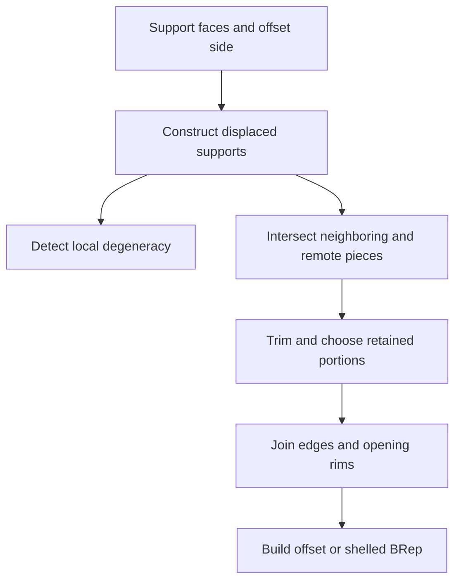

# Offsets, planar profiles, and shelling

Source baseline: upstream `3fd5b9548d19aa8c12c29bc9637a96d42a06f8a5`.
This guide traces representative public calls and explains offset geometry.
Workflow examples are not executed results or a universal thickness guarantee.

## 1. Offset does not mean translation

A surface offset displaces each point along its local normal:

$$
\mathbf S_d(u,v)=\mathbf S(u,v)+d\mathbf n(u,v).
$$

A translation uses one fixed vector. These coincide for a plane with a suitable
translation but differ on curved supports. A solid offset also resolves how
adjacent displaced faces meet. Shelling selects openings, creates inner/outer
boundaries, and connects rims to represent a wall.

An offset curve similarly depends on a normal convention or supporting plane.
A spatial curve does not have a unique planar-style left offset without an
additional frame or support definition.

## 2. Curvature limits and self-intersection

Under the convention $d\mathbf n=-S\,d\mathbf x$, an offset's local tangent map
contains $I-dS$. A principal direction becomes singular when

$$
1-d\kappa_i=0.
$$

The sign depends on the chosen normal/curvature convention, but the geometric
warning is invariant: offset distance near a local radius of curvature can
collapse or fold the parameterization. Even when every local patch remains
regular, distant parts can collide globally.



The normal formula is therefore only the geometry stage of a full solid operation.

## 3. SMLib component boundaries

[SmOffsetSurface.h](../source/SMLib/inc/SmOffsetSurface.h) and
[SmOffsetCurve.h](../source/SMLib/inc/SmOffsetCurve.h) describe offset geometry.
[SmOffsetGeometryCreation.h](../source/SMLib/inc/SmOffsetGeometryCreation.h)
and [SmOffsetExecutive.h](../source/SMLib/inc/SmOffsetExecutive.h) participate
in constructing and integrating the result.

`SmApiCreateOffsetSurface` in
[SmApiSurfaces.cpp](../source/SM_API/src/SmApiSurfaces.cpp) validates the input,
initializes the output null, and calls the surface's `CreateOffsetSurface` with
a wrapper-selected approximation tolerance of `0.001`. It returns a surface,
not a sewn shell, and that number is in the operation's modeling context.

`SmApiOffsetBrepFull` in [SmApiBrep.cpp](../source/SM_API/src/SmApiBrep.cpp)
delegates to `SmOffsetExecutive::OffsetBrep`, passing distance, extended-offset,
and self-intersection options. `SmApiShellBrepFull` is the related body-shelling
entry point. Read their full declarations before mapping GUI fields to arguments.

### Shell wrapper: preserving input through a consuming kernel

`SmApiShellBrepFull` resets its output, rejects a null body, and verifies that
every selected face belongs to that body. It then copies the BRep with a
`SmCopyBrepMap` and maps the selected source faces to their copied counterparts.
Passing pointers selected on the original directly into the copied body would
violate that correspondence.

The wrapper calls the ownership-reporting `SmOffsetExecutive::ShellBrep`
overload on this private working body. The kernel can consume, retain, or return
the working input on different paths. Its transfer flag and result identity
determine whether the temporary cleanup owner is released. Only a successful,
non-null result is published to the caller. This is why the public producer
contract can preserve the original while adapting a kernel operation with more
complicated ownership.


## 4. Extended joins, rounded joins, and openings

At a convex planar corner, parallel offsets leave a gap that can be joined by
extension/intersection or a rounded transition. At a concave corner, offsets
can overlap and need trimming. These policies change the shape, not just the
algorithm's performance.

For a shell, removed faces define openings. Remaining outer and inner boundaries
must be connected by rim faces. Choosing the wrong face side or offset sign can
grow material outward when the design intended an inward wall.

A planar profile offset is a region operation on closed coplanar loops. The
profile's traversal direction affects left/right interpretation; holes and
multiple loops require nesting and orientation. The wrapper
`SmApiCreateOffsetProfile` is in
[SmApiPrimitives.cpp](../source/SM_API/src/SmApiPrimitives.cpp), with its own
input-preservation and corner policies.

## 5. Exact and approximate representations

Offsets of some analytic supports remain analytic: a plane remains a plane and
a sphere of suitable signed radius remains a sphere. A general NURBS surface
offset is not generally representable exactly by a finite NURBS of the same
degree and knot structure. A procedural offset and an approximating spline
therefore have different contracts.

Measure both approximation to the intended offset and the consistency of its
trimmed boundary. Merely observing that the new surface is close to the original
does not establish the correct normal direction or offset distance.

For corresponding regular points, a diagnostic is

$$
e_d=\left|\big(\mathbf S_d-\mathbf S\big)\cdot\mathbf n-d\right|,
\qquad
e_t=\left\|\big(\mathbf S_d-\mathbf S\big)-d\mathbf n\right\|.
$$

These require a known correspondence and are not a substitute for global
self-intersection checks.

## 6. CAD scenario: an open-top housing

Select the top opening, define whether thickness grows inward or outward, and
check that small ribs and corner radii can accommodate it. Keep the original
body while constructing a new shell result. Validate the opening rims, cavity
classification, and minimum retained wall regions.

For a simple box, analytically compare inner dimensions and volume under the
chosen sharp-corner policy. Then add a curved corner and a narrow channel to
exercise local curvature and global collision separately. A uniform normal
offset does not automatically give the same nearest-boundary thickness near
every corner construction.

## 7. Workflow, ownership, and failure handling

```text
identify surface-only, profile-region, solid-offset or shell operation
verify normals, units, openings and selected ownership contract
check local curvature scale and obvious remote collisions
construct output; inspect status and operation-specific diagnostics
measure relevant thickness/clearance and validate resulting topology
publish result and reacquire any topology selections
```

The common body offset/shell APIs produce new results, but kernel helpers and
other variants can use different ownership. Initialize outputs and check the
exact selected entry rather than generalizing from names. Preserve input design
data when experimenting with repair or feasibility options.

## 8. Related algorithms and verification scope

Use [intersections](intersections.md) for trimming displaced supports,
[fillets](fillets-chamfers-blends.md) for transition geometry,
[tolerances](tolerances.md) for approximation budgets, and
[healing/stitching](healing-stitching.md) for post-construction diagnostics.
This source walkthrough does not claim every arbitrary distance is feasible or
that successful offset construction proves all application thickness criteria.
