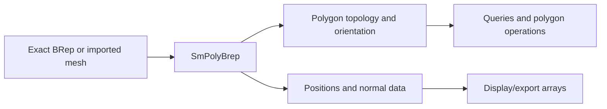
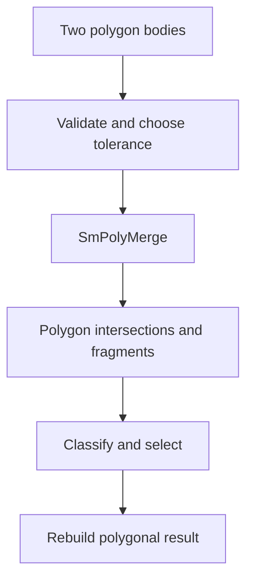
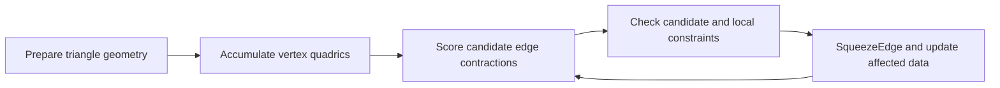

# Polygon BRep: mesh topology, booleans, and simplification

Source baseline: upstream `3fd5b9548d19aa8c12c29bc9637a96d42a06f8a5`.
This guide describes the polygonal subsystem. No mesh boolean or decimation
example was executed for this documentation; workflows are conceptual.

## 1. A polygon BRep is a different representation

`SmPolyBrep` represents polygonal geometry and connectivity. It can be produced
by tessellation or imported from a mesh. It is not merely an alias for `SmBrep`,
and polygon booleans are not the same algorithm as analytic/NURBS BRep booleans.

Its accuracy relative to an original CAD model depends on the tessellation or
conversion history. A mathematically precise operation on the polygonal boundary
does not recover curvature lost when the CAD support was sampled.

The primary declarations are in [SmPoly.h](../source/SMLib/inc/SmPoly.h), with
transfer data in [SmPolyBrepData.h](../source/SMLib/inc/SmPolyBrepData.h).
Public wrappers are in [SmApiPolygons.h](../source/SM_API/inc/SmApiPolygons.h).

## 2. Connectivity, winding, and normals

Vertices provide positions; edges and faces establish incidence. A polygon's
ordered vertices determine orientation. For a triangle,

$$
\mathbf n\propto(\mathbf p_1-\mathbf p_0)\times(\mathbf p_2-\mathbf p_0).
$$

Reversing winding reverses its normal. Shading normals may be stored per face or
corner and need not equal the geometric triangle normal. Sharing a position
does not require sharing a normal across a sharp edge.

Before interpreting a mesh as a solid, check closure, orientation, degeneracy
and the supported manifold assumptions. A visually closed surface can still
contain duplicate or disconnected vertices along what appears to be one edge.

## 3. Polygon boolean path

`SmApiPolyBoolean` in [SmApiPolygons.cpp](../source/SM_API/src/SmApiPolygons.cpp)
initializes the output null and rejects null or identical operand pointers.
It uses the maximum operand tolerance and an angular value of 20 degrees
converted to radians, constructs `SmPolyMerge`, and calls `ManifoldBoolean`.

The core components are [SmPolyMerge.h](../source/SMLib/inc/SmPolyMerge.h) and
[SmPolyIntersector.h](../source/SMLib/inc/SmPolyIntersector.h). A conceptual
pipeline is polygon candidate detection, intersection/splitting, classification,
and retained-mesh assembly. The actual ownership and supported degeneracies
must be read from the selected wrapper and executive; do not copy native solid
boolean cleanup rules without checking.

Coplanar triangles, slivers, near-coincident boundaries and non-manifold input
can change difficulty. A denser input mesh is not automatically a more robust
boolean input; it can add small poorly conditioned elements.

## 4. Queries and volume

For a closed consistently oriented triangular surface, signed tetrahedral
contributions relative to an origin give

$$
V=\frac16\sum_{(a,b,c)}\mathbf p_a\cdot(\mathbf p_b\times\mathbf p_c).
$$

This formula assumes the appropriate boundary interpretation. Open surfaces or
inconsistent winding can produce a number that is not the intended material
volume. Large coordinate offsets can also affect numerical conditioning.

Polygon section and ray queries operate on the mesh representation, so their
answer can differ from the original exact support by the meshing error. Preserve
that distinction in clearance and inspection tools.

## 5. Decimation and error metrics

[SmPolyDecimate.h](../source/SMLib/inc/SmPolyDecimate.h) defines simplification
state including boundary/interior/corner classification, weighted chord-height
distance, face-error tracking, and quadric attributes. The implementation is
[SmPolyDecimate.cpp](../source/SMLib/src/SmPolyDecimate.cpp).

A plane quadric illustrates one common simplification metric. For normalized
plane coefficients $\mathbf p=(a,b,c,d)^T$ and homogeneous point $\mathbf v$,

$$
E(\mathbf v)=(\mathbf p^T\mathbf v)^2
=\mathbf v^T(\mathbf p\mathbf p^T)\mathbf v.
$$

Summing plane contributions scores deviation from several incident planes.
The presence of quadric data does not establish that every decimation path uses
one identical optimization or preserves every feature. Boundary constraints,
corner classification and error checks remain essential.

The source contains distinct `DoMeasuredDecimation` and `DoQuadricDecimation`
paths. The measured path builds per-vertex attributes, sorts candidates in
working groups, reconstructs affected faces, and calls `CheckErrorBounds` on
candidate replacement geometry. Its bookkeeping retains geometric error
information instead of optimizing only a requested polygon count.

The quadric path first triangulates faces with more than three nondegenerate
edges, then accumulates temporary quadric vertex attributes from triangle
geometry. Candidate edge contractions are scored and accepted through the
path's checks, with `SqueezeEdge` performing the local topology change. View-based
inputs can distinguish parallel direction from perspective eye position.
The minimum-edge-length decimation path is another separate policy, not a
synonym for quadric minimization.

This diagram summarizes the quadric branch's responsibilities, not every
sorting or termination detail. Inspect the selected branch's configured limits
before interpreting its result as meeting a chord-height bound.

Simplification changes the mesh. Its error is relative to the input polygonal
surface unless an additional original-support check is performed. Successive
tessellation and decimation errors should not be conflated.

## 6. CAD display and export scenario

Tessellate a model at a documented quality, keep the full-quality result for
measurement/export as required, and derive a lighter preview mesh separately.
Preserve sharp-edge normals and material/attribute mapping when reducing detail.

Check boundary closure, orientation, face degeneracy and actual visual quality.
A target triangle count alone does not establish acceptable geometric error.
For a cylindrical hole, compare its polygonal radius/clearance before and after
decimation to avoid closing a visually small but functionally important passage.

## 7. Verification and scope

Use a box for known volume and winding, a mesh with an intentional open boundary
for topology classification, and a sharp feature for normal preservation.
Compare mesh operations against simple analytic cases while accounting for
tessellation error. Do not demand equality with exact curved-volume formulas
at arbitrary coarse resolution.

See [tessellation](tessellation.md), [booleans](booleans.md),
[queries](queries.md), and [USD interchange](usd-interchange.md). Kernel decimation
classes do not imply a stable wrapper for every configuration, and this chapter
does not certify arbitrary triangle soups as valid boolean solids.
