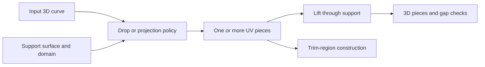
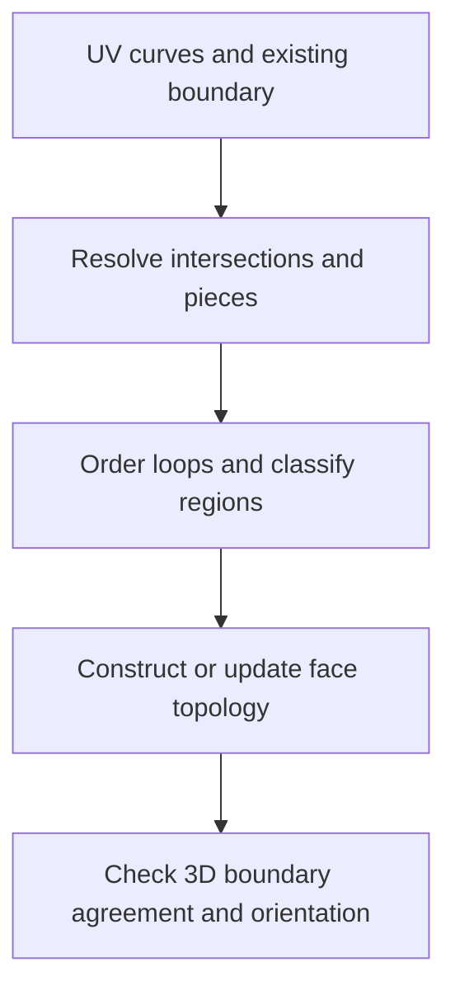

# Projection, curve dropping, lifting, and trimming

Source baseline: upstream `3fd5b9548d19aa8c12c29bc9637a96d42a06f8a5`.
The workflows below are source walkthroughs and pseudocode. No C++ execution or
global projection-error guarantee is claimed by this documentation.

## 1. Four related but different operations

Directional projection intersects rays from a curve with a surface. Closest-point
projection minimizes distance. Dropping a curve constructs a parameter-space
trace on a support under the selected kernel policy. Lifting maps a UV curve
back to 3D. Trimming uses curves to select a region and construct boundary topology.

None of these names alone establishes a unique result. A ray can hit a surface
twice; a point can have several closest points; a periodic surface has multiple
UV representations; a projected curve can become disconnected.

## 2. Mathematical models

For fixed direction $\mathbf d$, directional projection solves

$$
\mathbf S(u,v)=\mathbf C(t)+\lambda\mathbf d.
$$

Closest-point projection instead seeks

$$
\min_{(u,v)\in D}\|\mathbf S(u,v)-\mathbf C(t)\|^2.
$$

The first model preserves the prescribed ray direction; the second normally
uses orthogonality at regular interior minima. They coincide only in special
cases. Domain boundaries must be considered separately.

Given a UV curve $\mathbf c(t)=(u(t),v(t))$, lifting is the composition
$\mathbf L(t)=\mathbf S(\mathbf c(t))$. Its exact procedural representation
need not be a simple finite NURBS curve. A returned spline approximation has
its own tolerance and may require parameter-correspondence checks.



## 3. The simple drop wrapper has specific policies

`SmApiDropCurveToSrf` in [SmApiCurves.cpp](../source/SM_API/src/SmApiCurves.cpp)
accepts a `SmBSplineCurve`, a surface, and optional UV/3D output arrays. Its
inspected path obtains the surface context and calls `DropAndTrimCurve` over
the surface's natural UV domain and curve's natural interval.

This wrapper sets `dApproxTol` to `10`, initializes drop/gap variables to zero,
and uses `0.001` for the optional lifting calls. Those are actual wrapper
arguments, not recommended tolerances for arbitrary units. Their detailed
interpretation belongs to the called methods. The simple wrapper does not
expose every kernel control an application might need.

When 3D outputs are requested, it lifts into a temporary array. A failed lift
deletes temporary lifted and UV curves before returning; successful outputs
are appended only after all requested lifting succeeds. If UV output was not
requested, those temporary UV curves are deleted after use.

This workflow is worth following because it preserves pairing and avoids
publishing only half of a requested result:

```text
validate curve and surface
drop/trim into temporary UV segments
for each UV segment, construct its requested 3D counterpart
if a lift fails, clean temporary owned results and return failure
append requested outputs; release unrequested temporary UV curves
```

Inspect [SmSurfaceDropCurve.cpp](../source/SMLib/src/SmSurfaceDropCurve.cpp),
[SmSurfaceDropCurve.h](../source/SMLib/inc/SmSurfaceDropCurve.h), and
[SmApiTrimmedSurfaces.h](../source/SM_API/inc/SmApiTrimmedSurfaces.h) for the
deeper geometry and face-construction boundaries.

## 4. Seams, poles, and branch continuity

On a cylinder, $u$ and $u+P$ can represent the same point. A continuous 3D curve
can cross the seam while its principal-range UV coordinates jump by $P$.
Joining those endpoints with a straight line in the principal UV rectangle can
create a spurious segment across the whole surface.

At a pole, many U values map to the same 3D point. UV distance becomes a poor
measure of spatial distance. Branch continuation must use geometric evidence,
domain information, and the surface's periodic/degenerate structure.

For corresponding segments, measure

$$
e(t)=\|\mathbf S(\mathbf c(t))-\mathbf L(t)\|.
$$

If the two curves use different parameters, first establish the correspondence.
Comparing equal parameter values without that check can manufacture a false gap.

## 5. Trimming is region construction

A closed projected curve does not by itself specify which side to retain.
Orientation, nesting, intersection with existing boundaries, and the modeled
domain determine the trim region. A face may contain holes and multiple boundary
occurrences of a seam edge.



SMLib's edgeuse UV trims are optional derived data, while 3D edge geometry and
topology define the boundary. Constructing a face and generating a useful UV
trim cache are related but distinct. See [topology.md](topology.md).

## 6. CAD scenario: a logo on a curved panel

Choose whether the design intends projection along a manufacturing direction
or shortest-distance attachment. Those can yield different shapes on a curved
panel. Place the support and source curve in consistent units, choose the
relevant domain, and inspect all output segments.

Before trimming, verify branch continuity, seam handling, loop closure, nesting,
and the intended kept side. A small gap in the source sketch may remain a
meaningful gap rather than something the kernel should silently close.
Keep a copy of the original body when trim operations mutate topology.

## 7. Failure diagnosis and acceptance

Distinguish failure to find a projected branch, branch switching, UV segmentation,
lifting error, loop assembly, and topology reconstruction. Tightening the lifting
tolerance does not repair a wrong branch chosen earlier. A successful drop can
still produce several pieces that the application must interpret.

Use a plane for a known projection, a cylinder for seam crossing, and a surface
pole for singular-parameter behavior. Check positions and output pairing, not
only the displayed silhouette. Sampled residuals are diagnostic evidence, not
automatically a continuous maximum-error certificate.

Related guides: [intersections](intersections.md), [sections](sections.md),
[tolerances](tolerances.md), and [healing/stitching](healing-stitching.md).
