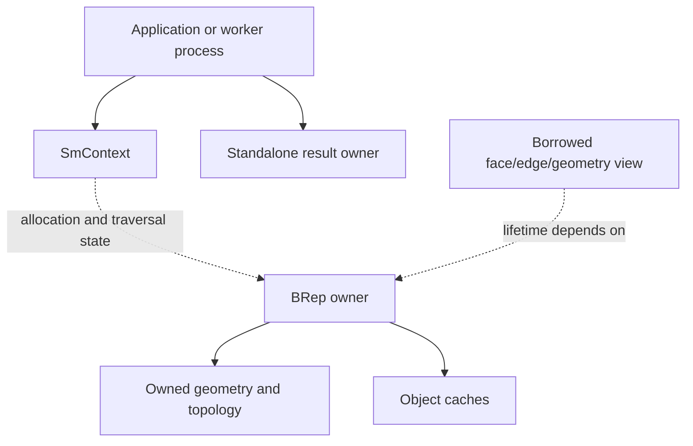

# Runtime: contexts, ownership, notifications, and concurrency

Source baseline: upstream `3fd5b9548d19aa8c12c29bc9637a96d42a06f8a5`.
This guide describes the checked-in configuration and native lifetime contracts.
Application scheduling pseudocode is not a new thread-safety guarantee.

## 1. Context and object lifetime

`SmContext` supplies kernel runtime state used by allocation, traversal marks,
and other services. A context association is not a license to ignore individual
object ownership. Standalone outputs, BRep-owned geometry, borrowed incidence
pointers, and temporary numerical arrays have different destruction rules.

The API implementation in [SmApiGeneral.cpp](../source/SM_API/src/SmApiGeneral.cpp)
contains a process-global `pGlobalContext`. `SmApiCreateContext` and
`SmApiGetOrCreateContext` allocate it when null; the shown lazy initialization
has no synchronization. Initialize once before the application starts dispatching
modeling work.



Keep the context alive through destruction of its associated objects. Do not
attach an object from another context by assigning a raw pointer into topology.
Context consistency is part of the runtime graph's invariants.

## 2. Three ownership patterns

| Pattern | Application responsibility |
| --- | --- |
| New standalone result | Check status, then establish an owner and destroy it before its context |
| Borrowed view | Keep the owner alive; do not delete the child independently |
| Consumed/mutated input | Follow the selected operation's success and failure contract exactly |

For example, the linear-sweep wrapper copies input curves before a consuming
kernel constructor, while the native difference example reuses A and deletes B
on success. The same general library can therefore expose both preserving and
consuming interfaces.

`std::unique_ptr` is useful for independently owned objects with a complete type
and compatible deletion. It is incorrect for a borrowed edge curve. Internal
`SmObjDelete`/`SmObjsDelete` cleanup helpers appear throughout wrappers to
release temporary results when status propagation exits early.

## 3. Mutation and cache lifecycle

Object-level caches contain bounds, decomposition trees, evaluation support or
other derived state. A geometry edit can preserve the outer pointer while
invalidating that state. Representation replacement can also invalidate raw
coefficient pointers and borrowed geometry views.

[SmObject.h](../source/SMLib/inc/SmObject.h) and
[SmAObject.h](../source/SMLib/inc/SmAObject.h) define the object/attribute/cache
infrastructure. Notifications connect supported mutators to owners and consumers.
Bypassing a mutator to change storage directly can leave a numerically plausible
but stale result in another subsystem.

In the checked-in configuration, `SM_USE_GLOBAL_CACHE` is disabled in
[SmConfig.h](../source/SMLib/inc/SmConfig.h). Object-owned caches still exist.
Keeping a context alive does not preserve caches belonging to objects that were
deleted or replaced. Optional global-cache code should not be described as the
active default merely because it appears in a header.

## 4. Native statuses and error propagation

Compare returned status with `SM_SUCCESS`, not a guessed numeric value. Initialize
output pointers before calls and inspect whether arrays are appended, cleared,
or left partially populated. An error can occur after mutation; cleanup and
rollback are different responsibilities.

```text
initialize output and temporary owners
call the selected operation
on failure, preserve diagnostics and clean up under that operation's contract
on success, transfer or retain ownership as documented
publish only outputs the application has accepted
```

Python bindings wrap statuses in exceptions and have additional handle guards.
Those protections should not be assumed for raw native pointers. Read
[validation-diagnostics.md](validation-diagnostics.md) for diagnostic evidence.

## 5. Concurrency in the shipped configuration

The repository's [concurrency guide](../.agents/operations/concurrency.md)
requires general `SmApi*` work to be serialized within a process. Shared context
mark counters and other mutable state make arbitrary concurrent API calls unsafe.
Creating multiple explicit contexts does not prove that every wrapper avoids
the global context.

For independent jobs, separate worker processes provide independent runtime
state. A Qt application can coordinate work through a serialized modeling
service or isolated worker processes; the GUI's threading model does not change
the kernel's contract.

The guide identifies specific isolated-context USD tessellation/healing paths
with narrower concurrency support. Treat those as named exceptions and preserve
their stage-read/no-concurrent-mutation requirements. They do not imply general
parallel modeling support. Likewise, compiled-out parallel code is not an active
capability of the shipped build.

## 6. Cancellation and progress

The inspected context/solver interfaces and representative global-solver,
tessellation and fillet-executive paths do not establish a uniform public
cancellation/progress contract. Treat that capability as unverified at the
general `SmApi*` boundary. Before adding a cancel button for an in-progress call,
identify an actual supported polling/callback path, its cleanup, and the state
left on cancellation. An unrelated graphics interrupt field is not such a contract.

For a generic application design, cancel a queued job before it starts, or use
a dedicated disposable worker process when isolation is required. Terminating
an in-process thread in the middle of intrusive topology mutation is not a
safe rollback mechanism.

## 7. CAD edit-loop workflow

Initialize one modeling worker's context, create or import the accepted model,
and retain it across ordinary queries. For a destructive operation requiring
undo, create a recoverable working copy. After success, update selections and
display caches based on the actual changed model. Dispose of obsolete models
under explicit ownership.

Profile geometry operations separately from bounds, property integration,
tessellation and file I/O. Recreating the model every frame defeats object-cache
reuse; retaining stale mesh data after a shape edit gives the opposite failure.

## 8. Verification and related guides

Review every owned/borrowed/consumed pointer crossing the application boundary.
Exercise success and failure cleanup, repeated calls, replacement of geometry,
and destruction order in executable integration work. This document is a
source review, not a fresh sanitizer or concurrency test report.

Continue with [editing](editing.md), [spatial-indexing](spatial-indexing.md),
[native I/O](native-io.md), and [assemblies/attributes](assemblies-attributes.md).
