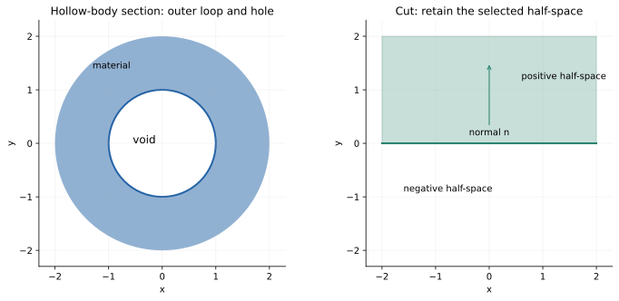
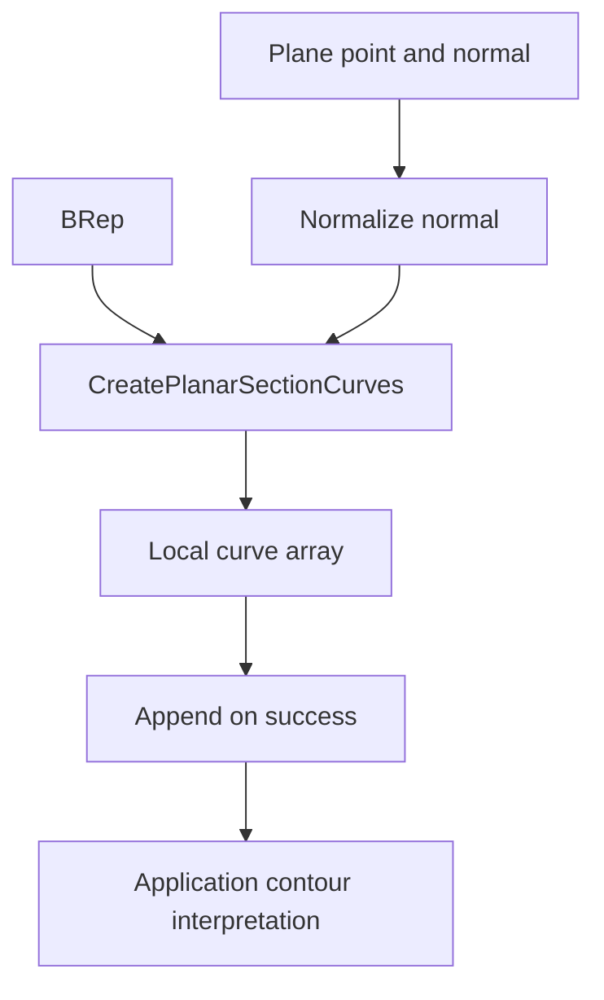
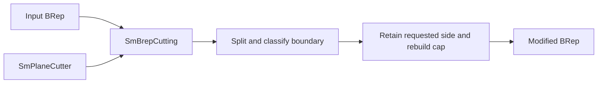

# Sections: contours, plane cuts, and caps

Source baseline: upstream `3fd5b9548d19aa8c12c29bc9637a96d42a06f8a5`.
Native call signatures are checked against source; examples here are workflow
descriptions rather than executed kernel results.

## 1. Sectioning and cutting have different outputs

A section query returns where a body's boundary meets a plane. A cut changes
the body by retaining a selected half-space and constructing the required cap
topology. A viewport clipping plane can hide pixels without doing either.

Use the section query for inspection, contours, and measurements. Use the cut
operation when downstream booleans, volume, or export must see the modified solid.
Do not mistake a visually clipped model for a newly constructed closed BRep.

## 2. Plane coordinates and contour geometry



The figure is a mathematical illustration; the left panel's material area is
$\pi(2^2-1^2)=3\pi$ in squared coordinate units.

For a plane point $\mathbf p$ and unit normal $\mathbf n$, signed distance is

$$
d(\mathbf x)=\mathbf n\cdot(\mathbf x-\mathbf p).
$$

Choose orthonormal in-plane vectors $\mathbf a,\mathbf b$ with
$\mathbf a\times\mathbf b=\mathbf n$. Then

$$
\mathbf x(\xi,\eta)=\mathbf p+\xi\mathbf a+\eta\mathbf b.
$$

This frame converts 3D section curves into planar coordinates for ordering,
nesting, or area computation. Reversing the frame orientation reverses signed
area, even though the geometric section is unchanged.

For a simple oriented planar loop,

$$
A=\frac12\oint(\xi\,d\eta-\eta\,d\xi).
$$

Holes contribute with the appropriate opposite orientation. A list of closed
curves is not yet a complete inside/outside nesting classification.

## 3. Actual section wrapper

`SmApiIntersectBrepWithPlane` is implemented in
[SmApiIntersectors.cpp](../source/SM_API/src/SmApiIntersectors.cpp). It checks
the BRep pointer, copies and normalizes the normal, rejects a zero/invalid
normal when unitization fails, obtains the default API context, and calls
`CreatePlanarSectionCurves`.

It collects output in a local array because the kernel method resets that
array, then **appends** successful curves to the caller's array. This differs
from wrappers that replace their outputs. Prefer a fresh array when one call's
results must be unambiguous, and own/delete newly returned standalone curves
according to the native contract.



The public declaration is in
[SmApiIntersectors.h](../source/SM_API/inc/SmApiIntersectors.h). Do not assume
every array entry is one complete closed contour for every topology class and
degenerate plane position. Open sheets, multiple components, and tangencies
need explicit interpretation.

## 4. Actual cut workflow

`SmApiCut` in [SmApiBrep.cpp](../source/SM_API/src/SmApiBrep.cpp) normalizes the
plane normal, constructs `SmBrepCutting` and `SmPlaneCutter`, and calls `DoCut`
using the BRep's tolerance. This is an in-place modeling path, not a curve query.



The application contract retains the positive side of the plane normal. For
a horizontal plane at $z=h$, an upward normal retains the upper part and a
downward normal retains the lower part. Verify the intended side with a known
test point before applying a destructive cut to production geometry.

Read [SmBrepCutting.h](../source/SMLib/inc/SmBrepCutting.h),
[SmBrepCutting.cpp](../source/SMLib/src/SmBrepCutting.cpp), and
[SmCutter.h](../source/SMLib/inc/SmCutter.h) for the cutter abstraction.

## 5. Contour assembly and nesting

A practical planar-contour consumer should:

```text
retain each returned curve's interval and orientation information
map endpoints into a consistent plane frame
identify compatible endpoint connections within justified tolerance
walk connected components without discarding duplicate occurrences blindly
classify closed loops and open chains
establish nesting and retained-region convention
measure or export only after checking the expected contour class
```

Coincident endpoints alone do not establish the intended connectivity at a
branching or touching configuration. For a closed manifold solid intersected
transversely by a generic plane, closed loops are expected. That expectation
must be relaxed at tangencies, coplanar faces, or for sheet/wire models.

## 6. Degenerate section positions

A tangent plane may produce a point or contact set rather than an ordinary loop.
A plane coincident with a planar face creates a two-dimensional overlap, and
its boundary handling is a policy question. A plane through a vertex or along
an edge can create duplicated endpoint events that need consistent treatment.

Do not perturb the plane silently to make a difficult case disappear: moving
the section changes the requested measurement. If an offset section is used
for diagnosis, label its displacement and compare both cases.

## 7. CAD scenario: inspect a hollow housing

A mid-height transverse section can contain an outer contour and an inner
contour. Their difference gives material cross-sectional area under the assumed
orientation/nesting. A section above an internal ledge may have a different
number of components. These changes can be real model features.

For a rectangular box, verify section dimensions analytically. For a hollow
box, verify hole nesting and area. Then compare a section query with a cut on
a copy: the query preserves the model, while the cut changes volume and adds
a planar boundary. Check cap orientation and material regions after cutting.

## 8. Verification limits and reading order

Check plane residuals $|d(\mathbf C(t))|$, curve-to-body agreement, endpoint
connectivity, and expected component type. A good-looking contour does not
prove the cut's cap topology is valid. Conversely, a section query should not
be judged by the volume of a body it never modified.

Continue with [intersections](intersections.md), [queries](queries.md), and
[topology](topology.md). Treat output ownership, append/replace behavior, and
the query-versus-mutator distinction as part of correctness.
