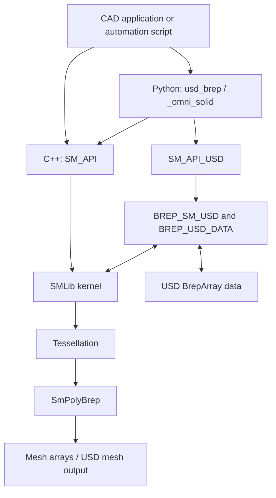
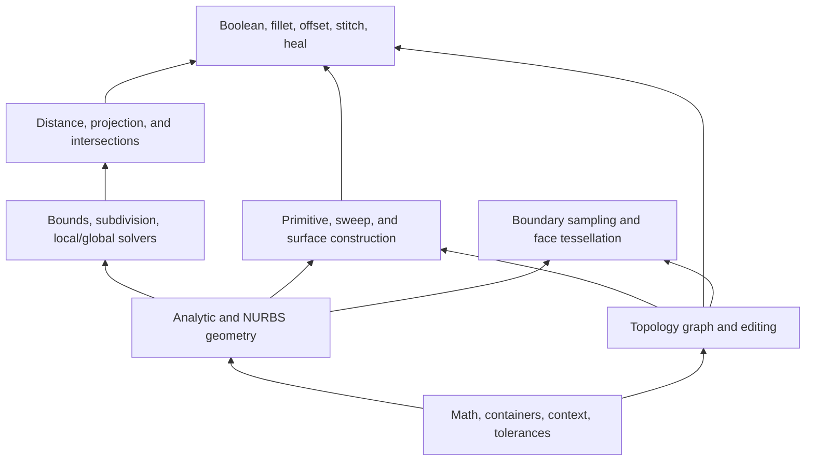

# SMLib: features, architecture, algorithms, and CAD workflows

SMLib is the geometry and solid modeling kernel inside USD BRep. It constructs and
edits boundary representations (BReps), evaluates analytic and NURBS geometry,
answers geometric queries, and generates polygon meshes. The USD layers store
and exchange those models; they are separate from the core modeling algorithms.

This document is a guide to the implementation in this checkout. Component names
below describe responsibilities, not necessarily separate build targets. Links
point to current headers, implementations, and operation guides. A capability in
the C++ kernel is not automatically available through `SM_API` or Python.

“Exact geometry” means a surface/curve representation rather than a fixed polygon
approximation. Computation still uses floating-point arithmetic and tolerances.
General intersections, fitting, offsets, and sweeps can involve approximation;
they should not be understood as universally exact symbolic constructions.

## 1. Features

| Area | Capabilities | Typical CAD purpose |
| --- | --- | --- |
| Geometry | Analytic curves and surfaces; B-spline/NURBS curves and surfaces; evaluation, derivatives, normals, curvature, domains, and transformations | Mathematical definition of a part |
| Topology | Regions, shells, faces, loops, edges, vertices, and oriented use objects; solid, sheet, wire, and non-manifold forms | Connectivity, boundaries, material regions, and holes |
| NURBS tools | Basis evaluation, knot insertion/refinement/removal, degree elevation/reduction, splitting, compatibility, and control-point editing | Prepare, simplify, and reshape curves and surfaces |
| Interpolation and fitting | Curve interpolation, least-squares approximation, ordered-grid and point-cloud surface fitting, boundary/tangent constraints | Build geometry from design sections or measured data |
| Construction | Primitives, extrusion, revolution, path sweeps, draft/taper, ruled surfaces, skinning/lofting, and surface patches | Build the initial part shape |
| Solid operations | Union, difference, intersection, merge, imprinting, cutting, and CSG evaluation | Add bosses, drill holes, create pockets, and combine bodies |
| Local refinement | Selected-edge fillets, chamfers, variable-radius blends, corner treatment, and fillet removal | Round or bevel a finished design |
| Offset and shell | Curve/profile offsets, surface/BRep offsets, and signed-thickness shells | Wall thickness, clearance envelopes, and hollow parts |
| Repair | Stitching, orientation handling, and staged BRep healing | Join and repair imported geometry |
| Queries | Closest points, body distance/relationship, intersections, sections, bounds, length, area, volume, and mass properties | Inspection, clearance, analysis, and selection |
| Mesh processing | BRep tessellation, polygon BRep traversal, and polygon Boolean operations | Visualization and mesh-based downstream processing |
| Integration | Native kernel objects exposed through C++/Python; separate USD BRep and mesh import/export layers | Embed modeling in a CAD application or USD pipeline |

The kernel supplies modeling operations. An application still needs to provide its
own design UI, feature-history/rebuild policy, assembly logic, and application-level
parameter management. The numerical solvers described below are geometry solvers;
their existence does not establish a complete sketch-constraint or assembly solver.

Public operation inventory: [operation index](../.agents/operations/INDEX.md).

## 2. System architecture

### 2.1 API and integration layers



| Layer | Responsibility | Source entry point |
| --- | --- | --- |
| SMLib | Geometry, topology, numerical algorithms, modeling, and tessellation | [source/SMLib](../source/SMLib) |
| SM_API | High-level C-style C++ wrappers, arguments, status propagation, and operation contracts | [source/SM_API/inc](../source/SM_API/inc) |
| SmPyLib | Stable Python handles, argument conversion, exceptions, and ownership checks | [source/SmPyLib](../source/SmPyLib) |
| SmPyDevLib | Internal topology walks, validation, drawing, and kernel diagnostics | [source/SmPyDevLib](../source/SmPyDevLib) |
| SM_API_USD | User-facing USD import/export and scene operations | [source/SM_API_USD](../source/SM_API_USD) |
| BREP_SM_USD / BREP_USD_DATA | Translation between runtime BReps and packed USD data | [BREP_SM_USD](../source/BREP_SM_USD), [BREP_USD_DATA](../source/BREP_USD_DATA) |

`_omni_solid` is the extension used by source-checkout examples. The packaged
`usd_brep` API organizes operations into submodules. `_smlib_dev` is a separate
developer extension; intrusive topology and debugging tools belong there.

### 2.2 Internal dependency structure



The division between geometry and topology is fundamental. Geometry answers
“where is the surface?” Topology answers “which bounded part of that surface is a
face, which edges bound it, and how is it connected to its neighbors?” A modeling
operation normally has to update both.

### 2.3 Context, ownership, tolerances, and caches

`SmContext` supplies shared kernel state and is associated with persistent
geometry/topology objects. `SM_API` lazily provides a process-global default
context; some operations use an input object's context or a dedicated output
context. Python initializes the API context automatically.

Context association alone does not define ownership or guarantee that deleting a
context reclaims every related object. BRep-owned surfaces, edge curves, use
objects, and standalone geometry have different lifetime rules. At the public API
boundary, always distinguish producers, mutators, and consuming operations.

Tolerance is also not one universal number. Zone/coincidence, intersection, and
approximation tolerances serve different purposes. Per-object bounds, surface
subdivision, UV trim, and other derived data can be cached or computed lazily.
Representation changes must invalidate the affected data. Shared mutable context
and cache state should not be assumed safe for concurrent operations.

Sources: [SmContext.h](../source/SMLib/inc/SmContext.h),
[SmTol.h](../source/SMLib/inc/SmTol.h), and
[lifetime/context/cache reference](../.agents/skills/smlib-kernel-operations/references/lifetime-context-cache.md).

## 3. Components and algorithms

### 3.1 Analytic geometry and geometric interfaces

`SmCurve` and `SmSurface` define the common evaluation/query interfaces. Concrete
types include lines, circles, ellipses, planes, cylinders, cones, spheres, tori,
and B-spline geometry. A curve has a parameter $t$; a surface has parameters
$(u, v)$. Their domains are not automatically $[0, 1]$, and an untrimmed surface
can have a finite natural parameter domain.

Analytic types use their own geometric definitions. Generic algorithms can work
through the common interfaces, while supported special cases can use analytic
relationships. Conversion to NURBS is available when an operation or output
representation requires it; converting every primitive at creation is unnecessary.

Evaluation provides points and derivatives. These support tangents, normals,
curvature, local coordinate frames, distance equations, and intersection tracing.
At poles, seams, or degenerate parameterizations, the algorithm must handle cases
where the usual derivative-based construction becomes singular.

Sources: [SmCurve.h](../source/SMLib/inc/SmCurve.h),
[SmSurface.h](../source/SMLib/inc/SmSurface.h),
[SmCircle.h](../source/SMLib/inc/SmCircle.h), and
[SmCylinder.h](../source/SMLib/inc/SmCylinder.h).

### 3.2 Topology: entities and oriented uses

The runtime BRep is a graph, not merely a list of trimmed surfaces:

| Entity | Meaning |
| --- | --- |
| `SmBrep` | Root object; owns global topology lists and region infrastructure |
| `SmRegion` | Connected volume of space, including an infinite region |
| `SmShell` | Connected boundary component; may represent faces, wires, or an isolated vertex |
| `SmFace` | A surface with a pair of oriented faceuses |
| `SmLoop` / `SmLoopuse` | Boundary loop and its oriented occurrences; special vertex loops also exist |
| `SmEdge` | A 3D curve with a modeled parameter interval |
| `SmVertex` | A 3D point and its incidences |
| Faceuse / edgeuse / vertexuse | An occurrence of an entity in a specific owner and orientation |

A shared edge is stored once but can participate in several face boundaries.
Edgeuses carry this incidence and connect through mate/radial relationships.
This supports seams and non-manifold connectivity that cannot be represented by
assuming every edge has exactly two neighboring faces.

Topological identity is distinct from position: two vertices at the same
coordinates remain separate until an operation connects or merges them.
Similarly, touching surfaces are not automatically a stitched shell.

The defining boundary data is topology plus the edge's 3D curve/interval and the
face's surface. An edgeuse UV trim curve is optional, derived data. It is useful
for parameter-space operations, but a faulty UV trim alone does not establish
that the underlying topology is wrong.

Sources: [SmBrep.h](../source/SMLib/inc/SmBrep.h),
[SmFace.h](../source/SMLib/inc/SmFace.h),
[SmEdgeuse.h](../source/SMLib/inc/SmEdgeuse.h), and the
[BRep model reference](../.agents/skills/smlib-brep-model/references/brep-format.md).

### 3.3 NURBS representation and basis evaluation

The main C++ types are `SmBSplineCurve` and `SmBSplineSurface`; volume-related
NURBS classes also exist internally. The `NL_*` implementation is incorporated
into SMLib, rather than being a separate public library boundary.

A rational B-spline curve combines control points $\mathbf{P}_i$, weights $w_i$, degree
$p$, and a nondecreasing knot vector:

$$
\mathbf{C}(u) =
\frac{\sum_i N_{i,p}(u)\,w_i\,\mathbf{P}_i}
     {\sum_i N_{i,p}(u)\,w_i}
$$

A NURBS surface uses a tensor product of U and V basis functions over a control
net. Degree, knots, and weights determine the basis; control points determine
its spatial placement. Control points generally do not lie on the resulting
curve or surface.

`N_BasisFindSpan` locates the active knot span. `N_BasisEval` computes the
nonzero basis functions through a triangular recurrence with left/right knot
distances: the Cox-de Boor basis recurrence evaluated iteratively. The derivative
routine is `N_BasisDerivs`. Curve/surface evaluation combines these basis values
with control data and handles rational coordinates.

Local support is valuable for editing: changing a control point affects only
the parameter spans supported by its basis function. At an ordinary interior
knot of multiplicity $m$, a degree-$p$ spline has continuity at least $C^{p-m}$
when $m \leq p$; particular control data can make it smoother.

Sources: [SmBSplineCurve.h](../source/SMLib/inc/SmBSplineCurve.h),
[SmBSplineSurface.h](../source/SMLib/inc/SmBSplineSurface.h),
[NL_BasisBasic.cpp](../source/SMLib/src/NL_BasisBasic.cpp), and
[NL_CrvBasic.cpp](../source/SMLib/src/NL_CrvBasic.cpp).

### 3.4 Knot editing, refinement, and the Oslo question

Knot insertion adds degrees of freedom while preserving the represented shape,
up to floating-point roundoff. It finds the affected span and multiplicity,
copies unaffected control points, and recomputes the local control points using
weighted combinations. Repeated insertion can expose separate Bezier spans or
make multiple profiles share compatible knot vectors.

| Task | Implementation |
| --- | --- |
| Insert one knot, possibly repeatedly | `N_CrvInsertKnot`; C++ `InsertOneKnot` |
| Insert a sequence of knots | `N_CrvRefine`; C++ `InsertKnots` |
| Refine a surface in U or V | `N_SrfInsertKnot`, `N_SrfInsertKnots` |
| Split or extract spans | `N_CrvSplit`, `N_CrvExtractCrvSeg`, `N_CrvDecomposeBez` |
| Remove knots under a deviation tolerance | `N_CrvRemoveKnot`, `N_CrvRemoveKnots`, surface counterparts |
| Make curves compatible | `N_CrvsMakeCompatible` and related tolerance variants |

Knot removal attempts the reverse simplification and checks whether the reduced
representation meets the requested error bound. It is not guaranteed to succeed
for every knot. Boundary/derivative constraints can further restrict removal.

**Oslo:** Oslo is associated with changing/refining a B-spline basis while
preserving the represented geometry. This checkout implements the relevant
refinement functionality, but a search of `source/SMLib` found no symbol or
comment naming an Oslo implementation. `N_CrvRefine` explicitly walks the inserted
knots and blends affected control points. It is documented here as knot
refinement, without claiming a particular Oslo variant or a separate Oslo module.

Sources: [NL_CrvTool.cpp](../source/SMLib/src/NL_CrvTool.cpp),
[NL_SrfTool.cpp](../source/SMLib/src/NL_SrfTool.cpp), and
[NL_BasisBasic.h](../source/SMLib/inc/NL_BasisBasic.h).

### 3.5 Degree elevation and reduction

**Degree elevation** raises polynomial degree without changing the geometric
shape, within numerical precision. `SmBSplineCurve::DegreeElevate` delegates to
`N_CrvElevateDegree`. That implementation processes Bezier segments, applies
degree-elevation coefficients, and assembles the elevated B-spline. Surface
elevation applies the corresponding operation in the selected U or V direction.

**Degree reduction** tries to represent the shape with a lower degree. Unlike
elevation, it generally introduces approximation unless the original geometry
already admits a lower-degree representation. `N_CrvReduceDegreeOnce` uses
Bezier degree-reduction coefficients and tolerance/error checks; repeated
reduction and surface variants are also present.

These operations are useful when making profiles compatible for lofting,
preparing geometry for another system, or reducing representation complexity.
Raising degree is a representation operation, not a request to make the shape
visually smoother. Reducing degree is not a substitute for validating deviation.

Sources: [SmBSplineCurve.cpp](../source/SMLib/src/SmBSplineCurve.cpp),
[SmBSplineCurveNLib.cpp](../source/SMLib/src/SmBSplineCurveNLib.cpp),
[NL_CrvTool.cpp](../source/SMLib/src/NL_CrvTool.cpp), and
[NL_Bezier.cpp](../source/SMLib/src/NL_Bezier.cpp).

### 3.6 Interpolation, approximation, and fitting

Interpolation requires the curve or surface to pass through supplied samples.
Approximation instead seeks a useful fit within a tolerance or with a chosen
number of control points. For noisy measurements, fitting every point exactly
can reproduce noise and create unnecessary oscillation.

The typical curve interpolation pipeline is:

1. Assign sample parameters: uniform, chord-length, centripetal, or supplied values.
2. Build a knot vector consistent with the degree and constraints.
3. Evaluate basis coefficients at the sample parameters.
4. Solve the linear system for control points, including supported derivative constraints.

`NL_CrvFit` includes LU-decomposed interpolation-matrix helpers and least-squares
approximation routines. Approximation paths can adjust control-point count,
parameterization, or knots and then simplify by knot removal.

Surface fitting includes structured grids, scattered points, point/normal data,
and boundary-constrained variants. Grid-based fitting exploits the two parameter
directions; scattered-point fitting additionally needs a suitable UV mapping.
`SmBSplineSurface::ApproximatePoints` selects fixed-size least-squares fitting or
tolerance-driven fitting according to its arguments. A point-cloud fitting
routine is a surface construction tool, not an automatic complete reverse-
engineering system for an arbitrary scanned assembly.

Sources: [NL_CrvFit.h](../source/SMLib/inc/NL_CrvFit.h),
[NL_CrvFit.cpp](../source/SMLib/src/NL_CrvFit.cpp),
[NL_SrfFit.cpp](../source/SMLib/src/NL_SrfFit.cpp),
[NL_SrfLstSqFit.cpp](../source/SMLib/src/NL_SrfLstSqFit.cpp), and
[SmBSplineSurfaceNLib.cpp](../source/SMLib/src/SmBSplineSurfaceNLib.cpp).

### 3.7 Numerical infrastructure: local and global solving

Many operations reduce to equations in curve/surface parameters. The kernel
separates a local equation solver from a global search over candidate regions.

| Component | Algorithmic role |
| --- | --- |
| `SmLocalSolve1d` | Modified Newton iteration for one variable, with bisection and Brent entry points |
| `SmLocalSolveNd` | Multivariable Newton-style iteration using an evaluator and Jacobian, with interval/boundary handling |
| `SmGlobalSolver` | Traverse bounding/subdivision trees, reject unsuitable branches, select subdivisions, and invoke local solving |
| `SmTopologySolver` | Dispatch among point/vertex/curve/edge/face combinations and account for topology domains |
| `SmTree`, curve/surface caches | Spatial and parametric subdivision data for candidate search |
| `SmIntegrator`, `SmODEIntegrator` | Numerical integration infrastructure, including Romberg/Simpson and Runge-Kutta routines |

A local solver needs a suitable starting point and can converge to one of several
solutions. Global search provides candidate coverage and pruning. Success status,
the existence of an answer, and the requested single/all-result semantics must
be interpreted according to the particular query contract.

Here, **local/global solving** describes numerical search. It is separate from
the local/global *model editing* distinction in section 3.10.

Sources: [SmLocalSolve1d.h](../source/SMLib/inc/SmLocalSolve1d.h),
[SmLocalSolveNd.h](../source/SMLib/inc/SmLocalSolveNd.h),
[SmGlobalSolver.cpp](../source/SMLib/src/SmGlobalSolver.cpp),
[SmTopologySolver.cpp](../source/SMLib/src/SmTopologySolver.cpp), and
[SmIntegrator.h](../source/SMLib/inc/SmIntegrator.h).

### 3.8 Construction: primitives, extrusion, revolution, and sweeps

Primitive construction creates both geometry and the topology needed to bound
it. A cylinder, for example, requires its curved side, cap boundaries, and
consistent edge/vertex incidence; its surface equation alone is insufficient.

| Construction | Geometric idea | Implementation/API landmarks |
| --- | --- | --- |
| Primitive | Assemble canonical surfaces and their boundaries | `SmPrimitiveCreation`, `SmApiPrimitives.h` |
| Extrude / linear sweep | Translate a profile along a vector | `SmTranslationalSweepGeometry`, `linear_sweep` |
| Spin / revolve | Rotate a profile about an axis | `SmRotationalSweepGeometry`, `rotational_sweep`, `create_surface_revolution` |
| General path sweep | Move/reorient a section along a trajectory, optionally varying scale | `SmBSplineSurface::CreateSweepSurface`, `curve_sweep` |
| Pipe | Sweep a circular section along a path | `pipe_sweep` |
| Draft / taper | Change the section as it moves to form drafted walls | `draft_sweep`, `taper_extrude` |

The separation is particularly visible in `SmTopologySweep`, which implements
non-manifold topological sweeping using a `SmSweepGeometryCreation` strategy.
Translational and rotational strategies supply the geometry. Conceptually,
vertices sweep into edges, edges into faces, and suitable face regions into
volumes; start/end topology, capping, and stitching complete the result.

This strategy is an architectural example, not a claim that every high-level
sweep uses exactly the same code path. General sweeps can construct approximate
NURBS geometry and must manage frames, profile orientation, closed-path seams,
and possible self-intersection.

Sources: [SmPrimitiveCreation.cpp](../source/SMLib/src/SmPrimitiveCreation.cpp),
[SmTopologySweep.h](../source/SMLib/inc/SmTopologySweep.h),
[SmSweepGeometryCreation.h](../source/SMLib/inc/SmSweepGeometryCreation.h),
[SmTransSweepGeometry.cpp](../source/SMLib/src/SmTransSweepGeometry.cpp),
[SmRotationalSweepGeometry.cpp](../source/SMLib/src/SmRotationalSweepGeometry.cpp),
and the [sweep guide](../.agents/operations/sweeps.md).

### 3.9 Lofting, skinning, and boundary patches

Lofting is commonly called **skinning** in this implementation. A skin connects
an ordered sequence of profile curves. Its construction prepares compatible
curve representations and builds the surface in the transverse direction.
Section orientation, start points/seams, parameterization, degree, and knot
compatibility determine whether the correspondence produces a useful shape.

`SmBSplineSurface::CreateSkinnedSurface` builds a surface from sections.
`CreateRuledSurface` provides the simpler two-curve, linear transition.
`CreateCoonsPatch` and `CreateGordonSurface` provide boundary-curve and curve-
network construction methods; N-sided and corner patch constructors also exist.
These are distinct constructions, not aliases for one generic loft algorithm.

A lofted surface is not automatically a closed solid. The public
`create_skin_surface` returns a surface, while `create_skin_primitive` is a
BRep-oriented route with profile grouping and capping options. Otherwise,
trimming, end faces, and stitching are needed to form the intended shell/solid.

Sources: [SmBSplineSurfaceNLib.cpp](../source/SMLib/src/SmBSplineSurfaceNLib.cpp),
[SmApiSurfaces.h](../source/SM_API/inc/SmApiSurfaces.h),
[SmApiPrimitives.h](../source/SM_API/inc/SmApiPrimitives.h), and
[surface guide](../.agents/operations/surfaces.md).

### 3.10 Editing: representation, local, and global operations

These categories are a useful way to navigate the kernel, although they are not
three isolated implementation modules:

| Editing scale | Examples | Required work |
| --- | --- | --- |
| Representation edit | Knot insertion/removal, degree changes, reparameterization | Update control data and caches; preserve shape or satisfy an error tolerance |
| Geometric shape edit | Control-point movement, endpoint deformation, surface extension | Change shape and maintain the affected domain/boundary relationships |
| Local topological edit | Split an edge, insert an edge into a face, round selected edges, remove a fillet | Rebuild affected incidence, geometry, trims, and neighborhood connectivity |
| Whole-body operation | Transform, Boolean, offset, shell, cut, heal | Coordinate changes across the body; possibly reconstruct regions and shells |

The NURBS interfaces expose operations such as `SetControlPoint`,
`DeformToEndPointTargets`, `Trim`, `CreateExtendedCurve`, and
`CreateExtendedSurface`. Their presence does not imply that freely editing a
BRep-owned surface will repair its surrounding topology. Solid edits must use a
path that preserves boundary agreement and ownership.

A local selection can also trigger nonlocal changes: a large fillet or offset
can reach neighboring features. Conversely, a rigid whole-body transform can
preserve topology and underlying representation.

Sources: [SmBSplineCurve.h](../source/SMLib/inc/SmBSplineCurve.h),
[SmBSplineSurface.h](../source/SMLib/inc/SmBSplineSurface.h), and
[SmBrep.h](../source/SMLib/inc/SmBrep.h).

### 3.11 Euler-style topology construction and editing

Classical Euler operators build or modify a boundary graph through coordinated
changes to vertices, edges, loops, faces, and shells. Their practical value is
maintaining incidence relationships during a topological edit.

This checkout uses descriptive BRep methods rather than a clearly identified
module exposing textbook `MEV`, `MEF`, `KEF`, and similar names. Useful starting
points are:

| Kernel method | Role |
| --- | --- |
| `MakeShellVertexTopology` | Create shell/vertex topology |
| `MakeEdgeVertexTopology` | Extend existing topology with an edge and end vertex |
| `MakeEdgeTopology` | Connect existing vertices with an edge |
| `MakeVertexSplitEdge` | Insert a vertex and split an existing edge |
| `MakeEdgeInFace` / `MakeFaceTopology` | Construct face boundary topology |
| `DeleteEdge` / `DeleteFace` | Remove topology under the method's specific contract |
| `GlueVertices` / `GlueEdges` | Merge selected topology with the required incidence updates |

This is a conceptual correspondence, not a one-to-one assertion that each method
is a textbook Euler operator. SMLib also represents wires, vertex loops, multiple
regions, and non-manifold radial incidence, so a single closed-manifold Euler
characteristic check cannot establish validity for every model.

Call coordinated topology operations rather than editing intrusive links by
hand. Pointer reciprocity, orientation, geometry intervals, context association,
and invalidation of derived data all need to survive the operation.

Sources: [SmBrep.h](../source/SMLib/inc/SmBrep.h),
[SmBrep.cpp](../source/SMLib/src/SmBrep.cpp), and
[SmTopology.cpp](../source/SMLib/src/SmTopology.cpp).

### 3.12 Intersection queries and curve-to-surface projection

Intersection queries return common points or curves. They do not themselves
decide which material a Boolean should retain.

For a surface pair, the general problem is to solve

$$
\mathbf{S}_1(u, v) = \mathbf{S}_2(s, t).
$$

Regular intersections are curves. SMLib's surface
intersector infrastructure combines candidate search/local solving with tracing
and construction of 3D and UV result curves. At a regular crossing, the cross
product of the two surface normals supplies a tangent direction. At tangency it
degenerates, requiring separate handling.

`SmAdvSurfaceIntersector` adds tangency-curve and singularity handling. The code
distinguishes crossing, isolated tangent points, tangent curves, singularities,
and coincidence. Result curves can be fitted approximations with reported
deviations; an arbitrary NURBS/NURBS intersection is not guaranteed to be an
exact NURBS curve.

At the topology level, intersections must be clipped/classified against trimmed
faces, edges, and vertices. The public APIs cover curve/curve, curve/surface,
curve/face, curve/BRep, surface/surface, face/face, BRep/BRep, and plane sections.

Projection or “drop” is related but distinct: it constructs a UV representation
of a 3D curve on a surface, or projects geometry according to the selected
operation. Periodic seams, poles, multiple solutions, and UV/3D segment pairing
matter. A UV curve is only meaningful together with its surface and parameter
mapping.

Sources: [SmSurfaceIntersector.cpp](../source/SMLib/src/SmSurfaceIntersector.cpp),
[SmAdvSurfaceIntersector.h](../source/SMLib/inc/SmAdvSurfaceIntersector.h),
[SmSurfaceDropCurve.h](../source/SMLib/inc/SmSurfaceDropCurve.h),
[SmApiIntersectors.h](../source/SM_API/inc/SmApiIntersectors.h), and
[intersection guide](../.agents/operations/intersectors.md).

### 3.13 Boolean and global solid operations

`SmMerge` coordinates manifold and non-manifold Boolean paths. The high-level
wrappers select the appropriate path for the input topology. A representative
manifold pipeline is:

1. Find boundary intersections and coincidences.
2. Insert intersection geometry into both topology graphs.
3. Relate corresponding pieces through `SmTopologyIntersector::IntersectInsertRelate`.
4. Classify incident faces and remaining components against the other body.
5. Keep/delete/transfer topology according to union, intersection, difference, or merge.
6. Reconstruct shell/region relationships and identify the infinite region.
7. Optionally remove redundant topology in post-processing.

The classification step explains why Booleans need more than an intersection
curve list. If one solid is entirely inside another, their boundaries can have
no intersections while their material volumes overlap.

Imprinting and classification options reuse parts of this pipeline without
necessarily performing a conventional material-removal operation. CSG tree and
list entry points compose Boolean work, but their ordering and ownership
contracts are specific to the entry point.

Sources: [SmMerge.cpp](../source/SMLib/src/SmMerge.cpp),
[SmTopologyIntersector.cpp](../source/SMLib/src/SmTopologyIntersector.cpp),
[SmApiBrep.cpp](../source/SM_API/src/SmApiBrep.cpp), and
[Boolean guide](../.agents/operations/booleans.md).

### 3.14 Fillets, chamfers, and blends

`SmFilletExecutive` coordinates the operation. Solvers construct contact/rail
geometry and blend surfaces along selected edges; corner logic connects blends
where several edges meet. The executive creates an intermediate fillet BRep,
stitches its pieces, and integrates it into the target through topology/merge
machinery.

For a circular fillet, a rolling-ball/contact interpretation motivates the
tangency and radius equations. The implementation has specialized solver classes,
so this interpretation should not be read as one universal construction path.
Variable-radius fillets vary the size along the edge. Chamfers use different
cross-section/solver choices, while blend curves support continuity and shape
parameters.

$G^1$ means tangent continuity; $G^2$ adds curvature continuity; higher continuity
options are available for supported blend constructions. Requesting a continuity
level is not proof that every configuration is feasible. Radius, adjacent face
geometry, corner interactions, and nearby features determine whether a blend can
be constructed.

Sources: [SmFilletExecutive.h](../source/SMLib/inc/SmFilletExecutive.h),
[SmFilletStandardSolver.h](../source/SMLib/inc/SmFilletStandardSolver.h),
[SmFilletCorner.h](../source/SMLib/inc/SmFilletCorner.h),
[SmBlendSurface.h](../source/SMLib/inc/SmBlendSurface.h), and
[fillet guide](../.agents/operations/fillets.md).

### 3.15 Offset, shell, stitching, and healing

The geometric offset idea is

$$
\mathbf{S}_{\mathrm{offset}}(u, v)
= \mathbf{S}(u, v) + d\,\hat{\mathbf{n}}(u, v),
$$

where $\hat{\mathbf{n}}$ is a well-defined unit normal. Analytic special cases can remain analytic;
general offsets need procedural evaluation or approximation. Curvature and
self-intersection can prevent an offset from forming a useful boundary.

`SmOffsetExecutive` prepares topology, constructs offset geometry, resolves
convex joins by extending/intersecting surfaces or creating joining faces,
handles concave overlaps according to options, creates caps, and selects the
resulting regions. Shelling combines source and offset boundaries, removes
selected opening faces, and completes wall boundaries. It is more than moving
each face independently.

Stitching identifies matching boundaries and joins their topology. Healing uses
`SmHealData` and per-entity property/problem records to run a staged diagnosis
and repair sequence. It includes tolerance handling, degeneracy and coincidence
processing, seam/loop work, and UV trim generation. Some declared stages are
marked TODO or stubbed, so “healing supported” does not mean every defect is
repairable.

Sources: [SmOffsetExecutive.cpp](../source/SMLib/src/SmOffsetExecutive.cpp),
[SmOffsetGeometryCreation.cpp](../source/SMLib/src/SmOffsetGeometryCreation.cpp),
[SmStitch.cpp](../source/SMLib/src/SmStitch.cpp),
[SmHealData.h](../source/SMLib/inc/SmHealData.h), and
[offset/shell internals](../.agents/skills/smlib-kernel-operations/references/offset-shell-internals.md).

### 3.16 Distance, classification, and measurement queries

Closest-point queries minimize distance over a curve, surface, or trimmed BRep
boundary. For an interior curve candidate, a stationary point satisfies

$$
\bigl(\mathbf{C}(t) - \mathbf{P}\bigr) \cdot \mathbf{C}'(t) = 0.
$$

Surface candidates similarly use the U and V
derivatives. Endpoints, trim boundaries, singularities, and alternative local
minima also need consideration. This is why a single Newton iteration from an
arbitrary guess is not a sufficient global distance algorithm.

SMLib combines local geometric solving with bounding/subdivision and topology
dispatch. The query layer exposes point-to-curve/surface/BRep queries and
body-to-body relationship/distance. The documented `SmApiBrepDistance` contract
returns a surface gap, including wall clearance for containment, and zero for
touching/interpenetrating bodies. It should not be interpreted as a signed
distance or penetration depth.

Length, area, volume, centroid, and inertia require geometric measurement and,
for general curved boundaries, numerical integration. `SmApiBrepComputeMassProperties`
groups whole-body properties in one call. Tight bounding boxes and mass-property
queries can be substantially more expensive than ordinary bounds or topology counts.

Sources: [SmTopologySolver.cpp](../source/SMLib/src/SmTopologySolver.cpp),
[SmApiQueries.h](../source/SM_API/inc/SmApiQueries.h),
[SmApiQueries.cpp](../source/SM_API/src/SmApiQueries.cpp),
[SmFace.cpp](../source/SMLib/src/SmFace.cpp), and
[query guide](../.agents/operations/queries.md).

### 3.17 Tessellation and polygon BReps

`SmTess` converts a curved BRep into `SmPolyBrep`. Its implementation includes
curve subdivision/sampling, surface subdivision caches, UV boundary handling,
and polygon-face triangulation. Boundary coordination is needed so adjacent
faces meet along compatible mesh edges.

A useful stage model is:

1. Sample BRep edges, using curve bisection or supported cache-based paths.
2. Prepare/refine surface patches according to geometric and size criteria.
3. Map and reconcile trim boundaries with the face subdivision.
4. Triangulate trimmed regions and assemble polygon topology.

`SmTess.cpp` contains both standard and advancing-front triangulation paths.
Their presence does not imply that every public call enables every path.
Controls include chord height, curve angle, surface angle, edge-length target,
and subdivision aspect-ratio target. Maximum edge length and aspect ratio are
not hard guarantees on every final triangle; the surface angle is not a bound
on every pair of neighboring triangle normals.

`SmPolyBrep` has its own topology and polygon operations, including mesh Booleans.
Those operate on the polygon approximation, whereas solid BRep Booleans operate
on the curved boundary representation. Tessellation is useful for display and
downstream meshing, but does not itself constitute a quality-guaranteed volume
or all-quadrilateral finite-element mesher.

Sources: [SmTess.cpp](../source/SMLib/src/SmTess.cpp),
[SmPolyBrepData.h](../source/SMLib/inc/SmPolyBrepData.h),
[SmPolyIntersector.cpp](../source/SMLib/src/SmPolyIntersector.cpp), and
[tessellation guide](../.agents/operations/tessellation.md).

### 3.18 Validation and diagnostics

Validation checks several different properties: graph relationships, agreement
between geometry and topology, derived UV trims, and tolerance-dependent quality.
These should be reported separately. A manifoldness query is useful, but is not
a substitute for comprehensive kernel validation.

For trusted in-process models, internal diagnostics include `ValidatePointers`
and `AssertValid`; the latter has levels and traversal options. Validation can
materialize or refresh derived data. Its coverage is conditional in places and
is not a proof against arbitrary malformed input. Public Python failures report
`RuntimeError` with an `SM_ERR_*` code and often a kernel trace.

Sources: [BRep validation reference](../.agents/skills/smlib-brep-model/references/brep-format.md),
[developer topology guide](../.agents/operations/dev_topology.md), and
[error decoder](../.agents/docs/errors.md).

## 4. Classical CAD scenarios

The examples below use the source-checkout `_omni_solid` API. They illustrate
operation composition; their signatures were checked against the repository
stubs, but the snippets were not executed as part of this documentation change.
Set up the built runtime as described in [BUILDING.md](../BUILDING.md).

### 4.1 Machined plate: stock, through-hole, inspection, display

Start with stock, subtract a cylindrical tool that extends beyond both plate
faces, inspect the resulting solid, then tessellate it for display. Keep the
BRep for further modeling and CAD exchange.

```python
import _omni_solid as sm

stock = sm.create_box((0, 0, 0), 80, 50, 10)
drill = sm.create_cylinder((20, 25, -1), 5, 12)

# Boolean inputs are consumed. Copies preserve the original stock and tool.
part = sm.boolean_difference(stock.copy(), drill.copy())

print("Closed manifold solid:", part.is_manifold_solid())
print("Volume:", part.volume())
print("Bounds:", part.bounding_box())

display_mesh = sm.tessellate(
    part,
    chord_height_tolerance=0.05,
    curve_angle_tolerance_deg=15.0,
    surface_angle_tolerance_deg=15.0,
)
sm.usd.export_brep(part, "machined_plate.usda")
```

The dimensions and tessellation tolerance use the same chosen model units. For
this geometry, the expected volume is

$$
V = 80 \times 50 \times 10 - \pi \times 5^2 \times 10,
$$

subject to the numerical integration accuracy. Select finishing edges geometrically before
adding fillets; edge list positions are not persistent feature names.

### 4.2 Extruded bracket or profile

Construct ordered, connected planar boundary curves and extrude them. Closed
profiles with appropriate caps form solids; an open profile describes different
topology. Inner profile loops can represent holes under the selected sweep's
profile conventions.

```python
import _omni_solid as sm

profile = [
    sm.create_line_segment((0, 0, 0), (40, 0, 0)),
    sm.create_line_segment((40, 0, 0), (40, 20, 0)),
    sm.create_line_segment((40, 20, 0), (0, 20, 0)),
    sm.create_line_segment((0, 20, 0), (0, 0, 0)),
]
body = sm.linear_sweep(profile, (0, 0, 1), 8, cap_ends=True)
```

For an L-bracket, change the planar outline or union two extruded regions, then
subtract holes and apply selected-edge fillets. This combines curve construction,
sweep geometry, topology construction, Booleans, and blending.

### 4.3 Turned shaft, pulley, or vessel

Create a profile in a plane containing the rotation axis and call
`rotational_sweep` with the desired angle. A full revolution constructs an
axisymmetric body; partial revolution creates a sector. Add keyways or cross-
drilled holes with Boolean cutters and finish shoulders with fillets/chamfers.

The important kernel cases are axis contact, periodic seams, profile orientation,
and whether the swept profile encloses material. A revolution surface by itself
does not provide the same closed-body contract as a capped BRep sweep.

### 4.4 Pipe, cable route, or swept seal

Create a B-spline path, then use `pipe_sweep` for a circular section or
`curve_sweep` for a general section. Path curvature must be compatible with the
section size; a thick section swept around a tight bend can self-intersect.
General profiles also require consistent frame/orientation behavior.

This workflow exercises curve interpolation, derivatives/frames, surface
construction, end caps, and stitching. A capped circular sweep is a solid swept
section; a hollow tube needs inner and outer boundaries or a suitable shell/
Boolean construction.

### 4.5 Lofted duct, transition, or freeform cover

Prepare ordered sections with consistent orientation and corresponding seams.
Use `create_skin_surface` for a surface or `create_skin_primitive` for the
supported BRep construction. Add end closures or surrounding surfaces where
needed, then stitch and validate.

Knot compatibility and degree elevation help align section representations.
Interpolation preserves design sections, while approximation can reduce
complexity. Coons/Gordon or N-sided patch construction can be appropriate when
the design is specified by boundaries or intersecting curve networks instead of
a simple sequence of sections.

### 4.6 Molded housing or thin-walled enclosure

Build the outer body using primitives, draft sweeps, or lofts. Choose opening
faces using geometric criteria and call `shell_brep` with the intended signed
thickness. Add ribs/bosses with unions and openings with differences. Apply
fillets in an order compatible with the wall thickness and nearby features.

For `shell_brep`, the selected faces become openings; an empty selection creates
a closed wall. Positive and negative thickness have different offset directions.
Check openings, wall clearance, manifoldness, and volume. Thin regions or large
offsets can collapse or intersect, so successful construction needs geometric
inspection as well as status handling.

### 4.7 Imported CAD repair and reverse engineering

For imported BReps, inspect topology and geometry quality, run supported healing,
stitch matching boundaries when needed, and revalidate. Compare shape and gaps
before and after repair so a lower diagnostic count is not mistaken for proof
that the intended part was preserved.

For measured samples, separate the object into meaningful curve/surface regions,
choose interpolation or approximation, fit the regions, trim their boundaries,
and stitch the resulting faces. Knot removal or degree reduction can simplify
the result under a chosen deviation bound. Segmentation and feature recognition
remain application work unless a specific implemented operation covers them.

### 4.8 Assembly clearance, interference, and sections

Use ordinary bounds for inexpensive candidate rejection, then exact-geometry
queries for the remaining pairs. Use body relationship and distance for
separation/containment questions, intersection queries for contact or section
geometry, and Boolean intersection when an overlapping volume is required.

An empty boundary-intersection result does not rule out containment. A nonempty
result can describe touching rather than positive-volume interference. Also,
distance is not a penetration-depth metric. Choose the query that answers the
engineering question instead of treating these outputs as interchangeable.

Plane sections support inspection drawings and slice analysis. They return
curves; actually modifying the part requires a cutting/trimming operation.

### 4.9 USD visualization and downstream simulation preparation

Retain a BRep when downstream users need curved geometry and topology. Export it
through `SM_API_USD` as `BrepArray` data. For rendering, tessellate to `PolyBrep`
and use mesh arrays or USD mesh export. For an asset-generation pipeline, keep
the BRep in process and emit the mesh at the end; a USD BRep round trip is not
needed just to obtain display triangles.

Choose tessellation tolerances according to model scale and the downstream
purpose. A display-quality surface triangulation may need further remeshing,
quality improvement, or volume meshing before finite-element analysis.

## 5. Practical API rules and reading order

Python operations have three common lifetime patterns: producers return new
objects, mutators edit a supplied object, and consumers take ownership of named
inputs. Check the individual contract and copy before mutation/consumption when
the original must remain usable. Do not retain edge/face selections across edits
that replace their topology.

`Face.surface()` and `Edge.curve()` expose borrowed BRep-owned geometry. Before
representation-changing conversion or scaling, follow the binding's view-lifetime
contract and reacquire affected views afterward. Use geometric criteria for
selection rather than assuming a fixed ordering of faces or edges.

For source exploration, this order follows the dependency structure:

1. Read `SmCurve`, `SmSurface`, `SmBSplineCurve`, and `SmBSplineSurface` for geometry.
2. Read the BRep model reference, then `SmBrep`, `SmFace`, `SmEdge`, and use classes.
3. Follow `NL_BasisBasic`, `NL_CrvTool`, and `NL_CrvFit` for NURBS algorithms.
4. Follow `SmGlobalSolver`, `SmTopologySolver`, and the surface intersectors for queries.
5. Follow `SmTopologySweep`, `SmMerge`, `SmFilletExecutive`, and `SmOffsetExecutive` for modeling.
6. Follow `SmHealData` and `SmTess` for repair and mesh output.
7. Check the corresponding `SmApi*` header and Python stub before using a kernel capability through a public API.

Further references: [Python API stubs](../source/SmPyLib/stubs/usd_brep/__init__.pyi),
[packaged API guide](../tools/pyproject/README.md),
[operation guides](../.agents/operations/INDEX.md), and
[repository overview](overview.md).
