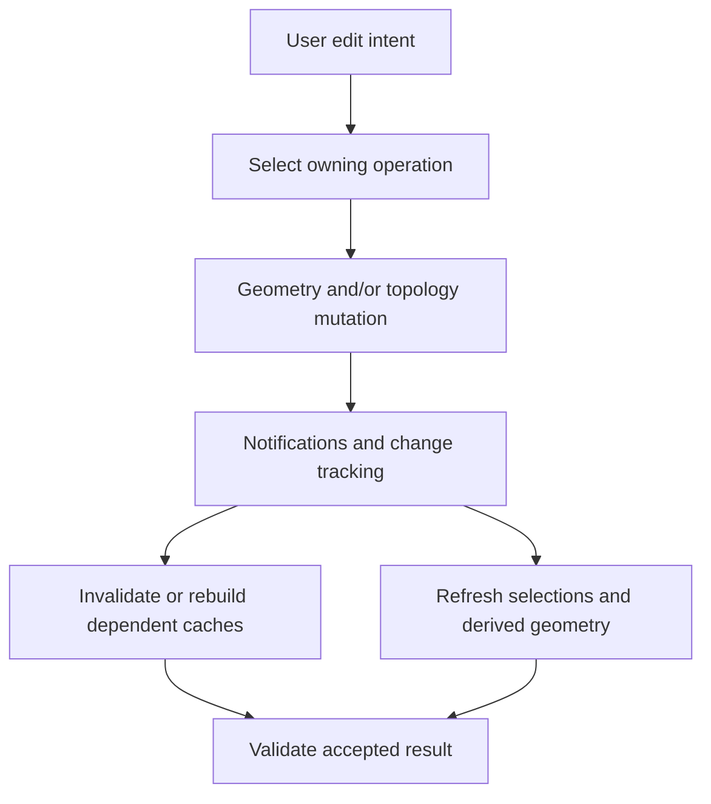

# Editing, feature removal, and dependent state

Source baseline: upstream `3fd5b9548d19aa8c12c29bc9637a96d42a06f8a5`.
This guide describes verified component roles and application-level transaction
patterns. Pseudocode is not an existing SMLib undo/history API.

## 1. Classify the edit before selecting a method

An edit can change placement, representation, geometry, topology, or material
regions. These categories overlap but imply different dependent updates.

| Edit | Potential consequence |
| --- | --- |
| Rigid transform | New positions/orientations; same geometric shape |
| Nonuniform scale | Analytic type or representation may change |
| Knot insertion or degree elevation | Same spline shape, different coefficient storage |
| Control-point movement | Changed support geometry and boundary agreement |
| Face/feature removal | New topology, reconstruction and region classification |
| Boolean or fillet | Combined geometry and topology changes |

“Local” refers to the intended edit region, not a guarantee that only one object
changes. Adjacent faces, trims, caches and selected entity identities may all be
affected. A global transform can preserve topology while a small edge edit can
replace many incidence objects.

The kernel also has an explicit `SmBrep::LocalOperation` for replacing selected
face supports and reconstructing their boundaries through `SmOffsetExecutive`.
See [local operations](local-operations.md) for its actual call path, UV mapping
assumptions, ownership limits, and dimensioned 3D face-edit examples. It rebuilds
the receiving body's face set; it is not a pointer-preserving surface setter.

## 2. Mathematical distinctions

A rigid transform is $\mathbf x'=R\mathbf x+\mathbf t$ with $R^TR=I$.
An affine transform replaces $R$ with a general matrix $A$. A free-form edit
changes the geometric function itself, for example

$$
\Delta\mathbf C(u)=N_{i,p}(u)\Delta\mathbf P_i
$$

for one polynomial B-spline control change. Local basis support limits the
parameter interval influenced by that control, but does not automatically
maintain neighboring face boundaries.

Representation-preserving operations must also be distinguished from
shape-preserving ones. Degree elevation preserves shape but can replace storage
and invalidate raw control-array pointers. A geometric transform can preserve
an object pointer while invalidating cached bounds.

## 3. Public transforms and internal ownership

[SmApiGeneral.h](../../../source/SM_API/inc/SmApiGeneral.h) exposes transform, scale,
translation and rotation calls. Their implementation is in
[SmApiGeneral.cpp](../../../source/SM_API/src/SmApiGeneral.cpp). Inspect the exact
accepted object type and transform convention; do not pass a general affine
matrix where the API expects an axis placement.

Geometry-changing methods notify owners and dependent systems. The common
notification infrastructure is declared in
[SmObject.h](../../../source/SMLib/inc/SmObject.h), with topology tracking in
[SmTrackTopologyChanges.h](../../../source/SMLib/inc/SmTrackTopologyChanges.h).
Updating raw arrays or intrusive links bypasses those responsibilities.



Notifications support consistency; they do not prove every arbitrary support edit
has reconstructed a valid solid. Model-level acceptance remains necessary.

## 4. Feature removal is a reconstruction problem

[SmFeatureExecutive.h](../../../source/SMLib/inc/SmFeatureExecutive.h) describes
`DoDefeature` and reconstruction choices for a base and extracted feature.
Feature-boundary loops carry rebuilding policy, including extending neighboring
surfaces or using information from the complementary BRep where supported.
The implementation is in
[SmFeatureExecutive.cpp](../../../source/SMLib/src/SmFeatureExecutive.cpp).

Deleting the faces of a boss leaves an opening. Removing the feature requires
partitioning the selected region and constructing a replacement boundary that
connects the retained supports. This is not equivalent to deleting face pointers
from a list.


This executive does not establish a complete parametric feature-history engine.
It operates on BRep geometry/topology; a CAD application's persistent feature
graph, dependency expressions and regeneration semantics are separate design work.

## 5. Identity and selection after edits

An edge selected before a boolean may be split into several edges, merged with
another edge, or removed. Pointer identity is not persistent design identity.
Change tracking and copy maps can help establish correspondences, but a single
old entity need not map to exactly one new entity.

For application selections, retain meaningful criteria or operation-provided
mapping information, then reacquire from the result. Do not rely on “edge number
four” across topology-changing operations. If the chosen criterion becomes
ambiguous, report that ambiguity rather than silently selecting a nearby edge.

Borrowed geometry views also need a policy for representation replacement.
The Python binding has specific guards for some such mutations; native callers
must manage lifetimes according to the native owning operation.

## 6. Application transaction pattern

```text
capture user intent and required preservation/undo behavior
copy the accepted model when the operation can destructively fail
resolve current selections on that working model
perform the supported operation and retain diagnostics
validate geometry, topology and application-specific dimensions
publish the working result and update selection mappings
retain or dispose of the previous model according to the application's history
```

This pattern is an application design, not a claim that every SMLib operation is
atomic. Copying has memory and performance cost; use it where the required
recovery semantics justify it. Merely catching an error does not restore the
pre-call object graph.

## 7. CAD scenario: remove a small boss

Identify the boss faces and intended base continuation. Examine whether extending
the neighboring support reconstructs the design or produces a different shape.
Perform the removal on a recoverable working body, then inspect the replacement
face, surrounding edges, material volume, and any eliminated fillets.

Validate the relevant design dimensions rather than assuming fewer faces means
successful defeaturing. Feature removal for analysis simplification may tolerate
a shape change that a manufacturing model must not accept; the kernel call cannot
infer that application requirement.

## 8. Reading and verification scope

Use [NURBS](nurbs.md) for coefficient editing, [deformation](deformation.md) for
spatial maps, [runtime](runtime.md) for ownership/caches, and
[assemblies-attributes](assemblies-attributes.md) for identity propagation.
Source review establishes the named mechanisms; no universal rollback,
persistent naming, or parametric regeneration guarantee is implied.
