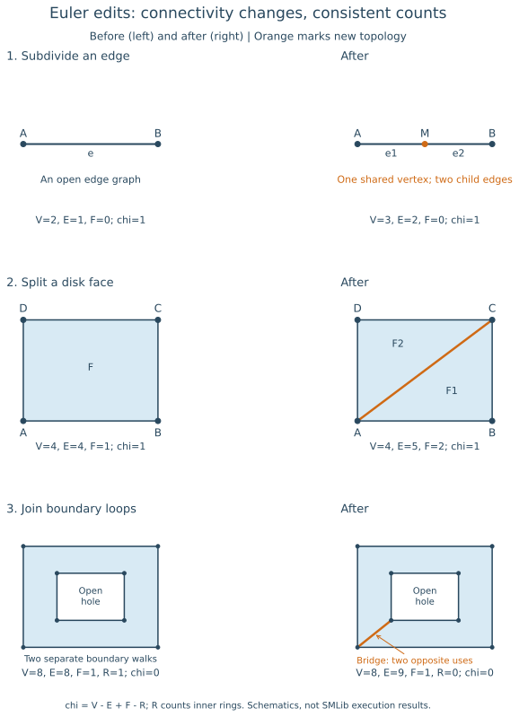
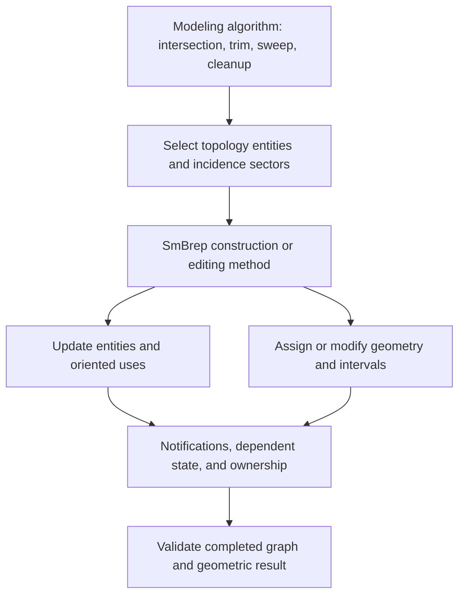
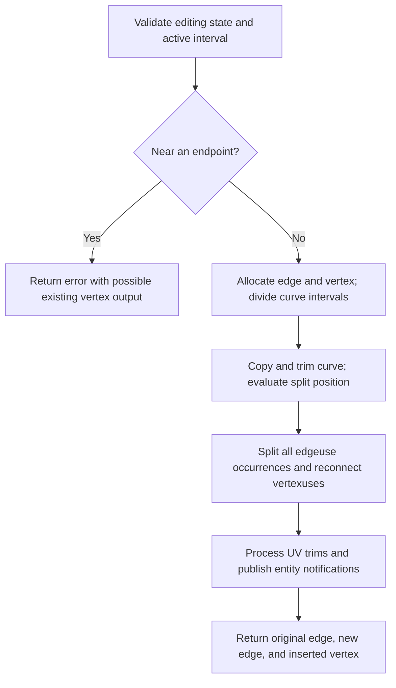

# Euler operations: topology editing in SMLib

Source baseline: upstream `3fd5b9548d19aa8c12c29bc9637a96d42a06f8a5`.
This chapter explains classical Euler operators, then traces representative
SMLib implementations. The illustrations are constructed topology examples,
not captured kernel results. C++ fragments are signature-reviewed, not compiled
or executed for this documentation change.

## 1. Why Euler operations are a separate topic

A modeling command specifies a geometric intention: extrude a profile, intersect
two bodies, split a face, or move a wall. Implementing that intention requires
editing the boundary's connectivity. Euler operations provide small, structured
transformations of vertices, edges, faces, and boundary loops.

For example, inserting a vertex into an edge requires more than allocating a
point. Every occurrence of the edge must be split, its loop neighbors repaired,
and its geometric interval divided. Splitting a face requires a new dividing
edge, two closed boundary walks, and assignment of existing holes to the correct
resulting face.

Euler operations are related to [topology](topology.md), but topology describes
the representation while this chapter describes how that representation changes.
They also sit below [local operations](local-operations.md): replacing a selected
surface requires geometric reconstruction, which in turn performs topology edits.
Euler operations do not compute a missing intersection curve by themselves.

SMLib uses descriptive methods on `SmBrep` rather than a public catalog named
`MEV`, `MEF`, or `KEMR`. Some methods combine several classical cases, and some
also construct or trim geometry. Their contracts must be read individually.

## 2. Euler characteristic and the correct counting convention

### 2.1 Disk faces on a closed surface

For a connected, closed, orientable surface with a valid cell decomposition,

$$
\chi=V-E+F=2-2g.
$$

Here $V$, $E$, and $F$ count vertices, edges, and disk-like faces once; $g$ is
the number of handles. A box boundary has $8-12+6=2$. A torus has $\chi=0$.
For disconnected closed components, add their characteristics.

An ordinary interior edge subdivision has

$$
(\Delta V,\Delta E,\Delta F)=(1,1,0),\qquad\Delta\chi=0.
$$

Drawing a diagonal across a disk face, between existing boundary vertices, has
$(\Delta V,\Delta E,\Delta F)=(0,1,1)$ and also preserves $\chi$.
These edits change the decomposition without changing the represented surface's
topological type.

### 2.2 Faces with holes and surfaces with boundary

A face with an inner boundary is not a disk. If each face is a genus-zero patch
with one outer boundary and $r_i$ inner boundaries, its contribution is
$1-r_i$. Define $R=\sum_i r_i$, counting inner rings rather than all loops.
Then the appropriate accounting is

$$
\chi=V-E+F-R.
$$

For $C$ orientable surface components, total genus $G$, and $B$ boundary
components, this becomes

$$
V-E+F-R=2C-2G-B.
$$

For closed boundaries, $B=0$. A common solid-modeling notation writes
$C=S$ for the number of connected closed shells. Authors who count all face
loops $L$ instead of inner rings use $R=L-F$, giving $V-E+2F-L$ on the left.
Check the convention before comparing formulas. The
[Euler–Poincaré teaching reference](https://pages.mtu.edu/~shene/COURSES/cs3621/NOTES/model/euler.html)
uses a total-loop convention and discusses solid boundary accounting.

These formulas assume a suitable decomposition and correct identifications.
They are not a license to count arbitrary kernel objects. In particular:

- Count an edge once even when it has several oriented uses.
- Count a face once, not once per faceuse or per material side.
- A periodic seam can occur twice in one boundary walk without being two edges.
- A kernel `SmShell` can represent a vertex, wires, or a region-side collection;
  the raw shell-object count is not automatically $C$ in the surface formula.
- Singularities, non-manifold branches, and non-disk periodic patches require
  a suitable topological analysis before applying the simplified expressions.

### 2.3 Necessary accounting, insufficient validation

The equation cannot detect a wrong curve, inverted loop, crossing face,
incorrect mate, or a vertex placed off its incident edges. Even integer counts
with the correct alternating sum can describe an invalid incidence graph.

It is useful to separate three questions:

1. **Accounting:** do entity changes match the intended operator?
2. **Topology:** are ownership, incidence, orientation, and connectivity valid?
3. **Geometry:** do the curves, surfaces, endpoints, and tolerances agree?

Only after all three should an application accept the intended modeling result.

## 3. Classical operators and inverses

The names combine **M**ake and **K**ill with **V**ertex, **E**dge, **F**ace,
**S**hell, and **R**ing. Some references use loop instead of ring, or reorder
the letters. The following names are a useful reading vocabulary; they are not
SMLib function names. See the
[classical operator overview](https://pages.mtu.edu/~shene/COURSES/cs3621/NOTES/model/euler-op.html)
for another notation.

| Pair | Forward operation | Typical forward count change |
| --- | --- | --- |
| MVFS / KVFS | Initialize / remove a degenerate vertex-face-shell seed | $\Delta V=1$, $\Delta F=1$, $\Delta S=1$ in the classical seed convention |
| MEV / KEV | Make / remove an edge and vertex, with specified incidence sectors | $\Delta V=1$, $\Delta E=1$ |
| MEF / KEF | Split / join faces across an edge | $\Delta E=1$, $\Delta F=1$ for a disk-face split |
| MEKR / KEMR | Join / separate two boundary loops using a bridge edge | $\Delta E=1$, $\Delta R=-1$ when joining an outer loop and an inner ring |
| KFMRH / MFKRH | Remove / restore a face while changing ring and handle structure | In the usual same-shell handle case: $\Delta F=-1$, $\Delta R=1$, $\Delta G=1$ |

The last pair's counts describe a topology-changing case, unlike subdivision:
both sides of the closed-surface formula decrease by two. Its actual attachment
and inverse requirements depend on the representation. This is not a claim
that SMLib provides a general `KFMRH` entry point. A classical seed is likewise
an intermediate convention, not a finite-volume solid or a valid display face.
For a concrete implementation of ring bridging and face-to-ring conversion,
see [queddy's operator documentation](https://www.queddy.com/euler-operators).

An inverse requires the correct local configuration. KEF cannot safely remove
an arbitrary sharp edge while retaining either of its two surfaces; doing so
would move boundary loops onto a support where they do not lie. A mathematically
inverse edit also does not restore application attributes, object addresses,
cached data, or editing history automatically.

Modern libraries likewise expose split/join operations with explicit incidence
preconditions and invalidation rules. For comparison, the
[CGAL Euler-operation reference](https://doc.cgal.org/latest/BGL/group__PkgBGLEulerOperations.html)
documents `split_face`, `join_face`, `split_vertex`, and `join_vertex`.
Its halfedge-graph API is not the SMLib radial-use model and should not be copied
as an assumed SMLib contract.

## 4. Visual examples: three different edits



[PNG alternative](../assets/euler/topology_edits.png). Orange marks new topology.
These are planar schematics. A face is shown from one side; the drawings do not
enumerate every faceuse, loopuse, edgeuse, or vertexuse in SMLib.

### Edge subdivision

The boundary segment $A\rightarrow B$ becomes $A\rightarrow M\rightarrow B$.
The opposite boundary occurrence becomes $B\rightarrow M\rightarrow A$.
The point $M$ is one shared topological vertex, not two coincident points.
The illustration counts only the open edge graph, whose characteristic is one.
It does not apply a closed-surface formula to that graph.

### Face split

For a quadrilateral ordered $A,B,C,D$, insert diagonal $AC$. The boundary walks
can become $(A,B,C,A)$ and $(A,C,D,A)$. The shared diagonal is traversed in
opposite directions. The sheet's counts change from $(4,4,1)$ to $(4,5,2)$,
so $\chi=1$ in both states, consistent with a disk with one boundary component.

### Ring bridge

An annular rectangular face has eight vertices, eight edges, one face, and one inner
ring: $8-8+1-1=0$. A bridge between existing outer and inner vertices adds an
edge and combines the two walks into one. It is used twice, in opposite
directions, by that combined walk. Now $8-9+1-0=0$.

The hole has not been filled. The bridge is a change in boundary representation,
with both sides belonging to the same face. Confusing a second edge occurrence
with a second geometric edge gives the wrong counts and the wrong connectivity.

## 5. SMLib architecture and method map



Declarations are in [SmBrep.h](../../../source/SMLib/inc/SmBrep.h); the representative
implementations below are in [SmBrep.cpp](../../../source/SMLib/src/SmBrep.cpp).

| Kernel method | Verified role | Classical relationship and limit |
| --- | --- | --- |
| `MakeShellVertexTopology` | Creates a shell and vertex | Seed-like; does not create the face of classical MVFS |
| `MakeShellVertex` | Also assigns a point position | Geometric shell-vertex seed, not a solid |
| `MakeEdgeVertexTopology` | Adds a wire edge and new vertex from an existing vertex | MEV-like wire construction; no curve is assigned |
| `MakeEdgeTopology` | Connects existing vertices with a wire edge; can combine shells | Connectivity construction; not an automatic face split |
| `MakeWireEdgeVertex` / `MakeWireEdge` | Wire construction with geometric inputs | Higher-level geometry-plus-topology construction |
| `MakeVertexSplitEdge` | Divides an existing edge and its occurrences at a parameter | Edge subdivision, with geometry and trim processing |
| `MakeEdgeInFace` | Locates endpoint sectors and delegates insertion | Can lead to MEF-like or MEKR-like cases |
| `MakeEdgeInFaceWithVU` | Inserts using explicit vertexuses; manages loops/faces and seams | Several cases, not one fixed Euler count change |
| `DeleteEdge` | Removes wire, lamina, or manifold edge topology and geometry | KEF-like when merging compatible adjacent faces; other cases differ |
| `DeleteTopologicalVertex` | Joins two incident edge geometries and removes an intermediate vertex | Restricted inverse of subdivision, not general edge collapse |
| `DeleteVertex` | Removes an isolated shell/loop vertex | Not general KEV on a vertex with incident edges |
| `MakeFaceTopology` / `MakeFace` | Builds face structure from supplied boundary data | Construction routines; not aliases for every classical face operator |

No standalone Euler-operator catalog was found in the stable
[SM_API](../../../source/SM_API/) or [Python bindings](../../../source/SmPyLib/).
The methods discussed here are kernel integration points. A CAD application
using stable wrappers normally reaches topology editing through modeling calls.

SMLib represents incidences explicitly: faceuses refer to shell sides, loopuses
to face boundary walks, edgeuses to edge occurrences, and vertexuses to vertex
incidences. A manifold-looking edge in a picture must not be implemented by
assuming there are exactly two `SmEdgeuse` objects in the kernel. See
[topology](topology.md) for mates, radial links, and orientation conventions.

### Building wire topology from a seed

`MakeEdgeVertexTopology` allocates a vertex, an edge, two vertexuses, and two
edgeuses. It finds the start vertex's shell in the requested region, inserts the
entities in the BRep and incidence lists, and connects the new objects. If the
start was a vertex-only shell, that shell is converted to wire-edge form.
The edge's topological direction runs from the existing vertex to the new one.
This particular wire constructor's two edgeuses do not establish the number
of edgeuses needed by other edge forms.

The method deliberately leaves curve geometry unassigned. Completing a wire
requires consistent point and curve data; use the geometry-aware wire methods
when those inputs are already available. Likewise, connecting the last vertex
back to the first with `MakeEdgeTopology` produces a wire cycle, not a face
with a supporting surface and not a solid. Face construction must assign the
boundary to a face with the necessary oriented uses and geometric support.

When connecting vertices from distinct shells, `MakeEdgeTopology` may combine
their shell contents. A graph edit can therefore change component structure
even when it only allocates one edge. Check actual ownership afterward rather
than retaining shell pointers from before the operation.

## 6. Implementation walkthrough: split an edge

### 6.1 Entry conditions and endpoint policy

`MakeVertexSplitEdge` takes an edge, a curve parameter, and three output
references. It initializes the outputs to null and requires
`m_bEditingEnabled == TRUE`. The parameter must lie in the edge's active interval;
the curve's natural interval alone does not determine the trimmed edge.

The implementation first checks proximity to interval endpoints using a scaled
parameter threshold. For an interior parameter, it also estimates the lengths
of the two prospective segments and compares them with endpoint vertex
tolerances. A short segment can cause the request to be treated as an endpoint
case rather than creating a tiny edge.

In that case the method returns `SM_ERR`, but `rpNewVertex` can refer to the
existing endpoint. Some tolerance-based paths call `SetExact(FALSE)` on that
endpoint. Therefore, failure does not imply all outputs are null or that the
body is unchanged. The introductory source comment uses older tolerance
terminology; the executable behavior is the relevant contract here.

### 6.2 Geometry and orientation

For a proper split at $t_s$, the parameter intervals are

$$
[t_0,t_1]\longrightarrow[t_0,t_s]\cup[t_s,t_1],\qquad
\mathbf p_M=\mathbf C(t_s).
$$

The method retains the original edge, allocates a second edge and a new vertex,
copies the curve, and trims the two curve representations. Assignment of the
lower/upper interval depends on the primary edgeuse orientation. Trimming can
snap an interval boundary to a knot; the code adjusts stored intervals and the
evaluation parameter accordingly.

Do not interpret `rpNewEdge1` as necessarily the lower-parameter segment.
At the successful return it is the original edge object; `rpNewEdge2` is the
new object. Query the returned intervals and orientations when ordering them.

### 6.3 Reconnect all occurrences

The method obtains all original edgeuses and creates corresponding new
edgeuses and vertexuses. It processes paired occurrences, inserts them in the
appropriate boundary order, assigns their owners and orientations, and connects
the new vertex. The two directions of a boundary occurrence need different
neighbor-pointer updates.

It then processes UV trim splitting through `sm_MakeVertexSplitUVTrimCurve`,
adds the new entities to the BRep lists, and emits construction/split
notifications. Existing UV curves need not share the same parameter convention
as the 3D curve; the helper handles that correspondence rather than blindly
using the 3D split parameter everywhere.



This is not an atomic operation. Source comments explicitly disable some
automatic cleanup because allocated objects may already be attached when an
error occurs. Several trim/helper statuses are not propagated at this call
site. These are concrete reasons to use a working copy, capture diagnostics,
and validate the completed result rather than assuming rollback or complete
geometric validation from the status alone.

## 7. Implementation walkthrough: insert an edge in a face

### 7.1 Choose incidence sectors, not just endpoint coordinates

`MakeEdgeInFace` accepts a face, start/end vertices, a 3D curve, an optional UV
curve, an interval, and curve orientation. It calls `SmFace::FindVertexSector`
at both ends. A vertex can have several occurrences around a face, especially
at seams and self-touching boundary configurations. Coordinates and vertex
identity alone do not specify where the new edge belongs in the cyclic order.

After sector selection, it delegates to `MakeEdgeInFaceWithVU`, which receives
the actual vertexuses. For a closed curve, start and end vertices may be the
same. The insertion code can need to find the end sector again after inserting
the start because the local incidence structure has changed.

### 7.2 Same loop versus different loops

| Endpoint situation | Representative implementation behavior |
| --- | --- |
| Same ordinary loop, separating curve | Insert edge, divide loop, usually create a second face; distribute other loops appropriately |
| Different ordinary loops | Connect the loops, remove redundant loop/loopuse objects; no automatic extra face |
| Vertex-loop endpoints | Convert or remove isolated vertex-loop structures as the edge is attached |
| Periodic seam | Follow seam-specific handling; a new loop need not mean a new face |

In the same-loop branch, classification of other loops determines which face
owns each hole or isolated vertex. A correct diagonal split of a polygon is
the simplest case; a trimmed periodic surface is substantially more involved.

The implementation explicitly allows completion of the first seam on an uncut
doubly periodic face to create a loop without creating a face. Its documented
requirements include `SmCrvOnSurf` seams and input intervals already divided at
intersecting vertices. Both seam sides remain on the face, and the orthogonal
seam is needed before full UV validation. Do not apply the disk-face MEF count
rule indiscriminately to this case.

The input curves are consumed by insertion. Existing vertices and the face are
body-owned references. The output edge, loop, and face are not independent
objects for the caller to delete; outputs can legitimately omit a new loop or
face depending on the case. Failure cleanup must follow actual adoption state,
not a blanket rule to delete every input or output pointer.

## 8. Implementation walkthrough: remove and join

### Delete an edge between compatible faces

`DeleteEdge` handles multiple topological forms. Its documented manifold case
moves one face's topology to the other, combines loops, and removes the emptied
face. The supports must be coincident and capable of supporting the transferred
boundaries. `SmSurface::CoverOtherCoincidentSurface` is the source's suggested
geometric compatibility check.

The optional argument selects a surface to preserve, not necessarily the face
object whose address will survive. Removing a box's sharp edge is not this
operation: its incident planes are different and cannot both support the
combined boundary. A fillet or geometric reconstruction is required instead.

### Remove an intermediate vertex

`DeleteTopologicalVertex` requires exactly two incident edges. If no edge to
delete is supplied, it chooses the shorter one using approximate length.
It checks whether the curves can share a combined parameter range; geometric
coincidence alone is insufficient without compatible parameter behavior.

When that simple case is unavailable, the implementation copies and trims
curve representations and attempts a B-spline `JoinWith`, with possible analytic
recognition afterward. That branch relies on B-spline-compatible casts: do not
infer support for arbitrary procedural curve subclasses just from the broad
`SmCurve` base type. This is a constrained shape-preserving cleanup operation,
not unrestricted mesh decimation or contraction of any selected edge.

## 9. Worked CAD workflow: imprint a line across a box face

Take a $20\times12\times8$ box and imprint the segment from
$P=(10,0,8)$ to $Q=(10,12,8)$ on its top face. The objective is to partition
that face while preserving the solid's shape and volume.

1. Identify the top face and the two boundary edges containing $P$ and $Q$ by
   geometry and adjacency, rather than assuming entity-array positions.
2. Determine the corresponding parameters on the active edge intervals.
3. Split both edges using `MakeVertexSplitEdge`. Each split must update the
   occurrences on the neighboring side face as well as the top face.
4. Construct the segment's 3D curve and, if provided, its UV curve on the top
   support. Check endpoint agreement and that the segment remains in the face.
5. Insert it with `MakeEdgeInFace`, using the actual orientation and ownership
   contract. In this ordinary disk case, a new face is expected.
6. Validate the graph, geometry, shell closure, and unchanged bounds/volume;
   reacquire affected selections before publishing the edit.

The expected topology accounting for an initially unsplit box is:

| State | $V$ | $E$ | $F$ | $V-E+F$ |
| --- | ---: | ---: | ---: | ---: |
| Original box | 8 | 12 | 6 | 2 |
| First boundary edge split | 9 | 13 | 6 | 2 |
| Second boundary edge split | 10 | 14 | 6 | 2 |
| Top face divided by inserted edge | 10 | 15 | 7 | 2 |

The reference volume remains $20\cdot12\cdot8=1920$. Each top child has area
$10\cdot12=120$. These values are independent checks of this ideal construction;
the table does not report an executed SMLib test.

The kernel call for one split is shown below. It assumes a trusted working body,
a valid body-owned edge, an interior parameter, and an integration boundary
that will inspect status and output state afterward:

```cpp
// Kernel fragment, not a standalone example or a rollback mechanism.
SmEdge* firstEdge = nullptr;
SmEdge* secondEdge = nullptr;
SmVertex* insertedVertex = nullptr;
SmStatus status;

{
    SmTemporaryChangeValue<SmBoolean> editingEnabled(
        workingBrep->m_bEditingEnabled,
        TRUE);

    status = workingBrep->MakeVertexSplitEdge(
        selectedEdge,
        splitParameter,
        firstEdge,
        secondEdge,
        insertedVertex);
}

// Check status before treating outputs as a completed split.
// An endpoint error can return an existing body-owned vertex.
// Validate the working body before publishing it to the document.
```

`SmTemporaryChangeValue` is defined in
[SmObject.h](../../../source/SMLib/inc/SmObject.h); it restores the editing flag at
scope exit, not the model. Use the [copy-map workflow](local-operations.md#copy-operate-validate-publish)
to translate source selections onto a working copy. A successful inverse edit
does not replace an application undo transaction.

## 10. Validation, failure cases, and practical use

| Check | What it establishes or detects |
| --- | --- |
| Entity deltas and applicable Euler formula | Unexpected construction/deletion, provided the counting assumptions hold |
| `ValidatePointers` reports | Ownership/incidence problems and some geometric/tolerance problems; classify each report |
| `AssertValid` at `SM_LEVEL_2` with `SM_WALK` | Deeper checks on a graph already safe to traverse; coverage remains level/build dependent |
| Endpoint and edge-to-support agreement | Geometric gaps hidden by correct entity counts |
| Loop and faceuse orientation | Reversed traversal or wrong region-side interpretation |
| Shell/manifold form and material queries | Whether the result still represents the intended solid or sheet |
| Volume, area, and bounds | Independent shape expectations for an imprint or simplification |
| Rebuilt UV trims and tessellation | Derived-data consistency and display consequences |

Useful applications include inserting Boolean intersection curves, imprinting
partition lines, subdividing edges at intersection points, seam construction,
and removing redundant subdivisions after compatible faces are joined. Some
of those workflows temporarily contain incomplete topology; validation should
be applied at the appropriate completed boundary, with intermediate assumptions
documented rather than silently treating temporary states as finished solids.

Do not repair a topology error merely by changing entity counts or raising a
tolerance. Identify the first wrong incidence or geometric correspondence.
Record the original model, selected entities, curve intervals, orientation,
tolerances, operation status, and diagnostics. Avoid reusing deleted entity
addresses or treating a surviving address as proof that its dependent geometry
and cached selections remain unchanged.

Continue with [topology](topology.md) for representation,
[intersections](intersections.md) for the curves to insert,
[projection and trimming](projection-trimming.md) for UV correspondence,
[runtime](runtime.md) for ownership and notifications,
and [validation and diagnostics](validation-diagnostics.md) for interpreting
kernel reports. The [illustration generator](../assets/euler/generate_figures.py)
checks the schematic count changes; those checks do not execute SMLib.
