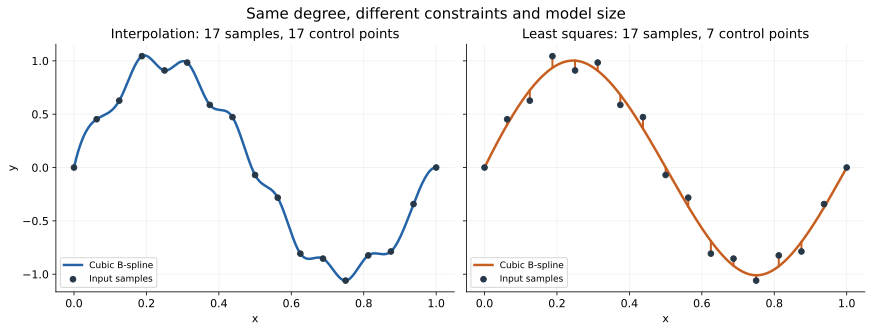
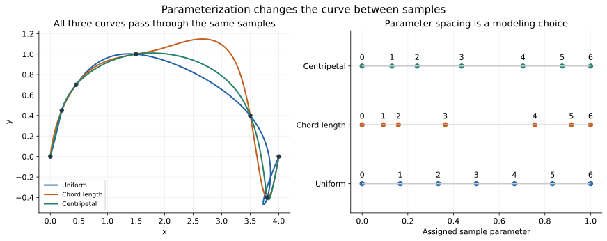
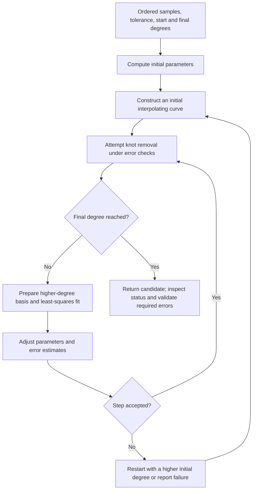
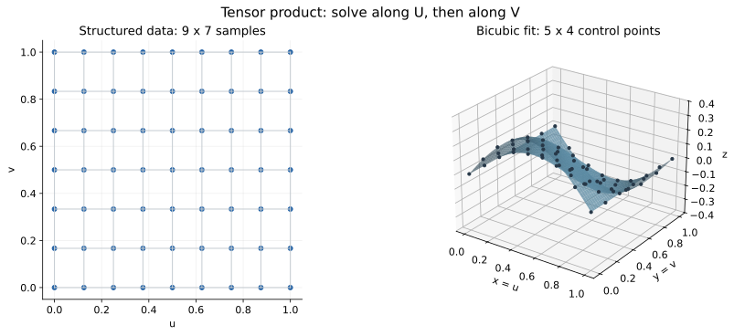
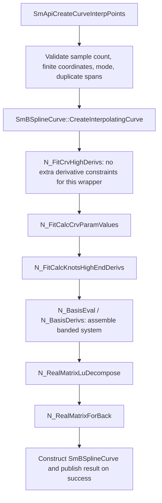
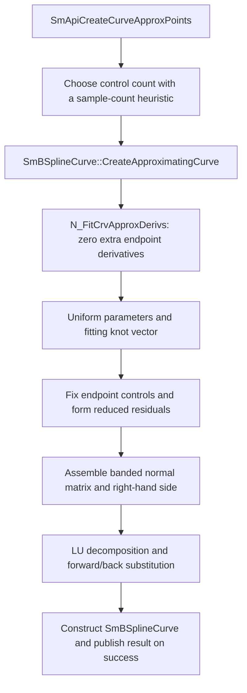
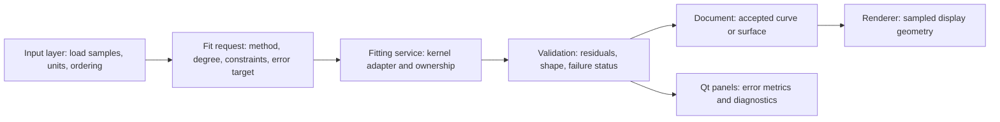

# Interpolation and approximation in SMLib

Interpolation constructs geometry that passes through specified data.
Approximation constructs geometry that fits the data according to an error
criterion, usually with fewer control points or additional smoothness constraints.
Both are central to CAD: sketch curves, loft sections, imported curve repair,
surface reconstruction, and compact representations of measured geometry.

This document develops the mathematics first, then maps it to the current SMLib
C++ implementation. **Theory** describes the mathematical problem; **implementation**
identifies verified source paths. An algorithm available inside the kernel is not
necessarily exposed by the simple `SmApi*` wrappers.

The figures are reproducible educational calculations using NumPy/SciPy and
Matplotlib. They illustrate the mathematics, not output captured from SMLib.
The C++ example is checked against source signatures but was not compiled or run
as part of this documentation change.

## 1. Three different meanings of “create a curve from points”

| Input interpretation | Unknowns | Requirement |
| --- | --- | --- |
| Control-point construction | No fitting solve when the full representation is supplied | Use the points directly as the control polygon |
| Interpolation | Control points | Pass through the data at assigned parameters |
| Approximation | Control points, and sometimes parameters/knots | Minimize an error or meet a tolerance |

Input samples and control points are different objects. In interpolation, the
samples normally become the right-hand side of a linear system; its solution is
the control polygon. In approximation, they become target observations in an
optimization problem. Directly using samples as control points does neither solve.



Both curves above have degree three. The left uses 17 control points to interpolate
17 samples; the right uses seven control points and fixes the two endpoints while
fitting the interior. Short orange segments show residuals at the assigned sample
parameters, not necessarily shortest distances to the curve. Here the fit has
sample RMS error approximately $0.0807$ and maximum sample error approximately
$0.1176$, in the figure's coordinate units.

In SMLib, `SmApiCreateCurve` takes control points,
`SmApiCreateCurveInterpPoints` interpolates samples, and
`SmApiCreateCurveApproxPoints` fits samples. Their similar names do not make them
interchangeable. See [SmApiCurves.h](../../../source/SM_API/inc/SmApiCurves.h) and
[SmApiCurves.cpp](../../../source/SM_API/src/SmApiCurves.cpp).

## 2. Mathematical model and terminology

### 2.1 Degree, order, samples, and controls

Use the following notation throughout:

| Symbol | Meaning |
| --- | --- |
| $\mathbf{Q}_j$, $j=0,\ldots,m$ | Ordered input samples; there are $m+1$ samples |
| $\bar{u}_j$ | Parameter assigned to sample $\mathbf{Q}_j$ |
| $\mathbf{P}_i$, $i=0,\ldots,n$ | Unknown control points; there are $n+1$ controls |
| $p$ | Polynomial degree of each spline span |
| $k=p+1$ | Order; a cubic has degree three and order four |
| $U=(u_0,\ldots,u_{n+p+1})$ | Knot vector, including repeated knots |
| $N_{i,p}(u)$ | B-spline basis function |
| $w_i$ | Rational control-point weight |
| $\varepsilon$ | Requested fitting tolerance, with an explicitly chosen error definition |

The formulas use indices starting at zero. Many `NL_*` functions accept the
**highest index**, not an array length: an argument $n$ can mean $n+1$ items.
Check the function's implementation before converting an array size.

### 2.2 B-spline basis and local support

A nonrational curve is

$$
\mathbf{C}(u)=\sum_{i=0}^{n}N_{i,p}(u)\mathbf{P}_i.
$$

The Cox-de Boor recurrence starts with piecewise constants:

$$
N_{i,0}(u)=
\begin{cases}
1, & u_i\leq u<u_{i+1},\\
0, & \text{otherwise},
\end{cases}
$$

and builds higher degrees:

$$
N_{i,p}(u)=
\frac{u-u_i}{u_{i+p}-u_i}N_{i,p-1}(u)
+\frac{u_{i+p+1}-u}{u_{i+p+1}-u_{i+1}}N_{i+1,p-1}(u).
$$

A term with zero denominator contributes zero. Evaluation at the final endpoint
uses the appropriate endpoint convention rather than applying only the half-open
interval definition literally.

Within a nonzero knot span, at most $p+1$ basis functions contribute. Therefore,
each sample equation touches only a small neighborhood of control points. This
creates sparse/banded systems. It does **not** mean changing one interpolation
sample affects only nearby controls: solving the coupled system can change the
whole curve, even though editing one control point has local support.

Implementation: `N_BasisFindSpan`, `N_BasisEval`, and `N_BasisDerivs` in
[NL_BasisBasic.cpp](../../../source/SMLib/src/NL_BasisBasic.cpp).

### 2.3 Rational curves

A NURBS curve is

$$
\mathbf{C}(u)=
\frac{\sum_{i=0}^{n}N_{i,p}(u)w_i\mathbf{P}_i}
     {\sum_{i=0}^{n}N_{i,p}(u)w_i}
=\sum_{i=0}^{n}R_{i,p}(u)\mathbf{P}_i.
$$

For fixed knots, parameters, and rational weights, the rational basis $R_{i,p}$
is known, and solving for Euclidean control points remains linear. Fitting
weights as additional unknowns generally makes the problem nonlinear. Fitting
homogeneous coordinates is another formulation, but minimizing a homogeneous
residual is not automatically equivalent to minimizing Euclidean distance.

Ordinary Euclidean point-fitting paths can produce nonrational B-splines stored
in NURBS-capable structures. A NURBS result type does not imply that the fitter
optimized rational weights.

## 3. Parameterization: deciding where samples belong on the curve

The data gives spatial positions, but a spline equation also needs parameter
values. An ordered sequence is necessary for ordinary curve fitting: arbitrary
point-cloud ordering can cause the curve to zigzag across the object.

For a normalized domain, a useful family of parameterizations is

$$
d_j=\lVert\mathbf{Q}_j-\mathbf{Q}_{j-1}\rVert,\qquad
\bar{u}_0=0,\qquad
\bar{u}_j=
\frac{\sum_{\ell=1}^{j}d_\ell^{\alpha}}
     {\sum_{\ell=1}^{m}d_\ell^{\alpha}}.
$$

| Method | Definition | Interpretation |
| --- | --- | --- |
| Uniform | $\bar{u}_j=j/m$ | Equal parameter spacing regardless of spatial distance |
| Chord length | $\alpha=1$ | Parameter increments follow the sample polyline's segment lengths |
| Centripetal | $\alpha=1/2$ | Square-root distances moderate large differences in segment length |

Treat uniform spacing as its own rule when distances vanish. The exponent-zero
interpretation is useful only when its distances are nonzero.



All three curves pass through the same samples. Their shapes between the samples
differ. Centripetal spacing can help with uneven sampling, but no parameterization
here universally guarantees the absence of overshoot, loops, or self-intersection.
Chord-length parameters estimate arc-length distribution; they do not produce
an exact arc-length parameterization of the final spline.

**Implementation.** `N_FitCalcCrvParamValues` computes these three alternatives in
[NL_CrvFit.cpp](../../../source/SMLib/src/NL_CrvFit.cpp). The public interpolation wrapper
accepts `SM_CP_UNIFORM`, `SM_CP_CHORDLENGTH`, and `SM_CP_CENTRIPETAL`. It requires
at least four finite points and rejects consecutive coincident points for the
two distance-based modes. Uniform mode permits coincident samples, but that is
not a guarantee of a useful shape.

## 4. Global interpolation

### 4.1 Knot construction

For unconstrained interpolation with one control point per sample, $n=m$.
A common clamped knot vector repeats the first and last parameters $p+1$ times:

$$
u_0=\cdots=u_p=\bar{u}_0,\qquad
u_{n+1}=\cdots=u_{n+p+1}=\bar{u}_n.
$$

Interior knots can be obtained by averaging sample parameters:

$$
u_{j+p}=\frac{1}{p}\sum_{\ell=j}^{j+p-1}\bar{u}_\ell,
\qquad j=1,\ldots,n-p.
$$

This is the construction in `N_FitCrvCalcKnotVector`. Derivative-constrained
variants use adjusted counts and averaging rules; do not reuse this formula
unchanged after adding extra constraints.

Clamping gives endpoint interpolation of the control polygon. It does not impose
the “natural cubic spline” condition of zero second derivative at the ends.

### 4.2 Assemble and solve the interpolation equations

Require

$$
\mathbf{C}(\bar{u}_j)=\mathbf{Q}_j,
\qquad j=0,\ldots,m.
$$

Define the collocation matrix

$$
A_{ji}=N_{i,p}(\bar{u}_j).
$$

Then the control points satisfy

$$
A P=Q.
$$

Here $P$ and $Q$ have three coordinate columns for 3D data. One factorization of
$A$ can serve all three right-hand sides. The system must have appropriate rank;
point count alone does not make arbitrary knots and parameters well conditioned.

**Implementation.** `N_FitCrvInterp` builds a banded matrix, evaluates its rows
with `N_BasisEval`, calls `N_RealMatrixLuDecompose`, and solves with
`N_RealMatrixForBack`. `N_FitCrvHighDerivs` builds the extended system used by the
simple public interpolation route. These are related implementations, not the
same function name.

### 4.3 A small worked example

Consider three 2D samples with parameters $0,1/2,1$:

$$
\mathbf{Q}_0=(0,0),\qquad
\mathbf{Q}_1=(1,1),\qquad
\mathbf{Q}_2=(2,0).
$$

A quadratic Bezier curve is a degree-two B-spline with knot vector
$U=(0,0,0,1,1,1)$. Its interpolation system is

$$
\begin{bmatrix}
1&0&0\\
\tfrac14&\tfrac12&\tfrac14\\
0&0&1
\end{bmatrix}
\begin{bmatrix}
\mathbf{P}_0\\
\mathbf{P}_1\\
\mathbf{P}_2
\end{bmatrix}
=
\begin{bmatrix}
\mathbf{Q}_0\\
\mathbf{Q}_1\\
\mathbf{Q}_2
\end{bmatrix}.
$$

The solution is

$$
\mathbf{P}_0=(0,0),\qquad
\mathbf{P}_1=(1,2),\qquad
\mathbf{P}_2=(2,0).
$$

The middle control point is above the middle sample. Using $(1,1)$ as the middle
control point would instead give midpoint $(1,1/2)$. This illustrates why
interpolation requires solving for controls.

This is a theory example; the simple `SmApiCreateCurveInterpPoints` wrapper is
cubic and requires at least four samples.

### 4.4 Position and derivative constraints

A prescribed derivative adds an equation such as

$$
\mathbf{C}'(\bar{u}_0)
=\sum_i N'_{i,p}(\bar{u}_0)\mathbf{P}_i
=\mathbf{D}_0.
$$

A specified derivative includes magnitude relative to the chosen parameter.
A tangent direction alone does not prescribe that magnitude. Rescaling the
parameter domain changes derivative magnitudes, even when the geometric curve
is unchanged.

SMLib provides endpoint and higher-derivative paths such as
`N_FitCrvHighDerivs`, and point-plus-derivative paths such as
`N_FitCrvFirstDeriv`. Some paths interpret vectors as directions and scale them;
others use derivatives as supplied. Consult the selected signature and branch.

Adding constraints requires sufficient degrees of freedom. In
`N_FitCrvHighDerivs`, the highest control index is the highest sample index plus
the counts of start/end derivative constraints.

## 5. Least-squares approximation

### 5.1 Fixed parameters, knots, degree, and control count

Choose fewer controls than samples, usually $n<m$, and minimize

$$
E(P)=\sum_{j=0}^{m}
\lVert\mathbf{C}(\bar{u}_j)-\mathbf{Q}_j\rVert^2
=\lVert AP-Q\rVert_F^2.
$$

The normal equations are

$$
A^{\mathsf T} A P=A^{\mathsf T}Q.
$$

For positive observation weights $\alpha_j$, use

$$
E(P)=\sum_j\alpha_j\lVert\mathbf{C}(\bar{u}_j)-\mathbf{Q}_j\rVert^2,
\qquad
A^{\mathsf T} W A P=A^{\mathsf T}WQ,
\quad W=\operatorname{diag}(\alpha_j).
$$

These observation weights express confidence or importance. They are distinct
from the rational NURBS weights $w_i$ attached to control points.

**Implementation.** `N_FitCrvApproxKnots` and `N_FitCrvApproxDerivs` explicitly
assemble banded normal matrices and solve them with LU routines. The plain
point-fitting branch fixes endpoint controls to endpoint samples and solves
for the remaining controls. `N_FitCrvApproxLstSq` supplies an interface with
parameter/knot preparation. Source: [NL_CrvFit.cpp](../../../source/SMLib/src/NL_CrvFit.cpp).

### 5.2 Endpoint elimination

For clamped endpoint interpolation, set
$\mathbf{P}_0=\mathbf{Q}_0$ and $\mathbf{P}_n=\mathbf{Q}_m$.
Move these known contributions to the right-hand side:

$$
\mathbf{r}_j=\mathbf{Q}_j
-N_{0,p}(\bar{u}_j)\mathbf{Q}_0
-N_{n,p}(\bar{u}_j)\mathbf{Q}_m.
$$

Solve a reduced least-squares problem for $\mathbf{P}_1,\ldots,\mathbf{P}_{n-1}$.
Derivative constraints can similarly determine additional end controls. This
avoids treating required endpoints as soft observations that the fit may miss.

### 5.3 Conditioning and solver choice

For a full-column-rank matrix, in the 2-norm,

$$
\kappa_2(A^{\mathsf T}A)=\kappa_2(A)^2.
$$

Consequently, normal equations can magnify poor conditioning. Clustered
parameters, unsupported control spans, excessive degree, and large coordinate
offsets can cause numerical difficulties. Data centering/scaling and a suitable
parameterization help, but do not repair an intrinsically rank-deficient system.

For a new fitting implementation, QR or SVD can offer better numerical robustness
than explicitly forming normal equations. This is numerical-design guidance;
the inspected SMLib paths above use normal matrices and LU. The educational
figure generator uses `numpy.linalg.lstsq`, not SMLib's linear solver.

### 5.4 Constraints and fairness

Hard constraints can be expressed as $BP=D$, while the remaining data is fitted:

$$
\min_P\lVert W^{1/2}(AP-Q)\rVert_F^2
\quad\text{subject to}\quad BP=D.
$$

A conceptual fairness extension is

$$
\min_P
\sum_j\alpha_j\lVert\mathbf{C}(\bar{u}_j)-\mathbf{Q}_j\rVert^2
+\lambda\int\lVert\mathbf{C}''(u)\rVert^2\,du.
$$

With fixed basis data, the second term is quadratic in the controls. It penalizes
parameter-space bending and depends on parameterization; it is not automatically
the same as minimizing geometric curvature energy. The value of $\lambda$ also
depends on scaling and the chosen units.

SMLib has weighted/constrained routines, including
`N_FitCrvWeightedLstSqKnots`. Its weight arguments use a specific sign convention:
positive entries denote soft observations, while negative entries mark hard
constraints. Do not feed these signed values directly into the positive-definite
$W$ in the theory equation. The implementation separates their roles.

Some surface refitting routines have smoothing controls, such as the bicubic
smoothing option documented for `N_FitSurfApproxPoints`. The simple public curve
approximation wrapper does not expose the general fairness functional above.
Sources: [NL_CrvFit.h](../../../source/SMLib/inc/NL_CrvFit.h) and
[NL_SrfLstSqFit.h](../../../source/SMLib/inc/NL_SrfLstSqFit.h).

## 6. Fitting to a tolerance and simplifying the representation

### 6.1 Fixed complexity versus fixed error

A fixed-control-count fit answers: “What is the best fit with this representation?”
A tolerance-driven fit answers: “What representation satisfies this error target?”
These are different contracts. Least squares minimizes a sum; it does not by
itself enforce a maximum error at every sample.

Two useful strategies are:

| Strategy | Outline |
| --- | --- |
| Start small and refine | Fit a compact curve, locate excessive residuals, add freedom, refit |
| Start dense and simplify | Build an interpolant or dense fit, remove knots while checking errors |

SMLib contains the second strategy and hybrid variants. Do not assume every
tolerance fitter is a simple loop that inserts a knot at the largest residual.

### 6.2 SMLib's hybrid curve path

`N_FitCrvApprox` starts with an interpolating curve at a chosen starting degree.
It combines knot removal, least-squares fitting with a higher-degree basis,
parameter/error adjustment, and restart logic. The requested final degree and
single/multiple-knot options control the representation it seeks.



This diagram summarizes the stages, not every branch or termination condition.
The implementation has finite degree limits; the restart arrow is not an
unbounded retry policy.

`N_FitCrvApproxKnotsTol` additionally accepts optional endpoint conditions and a
suggested knot vector. Its fairness flag chooses whether to start by approximating
noisy data or by interpolating precise data before knot removal.

Sources: `N_FitCrvApprox`, `N_FitCrvApproxKnotsTol`,
`N_FitCrvApproxKnotsAndTangentsTol`, and `N_FitRemoveKnots` in
[NL_CrvFit.cpp](../../../source/SMLib/src/NL_CrvFit.cpp).

### 6.3 Knot operations versus degree operations

| Operation | Shape effect | Fitting use |
| --- | --- | --- |
| Knot insertion/refinement | Preserves the current shape within roundoff | Add local freedom before a later refit |
| Knot removal | Exact only when possible; otherwise tolerance-controlled approximation | Reduce data size and unnecessary spans |
| Degree elevation | Preserves shape within roundoff | Make bases compatible or prepare a richer representation |
| Degree reduction | Generally approximate | Lower polynomial complexity under an error check |
| Refit controls | Changes shape according to the objective | Improve agreement after changing the basis |

Knot insertion alone does not improve a fit, and degree elevation alone does not
remove noise. The subsequent control-point solve is what changes the shape.
Order changes with degree according to $k=p+1$; the usual terms remain degree
elevation and degree reduction.

For a degree-$p$ spline, an interior knot of multiplicity $r\leq p$ permits
continuity as low as $C^{p-r}$. Multiple knots can preserve corners, but allowing
them and actually detecting design corners are separate decisions. A smooth
single-knot fit can round off a real feature.

See [NL_CrvTool.cpp](../../../source/SMLib/src/NL_CrvTool.cpp),
[NL_Bezier.cpp](../../../source/SMLib/src/NL_Bezier.cpp), and
the [NURBS discussion in the SMLib overview](arch.md).

## 7. Error definitions: what has actually been fitted?

### 7.1 Assigned-parameter residual

For fixed sample parameters,

$$
e_j^{\mathrm{param}}=
\lVert\mathbf{C}(\bar{u}_j)-\mathbf{Q}_j\rVert.
$$

This is the error minimized by the basic linear least-squares problem. Report
both RMS and maximum error:

$$
e_{\mathrm{RMS}}=
\sqrt{\frac{1}{m+1}\sum_{j=0}^{m}e_j^2},
\qquad
e_{\max}=\max_j e_j.
$$

### 7.2 Closest-point residual

The geometric sample distance is

$$
e_j^{\mathrm{geom}}=
\min_{u\in[u_p,u_{n+1}]}
\lVert\mathbf{C}(u)-\mathbf{Q}_j\rVert.
$$

It is no larger than the assigned-parameter residual. An interior stationary
candidate satisfies

$$
\bigl(\mathbf{C}(u)-\mathbf{Q}_j\bigr)\cdot\mathbf{C}'(u)=0.
$$

There can be several candidates; endpoints and singular cases matter. A single
Newton solve does not establish a global closest point. If the fitting process
updates parameters using projection, the overall algorithm becomes iterative,
even though each fixed-parameter control solve is linear.

`SmApiCurveClosestPoint` supports geometric validation; its contract is in
[SmApiQueries.h](../../../source/SM_API/inc/SmApiQueries.h).

### 7.3 Samples do not certify the entire shape

Even an exact interpolant can oscillate between samples. If a reference curve
or surface $\mathcal{R}$ is available, a stronger target is a two-sided distance:

$$
d_H(\mathcal{C},\mathcal{R})=
\max\left\{
\sup_{\mathbf{x}\in\mathcal{C}}\inf_{\mathbf{y}\in\mathcal{R}}\lVert\mathbf{x}-\mathbf{y}\rVert,
\sup_{\mathbf{y}\in\mathcal{R}}\inf_{\mathbf{x}\in\mathcal{C}}\lVert\mathbf{y}-\mathbf{x}\rVert
\right\}.
$$

A finite sample residual is not a certified Hausdorff bound. Dense/adaptive
sampling improves practical inspection but also needs additional reasoning to
become a mathematical guarantee. If only measured points are available, the
unknown surface between those observations cannot be verified from those points
alone.

Keep positional fit error separate from tangent-angle, curvature, closure, and
self-intersection checks. A CAD profile can fit all points and still be unsuitable
for a sweep or a watertight boundary.

## 8. Surface interpolation and approximation

### 8.1 Tensor-product representation

A nonrational B-spline surface is

$$
\mathbf{S}(u,v)=
\sum_{i=0}^{n_u}\sum_{j=0}^{n_v}
N_{i,p}(u)M_{j,q}(v)\mathbf{P}_{ij}.
$$

A rational surface adds weights to the numerator and divides by the weighted
basis sum, as for curves. The following linear equations assume nonrational or
fixed-weight basis data.



The illustrated height surface fits a $9\times7$ grid with a $5\times4$ bicubic
control net. The dark points are samples, not control points. This teaching
example solves unconstrained tensor-product least squares for height; it does
not reproduce all boundary policies of SMLib's surface fitters.

### 8.2 Structured-grid interpolation

Given an ordered grid $\mathbf{Q}_{ab}$, assign shared row/column parameters
$\bar{u}_a$ and $\bar{v}_b$. Define

$$
(A_u)_{ai}=N_{i,p}(\bar{u}_a),\qquad
(A_v)_{bj}=M_{j,q}(\bar{v}_b).
$$

For each coordinate, the interpolation equations are

$$
A_u P A_v^{\mathsf T}=Q.
$$

Exploit separability rather than constructing one enormous dense system:

1. Solve $A_u T=Q$ along one grid direction.
2. Solve $A_v P^{\mathsf T}=T^{\mathsf T}$ along the other.
3. Assemble the surface control net and its U/V knot vectors.

The factorizations can be reused for multiple grid rows/columns and coordinates.
`N_FitSrfToPtsKnots` performs directional interpolation solves using
`N_FitCrvCPtsFromSrfData`. `N_FitCalcSrfParamValues` prepares grid parameterization.
Source: [NL_SrfFit.cpp](../../../source/SMLib/src/NL_SrfFit.cpp).

### 8.3 Structured-grid approximation

With fewer controls, the corresponding objective is

$$
\min_P\lVert A_u P A_v^{\mathsf T}-Q\rVert_F^2.
$$

For complete grids with separable, fixed basis data and the appropriate rank,
directional least-squares solves exploit the same structure. Arbitrary missing
samples, nonseparable observation weights, or coupled constraints can require a
more general system.

SMLib provides `N_FitSrfLstSqApprox` and `N_FitSrfLstSqKnots`. Its tolerance-driven
`N_FitSrfApproxTol` combines grid interpolation, U/V knot removal, higher-degree
least-squares fitting, and parameter/error adjustment. Boundary and cross-tangent
variants have their own contracts.

### 8.4 Scattered points and UV mapping

An unordered cloud does not supply a rectangular grid. First choose a mapping
$(u_a,v_a)$ for each observation. Then assemble one row per point:

$$
A_{a,(i,j)}=N_{i,p}(u_a)M_{j,q}(v_a),\qquad
\min_P\lVert AP-Q\rVert_F^2.
$$

Flatten the pair $(i,j)$ into a control-net index for the solve. The difficult
part is often the mapping: a good fit cannot repair a UV map that folds together
unrelated areas or leaves large parts of the basis unsupported.

SMLib includes mappings based on a best-fit plane, boundary-derived base surfaces,
or projection to an existing surface. Relevant functions include
`N_FitSrfCalcParams`, `N_FitCalcSrfParamsBoundarySrf`, `N_FitRandomPN`, and
`N_FitSurfApproxPoints`. Some paths incorporate normals or boundary derivatives.
Their availability does not turn a general closed-object scan into one automatic
rectangular surface; segmentation into patches may be needed.

Sources: [NL_SrfFit.h](../../../source/SMLib/inc/NL_SrfFit.h),
[NL_SrfLstSqFit.h](../../../source/SMLib/inc/NL_SrfLstSqFit.h), and
[SmBSplineSurfaceNLib.cpp](../../../source/SMLib/src/SmBSplineSurfaceNLib.cpp).

## 9. Actual SMLib code workflows

### 9.1 Public curve interpolation route



The wrapper fixes degree three and dimension three. It defaults to uniform
parameterization. Its result pointer is reset to null before validation and is
valid only on `SM_SUCCESS`.

Do not confuse this call path with the separate
`SmBSplineCurve::InterpolatePoints` method: its open, no-explicit-parameter,
no-tangent branch calls `N_FitCrvInterp`. That method also has explicit-parameter,
tangent, and closed-curve branches.

### 9.2 Public curve approximation route



For $M$ input samples, the current wrapper requests

$$
N_{\mathrm{ctrl}}=
\begin{cases}
4, & M\leq8,\\
\lfloor M/2\rfloor, & 8<M\leq16,\\
\lfloor M/4\rfloor, & M>16.
\end{cases}
$$

This is an implementation heuristic, not a fitting-quality guarantee or a promise
that all small input counts are valid. It is discontinuous at the branch
boundaries. The wrapper uses cubic degree, uniform parameterization, and no
caller-specified tolerance or control count. A CAD UI should not label its output
“within requested tolerance” unless a separate check establishes that claim.

For explicit control count/degree/parameterization, inspect
`SmBSplineCurve::CreateApproximatingCurve`. For a tolerance-oriented kernel entry,
inspect `SmBSplineCurve::ApproximatePoints`; it is a different method with distinct
open/closed and tangent branches. For example, its open tolerance branch calls
`N_FitCrvApproxKnotsAndTangentsTol`.

Sources for both call graphs:
[SmApiCurves.cpp](../../../source/SM_API/src/SmApiCurves.cpp),
[SmBSplineCurveNLib.cpp](../../../source/SMLib/src/SmBSplineCurveNLib.cpp), and
[NL_CrvFit.cpp](../../../source/SMLib/src/NL_CrvFit.cpp).

### 9.3 Surface wrapper behavior

| Entry point | Current route and controls |
| --- | --- |
| `SmApiCreateSurface` | Constructs from a control grid; not a sample-fitting solve |
| `SmApiCreateSurfaceFromOrderedPoints` | Calls `SmBSplineSurface::ApproximatePoints` with cubic U/V degrees and no tolerance |
| `SmBSplineSurface::ApproximatePoints`, no tolerance | Calls `N_FitSrfLstSqApprox` with output control dimensions equal to input grid dimensions |
| Same method, tolerance supplied | Calls `N_FitSrfApproxTol` to seek a reduced representation under its error logic |
| `SmApiCreateSurfaceFromRandomPoints` | Calls `ApproximateRandomPoints` with cubic degrees and wrapper-selected count arguments |

The equal-sized grid route should not be described as guaranteed smoothing merely
because its name contains “Approximate”: in a suitable full-rank setting an
equal-sized system can reproduce the sample data. For the cubic grid route, use
at least four samples in each direction; the wrapper checks the flattened count,
while the kernel also has degree/grid assumptions.

The expected flattened layout is

$$
\operatorname{index}(\mathrm{row},\mathrm{column})
=\mathrm{row}\times N_{\mathrm{columns}}+\mathrm{column}.
$$

Sources: [SmApiSurfaces.cpp](../../../source/SM_API/src/SmApiSurfaces.cpp) and
[SmBSplineSurfaceNLib.cpp](../../../source/SMLib/src/SmBSplineSurfaceNLib.cpp).

## 10. C++ integration example

The following source-level example creates an interpolant and an approximation
of the same samples through the public wrappers. It deliberately does not claim
an approximation tolerance: the second wrapper has no tolerance argument.

```cpp
#include <SmApiCurves.h>
#include <SmApiGeneral.h>
#include <SmCurve.h>
#include <SmTArray.h>
#include <SmVector3d.h>

#include <memory>
#include <stdexcept>
#include <string>

void CheckStatus(SmApiStatus status, const char* operation)
{
    if (status != SM_SUCCESS)
    {
        throw std::runtime_error(
            std::string(operation) + " failed: " + std::to_string(status)
        );
    }
}

int main()
{
    // Initialize once before creating objects in this single-threaded example.
    SmApiCreateContext();

    SmTArray<SmPoint3d> samples;
    samples.Push(SmPoint3d(0.0, 0.0, 0.0));
    samples.Push(SmPoint3d(1.0, 1.2, 0.0));
    samples.Push(SmPoint3d(2.0, 0.8, 0.0));
    samples.Push(SmPoint3d(3.0, 1.5, 0.0));
    samples.Push(SmPoint3d(4.0, 0.9, 0.0));
    samples.Push(SmPoint3d(5.0, 0.0, 0.0));

    SmCurve* interpolatedRaw = nullptr;
    CheckStatus(
        SmApiCreateCurveInterpPoints(samples, interpolatedRaw, SM_CP_CENTRIPETAL),
        "SmApiCreateCurveInterpPoints"
    );
    std::unique_ptr<SmCurve> interpolated(interpolatedRaw);

    SmCurve* approximatedRaw = nullptr;
    CheckStatus(
        SmApiCreateCurveApproxPoints(samples, approximatedRaw),
        "SmApiCreateCurveApproxPoints"
    );
    std::unique_ptr<SmCurve> approximated(approximatedRaw);

    // Measure residuals and inspect shape before committing either curve.
    // Transfer ownership explicitly if the CAD document stores the result.
    return 0;
}
```

Link `SM_API` and `SMLib` with their normal runtime dependencies, and include their
headers. See the [native example build guide](../../../Examples/SM_API/README.md).
Here the newly created curves are caller-owned and the default context remains
alive while they are destroyed. Borrowed BRep edge curves have different ownership;
do not put a borrowed curve into a deleting `unique_ptr`.

For a C++/Qt application, keep responsibilities separate:



Preview tessellation controls display quality; fitting tolerance controls geometric
agreement. They should be separate UI settings. Preserve the original samples and
fit settings so users can recompute the result. Kernel context/cache behavior also
needs consideration before moving modeling work onto worker threads; the diagram
does not imply the same objects/context can be used concurrently.

## 11. Choosing a workflow and validating the result

| Situation | Useful starting point | Validate |
| --- | --- | --- |
| Precise design points | Interpolation with an appropriate parameterization | Sample residuals, overshoot, closure, and tangent behavior |
| Noisy measurements | Compact approximation, with constraints where justified | RMS and maximum residual, outliers, and shape between observations |
| Required end tangency | A fitting path with endpoint derivative/tangent controls | Direction, derivative magnitude when required, and parameter scaling |
| Dense imported curve samples | Tolerance-oriented fitting and knot simplification | Error to the source curve, not only to the chosen samples |
| Ordered measurement grid | Tensor-product surface fit | Row/column order, boundary behavior, UV quality, and normal consistency |
| Unordered surface cloud | Patch segmentation and an appropriate UV map, then fitting | Coverage, folds, unsupported spans, boundaries, and geometric residuals |
| Section curves for lofting | Fit each section, then align orientation and representation | Section accuracy and cross-section correspondence |

A practical acceptance sequence is:

1. Check units, finite coordinates, ordering, duplicate samples, and intended corners.
2. Record degree/order, control count, knot policy, parameterization, and constraints.
3. Check the operation status before reading the result.
4. Compute the selected residual definition, including RMS and maximum.
5. Check between-sample behavior, tangent/curvature quality, closure, and self-intersection as needed.
6. If fitting a boundary, verify compatibility with neighboring geometry before trimming or stitching.
7. Record whether acceptance is sample-based, a practical sampled comparison, or a certified bound.

More control points can reduce residuals while increasing oscillation; higher
degree can increase coupling and conditioning problems. A smaller error at the
measurements does not automatically produce the better CAD curve.

## 12. Source reading map and figure regeneration

| Topic | Source and symbols |
| --- | --- |
| Public curve contracts | [SmApiCurves.h](../../../source/SM_API/inc/SmApiCurves.h) |
| Wrapper defaults and validation | [SmApiCurves.cpp](../../../source/SM_API/src/SmApiCurves.cpp) |
| C++ kernel fitting entry points | [SmBSplineCurve.h](../../../source/SMLib/inc/SmBSplineCurve.h), [SmBSplineCurveNLib.cpp](../../../source/SMLib/src/SmBSplineCurveNLib.cpp) |
| Parameterization and knot averaging | [NL_CrvFit.cpp](../../../source/SMLib/src/NL_CrvFit.cpp): `N_FitCalcCrvParamValues`, `N_FitCrvCalcKnotVector` |
| Interpolation and constrained interpolation | Same file: `N_FitCrvInterp`, `N_FitCrvHighDerivs` |
| Fixed-size least squares | Same file: `N_FitCrvApproxKnots`, `N_FitCrvApproxDerivs` |
| Tolerance-driven approximation | Same file: `N_FitCrvApprox`, `N_FitCrvApproxKnotsTol` |
| Basis evaluation | [NL_BasisBasic.cpp](../../../source/SMLib/src/NL_BasisBasic.cpp) |
| Knot editing and degree changes | [NL_CrvTool.cpp](../../../source/SMLib/src/NL_CrvTool.cpp), [NL_Bezier.cpp](../../../source/SMLib/src/NL_Bezier.cpp) |
| Surface grid interpolation/fitting | [NL_SrfFit.cpp](../../../source/SMLib/src/NL_SrfFit.cpp) |
| Scattered points and constrained surfaces | [NL_SrfLstSqFit.cpp](../../../source/SMLib/src/NL_SrfLstSqFit.cpp) |
| Surface C++ adapter | [SmBSplineSurfaceNLib.cpp](../../../source/SMLib/src/SmBSplineSurfaceNLib.cpp) |

The figure generator is [assets/fitting/generate_figures.py](../assets/fitting/generate_figures.py).
Run it from the repository root:

```powershell
uv run --no-project --with numpy --with scipy --with matplotlib python mydocs/smlib/assets/fitting/generate_figures.py
```

It writes SVG figures for scalable Markdown display and PNG copies for preview.
It runs independent mathematical examples and checks interpolation residuals;
it is not a test of SMLib's fitting routines.
