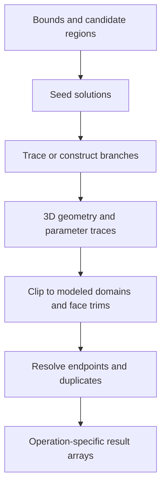

# Intersections: geometric solutions and trimmed results

Source baseline: upstream `3fd5b9548d19aa8c12c29bc9637a96d42a06f8a5`.
The C++ fragment is signature-reviewed, not executed here. Algorithm diagrams
separate a general numerical strategy from the verified SMLib entry points.

## 1. What an intersection result means

An intersection finds common geometry. It can be an isolated point, a curve,
an overlapping curve interval, or a coincident surface region. A BRep boundary
intersection is not a solid intersection: one solid can lie entirely inside
another without their boundaries meeting.

| Inputs | Generic transverse result | Important exceptional case |
| --- | --- | --- |
| Two curves in 3D | Usually empty; isolated crossings when present | Coincident interval |
| Curve and surface | Isolated points | Curve lies on surface |
| Two surfaces | Curves | Tangency, isolated contact, coincident patch |
| Two trimmed faces | Trimmed portions of support intersection | Intersection lies in a hole or outside modeled domain |

The caller must understand both result dimensionality and the wrapper's output
coverage. A function returning only 3D curves cannot express every lower-level
classification directly.

## 2. Equations and local geometry

Curve/surface intersection solves

$$
F(t,u,v)=\mathbf C(t)-\mathbf S(u,v)=\mathbf0.
$$

Its Jacobian has columns $[\mathbf C',-\mathbf S_u,-\mathbf S_v]$. A transverse
crossing provides independent directions; tangency can make this system singular.

Surface/surface intersection solves three equations in four parameters:

$$
\mathbf S_1(u,v)-\mathbf S_2(s,t)=\mathbf0.
$$

A regular solution is locally a curve. Its spatial tangent is parallel to
$\mathbf n_1\times\mathbf n_2$. At tangency that cross product vanishes, so a
simple predictor/corrector trace cannot be assumed to continue unambiguously.

Finding a seed and following a branch are separate tasks. Bounds and subdivision
localize candidates; local solving refines them; tracing/assembly describes the
connected result. Analytic special cases can bypass some generic work.



## 3. SMLib layers and source paths

Start with [SmApiIntersectors.h](../../../source/SM_API/inc/SmApiIntersectors.h) and
[SmApiIntersectors.cpp](../../../source/SM_API/src/SmApiIntersectors.cpp).

| Wrapper | Verified dispatch detail |
| --- | --- |
| `SmApiIntersectCurves` | Calls `GlobalCurveSelfIntersect` when the pointers are identical; otherwise `GlobalCurveIntersect`, using natural intervals |
| `SmApiIntersectSurfaces` | Uses the first surface's context and `GlobalSurfaceIntersect` on natural UV domains |
| `SmApiIntersectFaces` | Calls `FaceIntersect`, retaining trim-aware face semantics |
| `SmApiIntersectBrepWithPlane` | Normalizes the plane normal and calls `CreatePlanarSectionCurves` |

The geometric implementation includes
[SmSurfaceIntersector.cpp](../../../source/SMLib/src/SmSurfaceIntersector.cpp),
[SmAdvSurfaceIntersector.cpp](../../../source/SMLib/src/SmAdvSurfaceIntersector.cpp),
[SmSurfaceTracer.h](../../../source/SMLib/inc/SmSurfaceTracer.h), and
[SmSSIData.h](../../../source/SMLib/inc/SmSSIData.h).
Topology insertion for solid operations belongs to
[SmTopologyIntersector.cpp](../../../source/SMLib/src/SmTopologyIntersector.cpp), not
to the contract of every standalone intersection query.

## 4. Output policy is not uniform

In this revision, `SmApiIntersectCurves` uses a local tolerance of `0.001` and
returns `SM_ERR` when its solution array is empty. It appends requested point and
parameter outputs. The surface wrapper clears its curve array and also converts
an otherwise successful empty result into `SM_ERR`. Do not convert every error
from these functions into a presumed numerical failure—or every error into a
presumed harmless miss. Check the exact path and diagnostic context.

`SmApiIntersectFaces` explicitly cleans accumulated output curves after a later
kernel failure and clears optional point output. Passing arrays that already own
unrelated objects is therefore unsafe unless the entry's contract permits it.
Use fresh output containers and establish ownership of successful curve results.

The curve/surface helper optionally filters by a face's trim loops and suppresses
duplicate results from shared boundaries. Its overlap filtering uses a UV
midpoint classification in the inspected path. Such implementation details are
more precise than promising that every possible overlap is globally partitioned
at every trim event.

## 5. A small native usage fragment

For two known crossing curves, request both geometric and parameter outputs:

```cpp
#include "SmApiIntersectors.h"

SmApiStatus CollectCrossings(SmCurve* a, SmCurve* b)
{
    SmTArray<SmPoint3d> points;
    SmTArray<double> parametersA;
    SmTArray<double> parametersB;
    SmApiStatus status = SmApiIntersectCurves(
        a, b, &points, &parametersA, &parametersB);
    if (status != SM_SUCCESS)
    {
        return status;
    }
    // Compare evaluated positions at corresponding parameters before use.
    return SM_SUCCESS;
}
```

This is a signature example, not a complete overlap-interval consumer. The
wrapper extracts solution start parameters into its simple arrays; use the
appropriate lower-level representation when interval classifications matter.

For a returned point pair, a useful independent residual is

$$
e_i=\|\mathbf C_1(t_i)-\mathbf C_2(s_i)\|.
$$

Also verify the parameters lie in the intended modeled intervals. Natural
support domains can be larger than the application-visible edge domains.

## 6. Degeneracies and robustness

Near tangency, branches can approach closer than the acceptance tolerance.
Periodic seams create parameter duplicates; poles create singular coordinates;
coincident faces create a higher-dimensional relationship. These cases should
not be forced into the “one point per crossing” picture.

Keep 3D and UV evidence paired. A smooth 3D branch can cross a UV seam, requiring
multiple parameter pieces. A gap in UV coordinates may be an expected periodic
jump rather than a physical gap. See [projection-trimming.md](projection-trimming.md).

If an expected branch is missing, inspect candidate pruning, seed generation,
local convergence, branch continuation, trim clipping, and deduplication in
that order. Changing the final display sampling cannot recover a discarded
geometric branch.

## 7. CAD scenario and checks

Intersect a plane with a cylinder to obtain a section, then restrict the cylinder
to a face with a hole in parameter space. The support intersection and face
intersection can legitimately differ. Add a tangent plane and a coincident
planar-face case to expose result-dimensionality assumptions.

Check geometric residual, endpoint matching, trim membership, component count
under the intended case, and whether inputs survive unchanged under the chosen
query contract. For interference decisions, combine boundary evidence with
classification; use [queries](queries.md) and [booleans](booleans.md) for the
solid interpretation. Source review here does not establish fresh runtime
coverage of every degeneracy.
