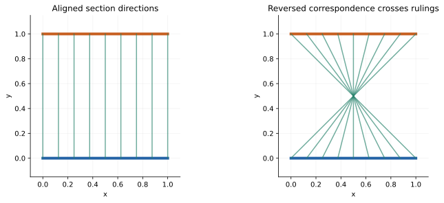
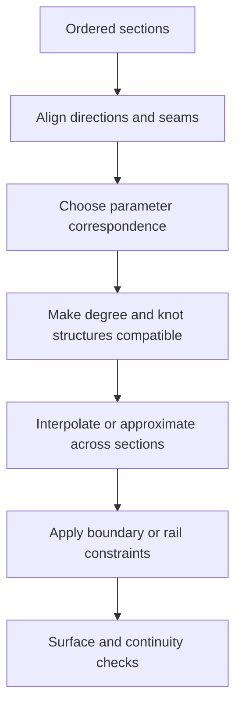
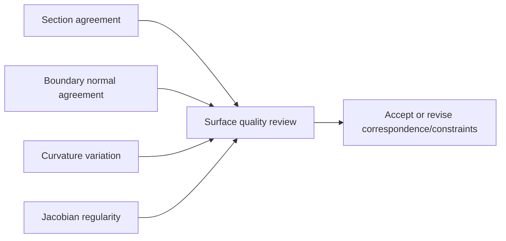

# Lofting, skinning, ruled surfaces, and boundary patches

Source baseline: upstream `3fd5b9548d19aa8c12c29bc9637a96d42a06f8a5`.
Theory examples explain the construction problem. Native calls are traced to
source but have not been executed as part of this guide.

## 1. Sections specify correspondence as well as shape

A loft connects a sequence of cross-sections. Two visually correct sections can
produce a twisted surface if their directions, seams, or parameter correspondence
do not agree. Matching a section's point set is weaker than matching which points
should connect between neighboring sections.

A ruled surface is the simplest two-section construction:

$$
\mathbf S(u,v)=(1-v)\mathbf C_0(u)+v\mathbf C_1(u),\qquad0\leq v\leq1.
$$

The straight rulings connect **equal parameter values**. Reversing one curve
changes the surface even though it leaves that curve's shape unchanged. For
rational representations, the actual construction must also reconcile weights
and homogeneous data; the Euclidean formula does not justify naive coefficient
interpolation in every rational implementation.

## 2. Compatibility before interpolation



The planar ruled-strip illustration shows a correspondence failure without any
change to the two section point sets. It is not output from the skin constructor.

Spline sections may differ in degree, knot vector, control count, domain and
orientation. Degree elevation and knot refinement can make compatible
representations without changing the section shapes. Reparameterization aligns
the chosen correspondence; it is not automatically determined by compatibility.



For compatible polynomial sections with controls $\mathbf P_{i,j}$, lofting can
solve a second spline problem in the section direction:

$$
\mathbf S(u,v)=\sum_i\sum_kN_{i,p}(u)M_{k,q}(v)\mathbf Q_{i,k},
$$

$$
\sum_kM_{k,q}(v_j)\mathbf Q_{i,k}=\mathbf P_{i,j}.
$$

This exposes the relationship with [fitting.md](fitting.md): parameter choice and
conditioning matter in the loft direction too.

## 3. Actual skin wrapper

`SmApiCreateSkin` in [SmApiSurfaces.cpp](../../../source/SM_API/src/SmApiSurfaces.cpp)
requires at least two profiles. It calls `SmBSplineSurface::CreateSkinnedSurface`
with synchronization disabled, `SM_SP_U`, zero approximation tolerance for
interpolation, no rails, and temporary derivative-surface outputs.

The wrapper deletes both derivative-surface outputs after the call and publishes
the principal surface only when status and pointer are valid. These fixed choices
are part of the simple wrapper's behavior, not all the controls available in the
kernel constructor.

The `SM_SP_U` argument determines the section-direction convention used by that
constructor. Read [SmBSplineSurface.h](../../../source/SMLib/inc/SmBSplineSurface.h)
when using lower-level options; do not assume U means “around the profile” in
every surface creation API.

## 4. Ruled construction and boundary patches

`SmApiCreateRuledSurface` dispatches to `SmBSplineSurface::CreateRuledSurface`
with `SM_SP_UNKNOWN` and returns a standalone support surface. It does not
automatically make a solid from the two input sections.

For four compatible boundary curves, a classical transfinite blend illustrates
the boundary-patch idea:

$$
\mathbf S(u,v)=\mathbf L_u(u,v)+\mathbf L_v(u,v)-\mathbf B(u,v),
$$

where the two ruled blends interpolate opposite boundary pairs and the bilinear
corner blend removes double counting. This is background theory, not an assertion
that every SMLib patch constructor uses this exact Coons formula.

Boundary compatibility requires matching corners. Tangent or curvature constraints
add cross-boundary derivative information; they cannot be inferred from boundary
positions alone.

### Kernel Coons and N-sided paths

The concrete implementations are in
[SmBSplineSurfaceNLib.cpp](../../../source/SMLib/src/SmBSplineSurfaceNLib.cpp).
`CreateCoonsPatch` expects four boundary curves; the implementation reads them
as **left, right, bottom, top**, not as one arbitrary cyclic traversal. Its
bilinear-blending branch calls `N_CreateCoonsSrf` and ignores derivative curves.
The bicubic-blending branch requires four cross-tangent functions and calls
`sm_CreateCoonsSrf` with the boundary-deviation tolerance. The resulting numerical
surface is copied into a context-owned `SmBSplineSurface`. A reported warning
from the bicubic routine is emitted as a debug warning rather than converted
into a failed result by this layer.

Here “bilinear” describes the blending construction; curved spline boundaries
do not become four straight edges. The patch can interpolate curved boundaries
and still fail an intended interior regularity or fairness criterion.

`CreateNSidedPatch` accepts consecutive, consistently directed, non-rational
boundary curves and compatible cross-derivative curves. It delegates to
`N_FillNSidedHole` and appends a collection of surfaces, one for each boundary
curve, rather than returning one arbitrary-topology tensor-product surface.
The angular tolerance at this entry is in degrees. An optional center point
and normal constrain the center tangent plane; the supplied normal is normalized
in place when both pointers are provided.

At this C++ entry the implementation indexes the derivative array once per
boundary. Supply a matching-size array with null entries for unspecified
derivatives; an empty derivative array is not supported by that access pattern,
despite the underlying numerical routine's optional-derivative description.
These kernel-level preconditions deserve explicit application validation.

| Constructor | Coverage and output | API boundary |
| --- | --- | --- |
| Ruled surface | Two-section correspondence; one support | Simple SM_API wrapper |
| Skin | Section interpolation and fixed wrapper choices | Simple wrapper omits rails and advanced controls |
| Coons patch | Four sides, optional cross-tangent construction | Kernel constructor described here |
| N-sided patch | Boundary interpolation with cross-derivative approximation; multiple supports | Kernel constructor with non-rational input restrictions |

Patch surfaces still require face topology and joining if they are to close a
hole in an existing solid. Producing neighboring surfaces is not proof that
all requested boundary and interior continuity conditions hold.

## 5. Rails, continuity, and fairness

A rail can impose additional correspondence or shape constraints. It can also
make the problem inconsistent if it does not meet the sections as required.
Derivative constraints may improve a join while producing oscillation elsewhere.
Interpolation through every section is not equivalent to a fair surface.

Useful diagnostics include section agreement, normal continuity, curvature
variation, and control-net behavior. A smoothness objective might penalize
second derivatives, but the existence of fitting functions does not establish
one universal SMLib fairing optimizer. Name an optimization method only when
the traced implementation actually uses it.



## 6. CAD scenario: a round-to-rectangular duct

Prepare sections with consistent traversal direction and meaningful landmarks.
Place the circular seam and rectangle corners deliberately; arbitrary seams can
create apparent twist. Choose intermediate sections to control the transition,
then inspect whether the support folds or its Jacobian becomes singular.

After constructing the side surface, create the required face topology, caps,
and material region. A valid lofted support is not yet a watertight duct solid.
For a hollow duct, offset/shell feasibility is another question and may fail at
tight curvature even if the outer loft is regular.

## 7. Code workflow and verification

```text
validate profile pointers, order, closure and intended correspondence
select ruled, skin, or supported patch construction
check status and output ownership
sample each required section at its assigned surface parameter
inspect boundary derivatives and regularity away from intended singularities
construct/sew/cap topology only when the desired result requires a body
```

For section error, compare $\mathbf S(u,v_j)$ against the intended section
using the actual parameter correspondence. Nearest-point agreement alone can
hide a reversed parameter direction. Test a straight two-section case first,
then a deliberately reversed section and a periodic seam case.

Source links: [SmApiSurfaces.h](../../../source/SM_API/inc/SmApiSurfaces.h),
[SmBSplineSurface.cpp](../../../source/SMLib/src/SmBSplineSurface.cpp), and
[SmBSplineSurfaceNLib.cpp](../../../source/SMLib/src/SmBSplineSurfaceNLib.cpp).
Related guides: [NURBS](nurbs.md), [sweeps](primitives-sweeps.md), and
[healing/stitching](healing-stitching.md).
