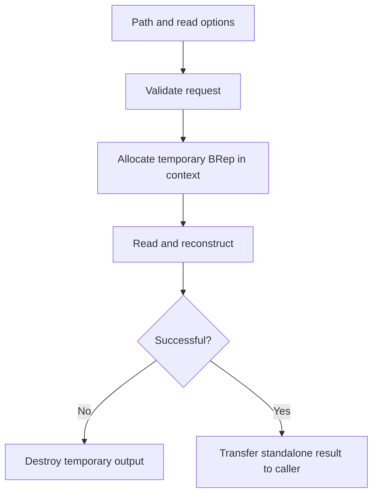

# Native SMLib persistence and part-container I/O

Source baseline: upstream `3fd5b9548d19aa8c12c29bc9637a96d42a06f8a5`.
The C++ fragment is signature-reviewed only. No file round trip was executed
for this documentation change.

## 1. Persistence is reconstruction, not pointer copying

Runtime BReps contain pointers, circular lists, contexts, paired uses, caches,
and geometry ownership. A file cannot preserve their process addresses. Loading
must reconstruct a graph with valid reciprocal relationships and associated
geometry under a live context.

Native SMLib files, flattened transfer records, USD BrepArrays, and polygon meshes
are separate representations. Do not infer that every file format serializes
the same fields or uses the same intermediate structure.

## 2. Public native API

[SmApiImportExport.h](../../../source/SM_API/inc/SmApiImportExport.h) declares:

| Entry | Contract |
| --- | --- |
| `SmApiReadBrepFromFile` | Read one native BRep; ASCII/binary selection and optional UV-trim rebuilding; caller owns successful result |
| `SmApiWriteBrepToFile` | Write one BRep with the selected native encoding |
| `SmApiReadPartFromFile` | Read curves, surfaces, Boolean-tree node data and BReps into initially empty arrays |

The implementation is compact enough to follow directly in
[SmApiImportExport.cpp](../../../source/SM_API/src/SmApiImportExport.cpp). Its cleanup
and output publication are important application examples.

## 3. Single-BRep read workflow

The read wrapper sets the output null and rejects a null path. It obtains the
default context, creates a BRep under `SmObjDelete`, and calls `ReadFromFile`
with the selected encoding and UV-trim option. On failure, the cleanup owner
destroys the temporary object. On success, it releases that cleanup and publishes
the result pointer.



```cpp
#include "SmApiImportExport.h"

SmApiStatus LoadNativeModel(const TCHAR* path, SmBrep*& result)
{
    result = nullptr;
    return SmApiReadBrepFromFile(path, FALSE, TRUE, result);
}
```

This example selects binary input and requests rebuilt UV trims. Use options
appropriate to the actual file and application. The caller must initialize the
API context as required and establish ownership after success.

## 4. Part-container publication and cleanup

The part reader rejects nonempty output arrays. It creates local arrays for
curves, surfaces, Boolean-tree node values and BReps, with cleanup owners for
the object arrays. It calls `SmBrepData::ReadPartFromFile`, then appends to the
caller's arrays only after the read succeeds.

If an append fails, it resets the caller's arrays and returns an allocation
error while the local cleanup owners still own the objects. Once publication
succeeds, it releases those cleanup owners. This establishes a much more useful
contract than merely “returns several pointers.”

Do not treat Boolean-tree node values as curve/face indices without consulting
the part-format contract. A part can contain standalone geometry in addition
to closed solids.

## 5. Runtime data, streams, and version policy

[SmDatabaseIO.h](../../../source/SMLib/inc/SmDatabaseIO.h) defines stream-oriented
reading/writing abstractions. [SmBrepData.h](../../../source/SMLib/inc/SmBrepData.h)
describes flattened topology/geometry data used in reconstruction and exchange
paths. The consuming read/write implementation determines actual encoding,
version interpretation, and optional normalization.

Healer-version information can influence native load behavior. Requesting UV
trim rebuilding is also a derived-data transformation, not proof that all geometry
and topology were otherwise left byte-identical. Record load options when
investigating a round-trip difference.

## 6. What a round-trip check should compare

A byte-for-byte file comparison is often too strict, while matching a bounding
box is far too weak. Useful invariants include intended topology class, material
regions, representative curve/surface evaluations, modeled intervals, orientation,
and application dimensions.

For a known transform-free round trip, compare geometric points under preserved
parameter conventions:

$$
e_i=\|\mathbf C_{\rm before}(t_i)-\mathbf C_{\rm after}(t_i)\|.
$$

If representation or parameterization changes, establish correspondence first.
Also inspect attributes and derived-data options when those matter. A paired
export/import bug can cancel itself, so a successful round trip alone does not
prove conformance of either direction.

## 7. CAD scenario: reproducible bug artifact

Save the minimal input before a consuming boolean or mutating repair. Record the
source revision, operation arguments, units, and import options beside the file.
On reload, verify the expected topology class and key dimensions before running
the failing operation. Otherwise the reproduction may actually be testing an
import normalization difference.

A native model file is useful for kernel reproduction, but a complete CAD
application document may also need feature history, selections, units, assembly
constraints and UI state. Do not assume native BRep persistence stores all of
that application data.

## 8. Safety and validation boundary

Validate serialized counts/types/indices before constructing or traversing
runtime links. Runtime `AssertValid` is not a replacement for input parsing.
Use [validation-diagnostics.md](validation-diagnostics.md) after successful
reconstruction and [healing-stitching.md](healing-stitching.md) to interpret
normalization. USD-specific contracts belong to [usd-interchange.md](usd-interchange.md).
