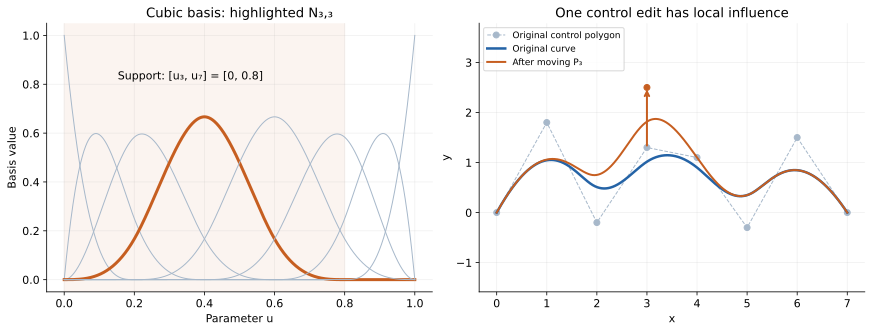
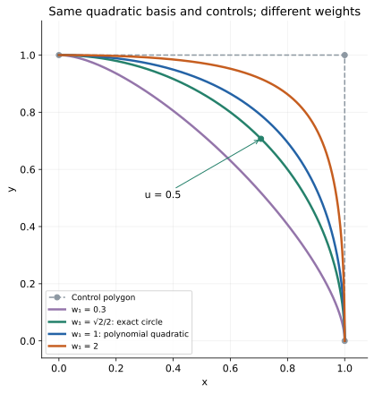
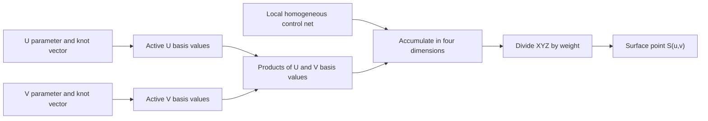
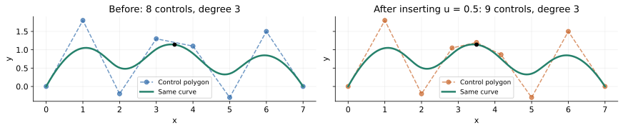
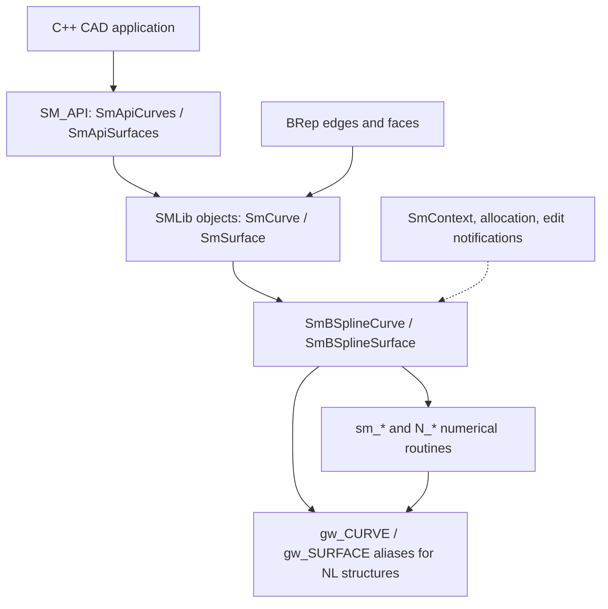
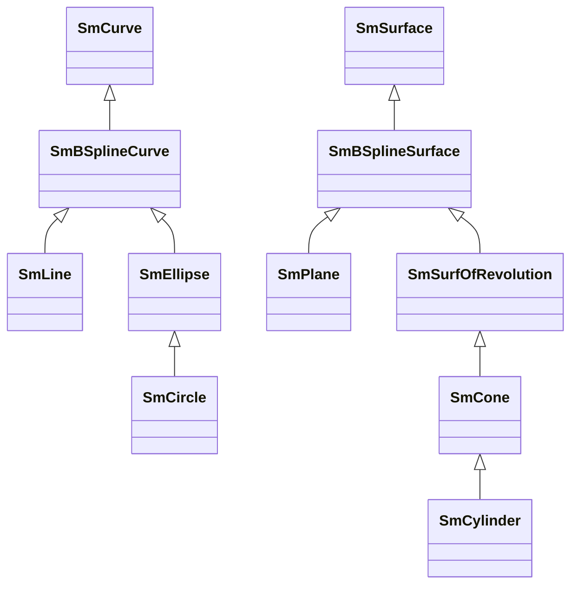
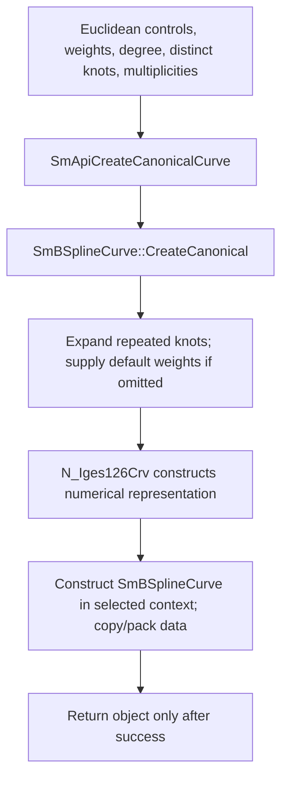
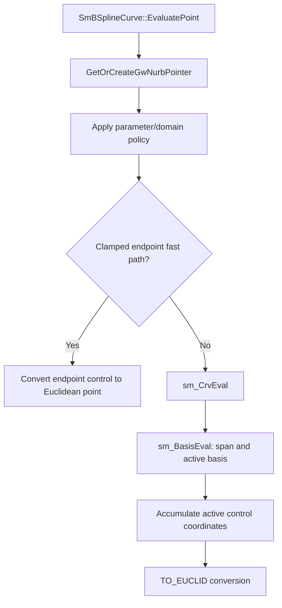
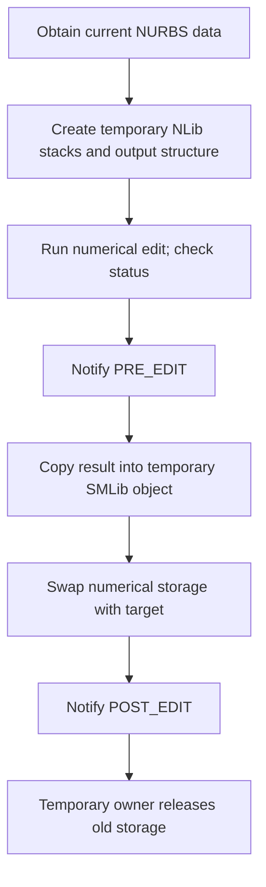
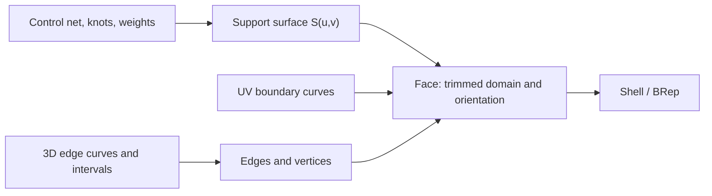

# B-splines and NURBS: theory and SMLib implementation

B-splines describe a curve using a degree, a knot vector, and a control polygon.
NURBS add weights, allowing the same representation to describe both free-form
shapes and exact conics such as circles and ellipses. Tensor products extend the
construction to surfaces.

This document starts with the mathematics, then follows the corresponding data
structures and algorithms in this repository. The implementation discussion is
about the checked-in SMLib code; a mathematical operation is not necessarily
available through every `SmApi*` wrapper.

The three plotted illustrations are independent NumPy/SciPy calculations, not
captured SMLib output. Their [generator](../assets/nurbs/generate_figures.py) checks
the mathematical properties shown. The C++ example below was checked against
source signatures but has not been compiled or executed for this document.

Related reading: [SMLib architecture](arch.md) and
[interpolation and approximation](fitting.md).

## 1. From Bézier curves to NURBS

### 1.1 Why a control polygon?

A parametric curve maps a scalar parameter to a point:

$$
\mathbf{C}(u)=(x(u),y(u),z(u)).
$$

CAD needs a representation that can be evaluated, differentiated, transformed,
subdivided, and edited. A weighted combination of control points provides these
operations without storing a dense list of points on the curve.

A degree-$p$ Bézier curve uses $p+1$ control points and Bernstein polynomials:

$$
\mathbf{B}(t)=\sum_{i=0}^{p} b_{i,p}(t)\mathbf{P}_i,
\qquad
b_{i,p}(t)=\binom{p}{i}t^i(1-t)^{p-i},
\quad 0\leq t\leq 1.
$$

Its endpoints are $\mathbf{P}_0$ and $\mathbf{P}_p$. Interior controls usually
do not lie on the curve. Moving one control affects the whole Bézier segment.
A long, complicated shape is therefore better represented by multiple pieces
than by one very high-degree polynomial.

### 1.2 What B-splines add

A B-spline joins polynomial pieces using a knot vector. It separates two choices:

- **Degree:** polynomial complexity within each nonzero knot span.
- **Number and placement of knots:** how many pieces there are and where their
  parameter intervals lie.

Adding pieces does not require raising the degree. The basis functions have local
support, so a control-point edit affects only a limited parameter interval.

### 1.3 What “non-uniform rational B-spline” means

| Term | Meaning |
| --- | --- |
| B-spline | A curve expressed in a piecewise-polynomial basis |
| Non-uniform | Knot intervals are allowed to have unequal lengths; repeated knots are also allowed |
| Rational | The coordinates are ratios of polynomial expressions |
| NURBS | A rational B-spline representation, including polynomial B-splines as a special case |

“Non-uniform” describes the available representation; a particular NURBS may
still use uniformly spaced distinct knots. Equal nonzero weights cancel from
the rational formula and produce an ordinary polynomial B-spline.

## 2. Degree, order, knots, and control points

Use these conventions consistently:

| Symbol | Meaning |
| --- | --- |
| $p$ | Degree |
| $k=p+1$ | Order |
| $\mathbf{P}_0,\ldots,\mathbf{P}_n$ | $n+1$ Euclidean control points |
| $U=(u_0,\ldots,u_m)$ | Expanded, nondecreasing knot vector |
| $w_0,\ldots,w_n$ | Weights |
| $m=n+p+1$ | Relation between highest indices |
| $m+1=n+p+2$ | Total number of expanded knots |

Equivalently:

$$
\text{knot count}=\text{control-point count}+\text{degree}+1.
$$

A cubic curve has degree three and order four. **Degree elevation** and
**degree reduction** are standard names; the order changes by the same amount.
Use the degree value when an SMLib argument is named `lDegree`.

### 2.1 Knots live in parameter space

Knots are scalar parameter values, not coordinates or sampled curve points.
The standard active domain is

$$
u\in[u_p,u_{n+1}].
$$

A nonzero interval $[u_j,u_{j+1})$ is a knot span. Repeated equal knots do not
create extra positive-length spans.

For example, five controls and degree two require eight expanded knots:

$$
U=(0,0,0,\tfrac13,\tfrac23,1,1,1).
$$

The distinct values are $(0,\tfrac13,\tfrac23,1)$ and their multiplicities are
$(3,1,1,3)$. SMLib's canonical creation API takes those **distinct values plus
multiplicities**; its low-level evaluator stores the expanded vector.

### 2.2 Clamping and continuity

For a clamped degree-$p$ curve, each end knot appears $p+1$ times. The curve then
interpolates its first and last controls. The generic internal-knot continuity
for multiplicity $r\leq p$ is

$$
C^{p-r}.
$$

For a cubic curve, a simple internal knot permits $C^2$ continuity, a double knot
$C^1$, and a triple knot $C^0$. These are guarantees of the spline space; a
particular curve can be smoother. Inserting a knot into an existing smooth curve
does not create a kink when the controls are updated correctly.

$C^1$ continuity matches parameter derivatives. Geometric $G^1$ continuity
matches tangent directions, allowing different speeds on the two sides. A
visually smooth join can be $G^1$ without being $C^1$.

### 2.3 Closed, periodic, and clamped are different properties

A curve is closed if its endpoint positions coincide. A periodic construction
also matches the required behavior across the parameter seam, using compatible
controls and knots. Repeating the first point at the end does not by itself
guarantee a smooth periodic join.

Clamping describes end-knot multiplicity. A closed curve can have a clamped
representation. Do not infer periodicity from the endpoint positions, or assume
that arbitrary unclamped textbook knot vectors satisfy a particular constructor's
contract. `SmBSplineCurve` documents clamped ends and internal multiplicities no
greater than the degree in [its header](../../../source/SMLib/inc/SmBSplineCurve.h).

## 3. B-spline basis and local control

The Cox–de Boor recurrence starts with piecewise constants:

$$
N_{i,0}(u)=
\begin{cases}
1,&u_i\leq u<u_{i+1},\\
0,&\text{otherwise}.
\end{cases}
$$

Higher-degree basis functions are

$$
N_{i,p}(u)=
\frac{u-u_i}{u_{i+p}-u_i}N_{i,p-1}(u)
+\frac{u_{i+p+1}-u}{u_{i+p+1}-u_{i+1}}N_{i+1,p-1}(u).
$$

A term with a zero denominator contributes zero. At the final domain endpoint,
use the appropriate endpoint convention or left limit rather than treating every
half-open degree-zero interval as zero.

The polynomial B-spline curve is

$$
\mathbf{C}(u)=\sum_{i=0}^{n}N_{i,p}(u)\mathbf{P}_i.
$$

Inside the valid domain, the basis is nonnegative and sums to one. Each function
has support within $[u_i,u_{i+p+1}]$, and at most $p+1$ are nonzero inside a knot
span. Consequently, the curve lies in the convex hull of its active controls.
Moving a control $\mathbf{P}_i$ by $\Delta\mathbf{P}_i$ changes the curve by

$$
\Delta\mathbf{C}(u)=N_{i,p}(u)\Delta\mathbf{P}_i.
$$



The highlighted basis has support $[0,0.8]$. The control edit has no effect at
parameters above $0.8$; this is locality in **parameter space**, not a fixed-radius
region in world coordinates.

Affine transforms commute with evaluation: translating, rotating, or scaling all
controls transforms the entire curve. This is one reason the representation fits
CAD modeling operations well.

## 4. Rational weights and homogeneous coordinates

### 4.1 NURBS curve equation

Define rational basis functions and the curve by

$$
R_{i,p}(u)=\frac{N_{i,p}(u)w_i}{\sum_{j=0}^{n}N_{j,p}(u)w_j},
\qquad
\mathbf{C}(u)=\sum_{i=0}^{n}R_{i,p}(u)\mathbf{P}_i.
$$

For positive weights, the denominator stays positive within the valid domain,
the rational basis is nonnegative, and the convex-hull property is retained.
Changing one weight changes its control's relative influence wherever its basis
is active. Multiplying **every** weight by the same nonzero number leaves the
curve unchanged.

Arbitrary negative weights do not retain these guarantees. A vanishing
denominator makes Euclidean evaluation singular. Application input validation
should enforce the weight policy that its intended geometry requires.

### 4.2 Why the implementation uses four coordinates

Lift each control into homogeneous space:

$$
\mathbf{P}_i^w=(w_ix_i,w_iy_i,w_iz_i,w_i).
$$

Evaluate an ordinary B-spline in four dimensions:

$$
\mathbf{H}(u)=\sum_iN_{i,p}(u)\mathbf{P}_i^w
=(\mathbf{A}(u),W(u)).
$$

Project back to Euclidean space:

$$
\mathbf{C}(u)=\frac{\mathbf{A}(u)}{W(u)}.
$$

This converts many rational algorithms into polynomial algorithms on homogeneous
controls followed by one projection. Knot insertion and degree elevation must
operate on those homogeneous controls, not independently interpolate Euclidean
positions and weights.

### 4.3 Exact quarter circle

Use degree two, knots $(0,0,0,1,1,1)$, and

$$
\mathbf{P}_0=(1,0),\quad
\mathbf{P}_1=(1,1),\quad
\mathbf{P}_2=(0,1),\qquad
(w_0,w_1,w_2)=(1,\tfrac{\sqrt2}{2},1).
$$

The result is exactly the unit-circle arc in the first quadrant, in exact
arithmetic. At $u=1/2$,

$$
\mathbf{C}(1/2)=(\tfrac{\sqrt2}{2},\tfrac{\sqrt2}{2}).
$$



Setting all weights to one gives a polynomial quadratic, not the same circle.
A circular arc can be rational quadratic, while a nonconstant polynomial curve
cannot trace a circle exactly. More general shapes still require approximation;
“NURBS” does not mean every analytic curve has a finite exact NURBS form.

The NURBS parameter is generally neither angle nor arc length. Even for this
circle, equal parameter steps do not generally produce equal angular steps.

## 5. Evaluation, derivatives, and geometric quantities

### 5.1 Basis evaluation and de Boor evaluation

There are two useful ways to view curve evaluation:

1. Locate the knot span, compute the $p+1$ active basis values, and form their
   weighted sum of controls.
2. Use de Boor's triangular interpolation directly on the active controls.

For the second view, let $u\in[u_s,u_{s+1})$ and initialize
$\mathbf{d}_j^{(0)}=\mathbf{P}_{s-p+j}^w$, $j=0,\ldots,p$. For
$r=1,\ldots,p$, update $j=p,p-1,\ldots,r$ using

$$
\alpha_j^{(r)}=
\frac{u-u_{s-p+j}}{u_{s+1+j-r}-u_{s-p+j}},
$$

$$
\mathbf{d}_j^{(r)}=
(1-\alpha_j^{(r)})\mathbf{d}_{j-1}^{(r-1)}
+\alpha_j^{(r)}\mathbf{d}_j^{(r-1)}.
$$

The final homogeneous point is $\mathbf{d}_p^{(p)}$. Repeated knots and endpoint
selection require the standard valid-span and zero-denominator handling.

These views compute the same curve. The main SMLib `sm_CrvEval` path uses
**basis evaluation followed by control accumulation**, so it should not be
described as literally executing the direct-control de Boor loop above.

### 5.2 Derivatives

Polynomial basis derivatives can be built from lower-degree basis functions:

$$
N'_{i,p}(u)=
\frac{p}{u_{i+p}-u_i}N_{i,p-1}(u)
-\frac{p}{u_{i+p+1}-u_{i+1}}N_{i+1,p-1}(u).
$$

Again, zero-denominator terms contribute zero. For a rational curve, differentiating
the quotient gives

$$
\mathbf{C}'=\frac{\mathbf{A}'-W'\mathbf{C}}{W},
\qquad
\mathbf{C}''=\frac{\mathbf{A}''-2W'\mathbf{C}'-W''\mathbf{C}}{W}.
$$

At repeated knots, some derivatives have distinct one-sided values. An evaluator
must choose a side. A tangent direction and a parameter derivative are also
different outputs: normalizing a derivative discards its speed.

For a regular space curve,

$$
\mathbf{T}(u)=\frac{\mathbf{C}'(u)}{\|\mathbf{C}'(u)\|},
\qquad
\kappa(u)=\frac{\|\mathbf{C}'(u)\times\mathbf{C}''(u)\|}
{\|\mathbf{C}'(u)\|^3}.
$$

Arc length is an integral, usually evaluated numerically:

$$
L(a,b)=\int_a^b\|\mathbf{C}'(u)\|\,du.
$$

If $\mathbf{C}'$ vanishes, the regular tangent/curvature formulas need special
treatment. A unit tangent alone cannot be used as the integrand for arc length.

## 6. Tensor-product NURBS surfaces

A surface has two degrees, two knot vectors, and a rectangular control net:

$$
\mathbf{S}(u,v)=
\frac{\displaystyle\sum_{i=0}^{n}\sum_{j=0}^{m}
N_{i,p}(u)M_{j,q}(v)w_{ij}\mathbf{P}_{ij}}
{\displaystyle\sum_{i=0}^{n}\sum_{j=0}^{m}
N_{i,p}(u)M_{j,q}(v)w_{ij}}.
$$

Here $m$ is the highest **V control index**, not the curve knot index used earlier.
The U and V expanded knot counts are respectively $n+p+2$ and $m+q+2$.
For a bicubic surface, $p=q=3$; at most $4\times4$ controls are active inside a
nonzero parameter cell.



Holding one parameter fixed gives an isoparametric curve. At a regular point,

$$
\mathbf{n}(u,v)=
\frac{\mathbf{S}_u\times\mathbf{S}_v}
{\|\mathbf{S}_u\times\mathbf{S}_v\|}.
$$

A pole can collapse a whole control-net boundary to one point, making this cross
product zero even when the represented geometric surface has a meaningful normal
limit. Pole handling is therefore more than ordinary vector normalization.

Tensor-product knot insertion adds a whole control row or column. It does not
provide arbitrary refinement confined to one small rectangular area; that would
require a different representation or subdivision into multiple patches.

## 7. Algorithms that change the representation

### 7.1 Knot insertion and refinement

Knot insertion adds a knot and updates the controls while preserving the curve.
For one insertion at $\xi$ in span $s$, with existing multiplicity $r$, affected
homogeneous controls satisfy

$$
\mathbf{Q}_i^w=(1-\alpha_i)\mathbf{P}_{i-1}^w
+\alpha_i\mathbf{P}_i^w,
\qquad
\alpha_i=\frac{\xi-u_i}{u_{i+p}-u_i},
\quad i=s-p+1,\ldots,s-r.
$$

Unaffected controls are copied, with indices shifted after the insertion region.
The degree stays fixed; expanded knot count and control count each increase by
one. Multiple insertions are called knot refinement. The homogeneous formulation
is also explained in Michigan Tech's
[NURBS knot-insertion notes](https://pages.mtu.edu/~shene/COURSES/cs3621/NOTES/surface/NURBS-knot-insert.html).



This operation is useful for adding editable controls, matching section knot
vectors before lofting, and preparing subdivision. Simply appending a control
point or changing a knot value is not knot insertion and generally changes shape.

The **Oslo algorithm** is a general method for converting spline coefficients
between compatible knot sequences. This repository has refinement routines such
as `N_CrvRefine`; the source inspected does not identify them as an Oslo
implementation. The presence of refinement functionality alone is insufficient
to attribute that specific algorithm name.

### 7.2 Subdivision and Bézier decomposition

Insert an internal knot until it has multiplicity $p$ to expose a shared endpoint
between Bézier pieces. Separate pieces can then receive their own clamped endpoint
knots. Repeating this at the internal breakpoints produces a sequence of degree-$p$
Bézier segments without changing the geometric curve.

This is useful for convex-hull bounds, recursive intersection, tessellation, and
degree editing. Decomposition changes the representation, not the underlying
shape; turning every segment into a separate topological edge is another decision.

### 7.3 Degree elevation

For one Bézier segment, raising degree from $p$ to $p+1$ gives

$$
\mathbf{Q}_0^w=\mathbf{P}_0^w,\qquad
\mathbf{Q}_{p+1}^w=\mathbf{P}_p^w,
$$

$$
\mathbf{Q}_i^w=
\frac{i}{p+1}\mathbf{P}_{i-1}^w
+\left(1-\frac{i}{p+1}\right)\mathbf{P}_i^w,
\quad i=1,\ldots,p.
$$

For B-splines, Bézier decomposition, segment elevation, and recombination provide
a shape-preserving route. Internal multiplicities grow along with the degree to
retain the original continuity. The process is described in the
[degree-elevation teaching notes](https://pages.mtu.edu/~shene/COURSES/cs3621/LAB/curve/elevation.html)
and is reflected in SMLib's `N_CrvElevateDegree` implementation.

Elevation does not automatically make the geometric shape smoother: it gives
the same shape in a larger spline space. It is especially useful for making
different curves compatible before constructing a surface.

### 7.4 Knot removal and degree reduction

These attempt to represent a curve with fewer coefficients. They are exact only
when the curve lies in the smaller spline space; otherwise a tolerance is needed.
Reduction must track error and may fail to meet the requested tolerance.

| Operation | Degree changes? | Shape behavior |
| --- | --- | --- |
| Knot insertion | No | Preserved, apart from floating-point effects |
| Degree elevation | Yes, upward | Preserved, apart from floating-point effects |
| Knot removal | No | Exact when possible; otherwise tolerance-controlled |
| Degree reduction | Yes, downward | Exact when possible; otherwise tolerance-controlled |
| Moving a control or weight | No | Intentional shape edit |
| Moving an internal knot without compensating controls | No | Generally changes shape and parameterization |
| Affine remapping of the entire knot vector and parameter | No | Same geometric locus with a different parameter scale |

Interpolation and fitting solve for coefficients from observations. These
representation operations start from an existing spline. Their error objectives
and workflows are discussed separately in [fitting.md](fitting.md).

## 8. SMLib architecture: public calls to numerical data



The C++ object layer provides virtual dispatch, context association, ownership
relationships, notifications, and geometric operations. The numerical layer
works with degrees, knots, control arrays, and temporary stacks.

`gw_*` and `NL_*` are not separate curve formats requiring an external bridge.
[SmNurbs.h](../../../source/SMLib/inc/SmNurbs.h) aliases the corresponding structures.
The NLib implementation is present under `source/SMLib/src` in this checkout.

### 8.1 Analytic types share the B-spline class hierarchy

The following is a selected, verified inheritance tree, not the complete geometry
hierarchy:



Sources: [SmLine.h](../../../source/SMLib/inc/SmLine.h),
[SmEllipse.h](../../../source/SMLib/inc/SmEllipse.h),
[SmCircle.h](../../../source/SMLib/inc/SmCircle.h),
[SmPlane.h](../../../source/SMLib/inc/SmPlane.h),
[SmSurfOfRevolution.h](../../../source/SMLib/inc/SmSurfOfRevolution.h),
[SmCone.h](../../../source/SMLib/inc/SmCone.h), and
[SmCylinder.h](../../../source/SMLib/inc/SmCylinder.h).

Inheritance does not imply that every operation uses a materialized control net.
Analytic subclasses can override operations and create NURBS storage lazily.
Keep three concepts separate:

- **Dynamic object type:** for example, `SmCircle` with its analytic properties.
- **NURBS storage:** a possibly absent or lazily generated `m_pNurb`.
- **Parameter convention:** ordinary spline parameters versus a separate STEP
  parameterization where the type provides one.

For circles and cylinders, do not substitute angular values for ordinary NURBS
parameters. Their STEP evaluation interfaces use the documented angular
convention, including degrees. A free-form control edit also need not preserve
the analytic subtype's defining constraints.

## 9. Data structures and storage conventions

### 9.1 Numerical representation

The declarations are in [NL_Geometry.h](../../../source/SMLib/inc/NL_Geometry.h) and
[NL_Nurbsdef.h](../../../source/SMLib/inc/NL_Nurbsdef.h).

| Structure | Important fields | Interpretation |
| --- | --- | --- |
| `NL_CPOINT` | `x, y, z, w` | Homogeneous coordinates for rational controls, with special nonrational/2D conventions |
| `NL_CPOLYGON` | `n, Pw` | Highest control index and pointer to $n+1$ controls |
| `NL_CNET` | `n, m, Pw` | Highest U/V control indices and a two-dimensional control array |
| `NL_KNOTVECTOR` | `m, U` | Highest knot index and expanded knot array of length $m+1$ |
| `NL_CURVE` | `pol, p, knt` | Control polygon, degree, and knot vector |
| `NL_SURFACE` | `net, p, q, knu, knv` | Control net, two degrees, and two knot vectors |

The index fields are generally **highest indices**, not counts. The meaning of
`m` depends on the containing structure. Mixing those conventions can produce
an allocation error even when the mathematical formula is correct.

For rational controls, stored XYZ are multiplied by the weight. However,
`NL_NOW` marks a nonrational control, and `NL_NOZ` marks the absent Z coordinate
of a 2D representation. These are sentinel values, not geometric weights or
coordinates. Use the library's conversions rather than blindly dividing every
stored XYZ by its `w` field.

### 9.2 Object representation

[SmBSplineCurve.h](../../../source/SMLib/inc/SmBSplineCurve.h) and
[SmBSplineSurface.h](../../../source/SMLib/inc/SmBSplineSurface.h) add:

- `m_pNurb`, pointing to the numerical curve or surface.
- A borrowed-storage flag controlling ownership of that numerical allocation.
- Knot/form metadata and out-of-bounds evaluation settings.
- Constructors that copy numerical data or, for specific overloads, borrow it.
- Evaluation, transformation, editing, and validity methods.

`GetGwNurbPointer()` returns the current pointer. `GetOrCreateGwNurbPointer()`
can call `MakeNurb()` when the data is absent. A pointer query and a materializing
query therefore have different effects.

`GetKnots()` exposes distinct knot values and optional multiplicities;
`GetKnotsAll()` exposes the expanded curve knot vector. Check which convention
an API consumes before passing data between methods.

The numerical borrowed-storage flag is separate from a curve or surface being
owned by a BRep. An edge's curve or face's surface is not automatically an
independently owned object that a caller can delete or replace.

### 9.3 Degree limits belong to implementation paths

The mathematical equations do not impose the implementation's array bounds.
This checkout contains different constants in different layers: `NL_MAXDEG`
in [NL_Nurbsdef.h](../../../source/SMLib/inc/NL_Nurbsdef.h) and `GW_MAX_DEGREE`
in [SmNurbsCrv.h](../../../source/SMLib/inc/SmNurbsCrv.h) are not identical.
`CreateCanonical` also has a degree range check that differs from its older
nearby comment. Do not infer universal support from one constant or successful
construction; verify the limits of evaluation and subsequent editing paths too.

## 10. Code workflow: construction and evaluation

### 10.1 Canonical curve construction



The public wrapper is in [SmApiCurves.cpp](../../../source/SM_API/src/SmApiCurves.cpp).
The canonical constructor is in
[SmBSplineCurve.cpp](../../../source/SMLib/src/SmBSplineCurve.cpp).
The numerical builder is in [NL_Iges.cpp](../../../source/SMLib/src/NL_Iges.cpp);
despite its name, this call constructs geometry from arrays and does not read an
IGES file. It checks numerical representation requirements, weights the controls,
and clamps/corrects the representation into NLib form.

The API expects Euclidean controls and a separate weight array. Do not
premultiply XYZ before passing those controls. Initialize the output pointer,
check the returned status against `SM_SUCCESS`, and only then use the result.
The constructor is a representation builder; it does not solve an interpolation
or least-squares problem.

### 10.2 Curve point evaluation

For the base B-spline curve path:



`EvaluatePoint` materializes the NURBS data if needed and normally clamps the
parameter unless out-of-bounds evaluation is enabled. Endpoint handling uses
the clamped-curve assumption. The lower evaluator computes basis values and
combines controls; it does not search for a nearest point or compute arc length.

Read [SmBSplineCurve.cpp](../../../source/SMLib/src/SmBSplineCurve.cpp) for the object
method and [SmNurbsCrv.cpp](../../../source/SMLib/src/SmNurbsCrv.cpp) for
`sm_CrvEval`, `sm_BasisEval`, and `N_BasisFindSpan` calls.

### 10.3 Curve derivatives

`SmBSplineCurve::Evaluate` dispatches to `sm_CrvDerivs` for derivatives.
That routine distinguishes rational basis derivatives from ordinary basis
derivatives and accumulates them against the controls.

Two details matter to callers:

1. Side flags select one-sided evaluation at a knot. Some nearby comments
   describe “left” using interval-relative language; inspect the actual flag
   mapping when diagnosing a knot-boundary discrepancy.
2. The `bNonZeroTangents` option can repair a nearly zero first derivative with a
   small oriented vector. This helps direction-based operations but is not the
   untouched mathematical derivative. Select the appropriate derivative mode
   when derivative magnitude is part of the calculation.

There is also an `N_BasisEval`/`N_BasisDerivs` family in
[NL_BasisBasic.cpp](../../../source/SMLib/src/NL_BasisBasic.cpp). Similar names do not
mean every curve creation, fitting, and evaluation call shares one implementation.

### 10.4 Surface evaluation

The main base-class implementations are in
[SmBSplineSurfaceNLib.cpp](../../../source/SMLib/src/SmBSplineSurfaceNLib.cpp):

| Object entry point | Numerical path for ordinary NURBS |
| --- | --- |
| `EvaluatePoint` | `N_SrfEvalPt` |
| `EvaluateSimple` | `N_SrfDerivs` |
| `Evaluate` | `N_SrfDerivs`, with additional handling around the derivative result |

The lower routines live in [NL_SrfNurb.cpp](../../../source/SMLib/src/NL_SrfNurb.cpp).
Power-basis surfaces have separate `N_SrfPowerBasis*` branches; the class name
alone does not identify the numerical branch taken.

The base surface `EvaluatePoint` currently has its domain-clamping block
disabled, while `EvaluateSimple` clamps ordinary NURBS parameters. Do not
generalize the curve evaluator's clamping behavior to every surface method.
Query the relevant domain and pass valid parameters explicitly.

Surface derivative outputs use a flattened matrix. `EvaluateSimple` documents
U as the outer index and V as the inner index:

$$
\text{index}(a,b)=a(d_v+1)+b,
\qquad
\text{entry}(a,b)=\frac{\partial^{a+b}\mathbf{S}}
{\partial u^a\partial v^b}.
$$

For requested orders $(1,1)$ the full layout is
`[S, Sv, Su, Suv]`. The upper-half option leaves some entries untouched, so
allocate the documented size and only read the entries actually requested.

## 11. Code workflow: editing and refinement

### 11.1 Algorithm map

| Operation | C++ object method | Numerical routine |
| --- | --- | --- |
| One curve knot insertion | `SmBSplineCurve::InsertOneKnot` | `N_CrvInsertKnot` |
| Multiple curve knots | `SmBSplineCurve::InsertKnots` | `N_CrvRefine` |
| Curve degree elevation | `SmBSplineCurve::DegreeElevate` | `N_CrvElevateDegree` |
| Curve degree reduction | `SmBSplineCurve::DegreeReduction` | `N_CrvReduceDegreeOnce` or `N_CrvReduceDegree` |
| Curve knot removal with constraints | `SmBSplineCurve::RemoveKnots` | `N_CrvRemoveKnotsDerivConstraints` |
| Surface knot insertion | `SmBSplineSurface::InsertOneKnot` / `InsertKnots` | `N_SrfInsertKnot` / `N_SrfInsertKnots` |
| Surface degree elevation | `SmBSplineSurface::DegreeElevate` | `N_SrfElevateDegree` |
| Surface degree reduction | `SmBSplineSurface::DegreeReduction` | `N_SrfReduceDegree` / `N_SrfReduceDegreeToTol` |

The curve wrappers are split between
[SmBSplineCurve.cpp](../../../source/SMLib/src/SmBSplineCurve.cpp) and
[SmBSplineCurveNLib.cpp](../../../source/SMLib/src/SmBSplineCurveNLib.cpp).
Surface wrappers are in
[SmBSplineSurfaceNLib.cpp](../../../source/SMLib/src/SmBSplineSurfaceNLib.cpp).
Core editing algorithms are in [NL_CrvTool.cpp](../../../source/SMLib/src/NL_CrvTool.cpp)
and [NL_SrfTool.cpp](../../../source/SMLib/src/NL_SrfTool.cpp), with Bézier helpers in
[NL_Bezier.cpp](../../../source/SMLib/src/NL_Bezier.cpp).

Surface editing applies the corresponding one-dimensional operation along the
selected parameter direction across the control net. This explains why a
U-direction insertion affects a whole row/column family and the U knot vector,
while leaving the V degree unchanged.

### 11.2 Storage replacement and notifications

Curve knot insertion and degree elevation illustrate a recurring wrapper pattern:



The numerical routine does not handle all object ownership and dependent state.
The wrapper connects it to context allocation and edit notifications. A raw
`gw_CURVE*` or control-array pointer retained across such an edit can become stale.
Do not use those pointers as stable application handles.

`SetControlPoint` also sends edit notifications. It converts Euclidean rational
input into homogeneous storage, also accepts nonrational input, and handles
promotion of existing nonrational controls. Its implementation warns about editing ellipse-derived
objects. For a free-form editor, establish an appropriate editable spline
representation rather than assuming an analytic circle remains a valid circle
after arbitrary control movement.

### 11.3 Elevation and reduction behavior

`DegreeElevate` takes a target degree, rejects a lower target, and handles an equal
target as no change. It passes the required increment to `N_CrvElevateDegree`.
The lower routine works through Bézier pieces and recombination.

`DegreeReduction` takes a tolerance and a maximum-reduction option. The single
step path also checks whether reduction actually succeeded; successful execution
of a numerical helper is not enough if its reduction-result flag reports failure.
The maximum path can attempt successive reductions within its tolerance logic.

These methods are kernel interfaces. Inspect
[SmApiCurves.h](../../../source/SM_API/inc/SmApiCurves.h) and
[SmApiSurfaces.h](../../../source/SM_API/inc/SmApiSurfaces.h) before assuming a matching
stable wrapper exists with the same arguments.

## 12. Native C++ example: construct an exact circular arc

This example supplies the quarter-circle representation from Section 4 directly.
It uses `SM_CF_UNSPECIFIED` because the result is a generic spline object; the
mathematical circular shape does not require an analytic `SmCircle` subtype.

```cpp
#include "SmApiCurves.h"
#include "SmApiGeneral.h"
#include "SmBSplineCurve.h"

#include <cmath>
#include <memory>
#include <stdexcept>

std::unique_ptr<SmBSplineCurve> CreateQuarterCircle()
{
    // The application initializes the API context once before calling this.
    SmTArray<SmPoint3d> points;
    points.Push(SmPoint3d(1.0, 0.0, 0.0));
    points.Push(SmPoint3d(1.0, 1.0, 0.0));
    points.Push(SmPoint3d(0.0, 1.0, 0.0));

    SmTArray<double> knots;
    knots.Push(0.0);
    knots.Push(1.0);

    SmTArray<ULONG> multiplicities;
    multiplicities.Push(3);
    multiplicities.Push(3);

    SmTArray<double> weights;
    weights.Push(1.0);
    weights.Push(std::sqrt(0.5));
    weights.Push(1.0);

    SmBSplineCurve* result = nullptr;
    const SmApiStatus status = SmApiCreateCanonicalCurve(
        points,
        knots,
        multiplicities,
        &weights,
        2,
        SM_CF_UNSPECIFIED,
        result);

    if (status != SM_SUCCESS)
    {
        throw std::runtime_error("SmApiCreateCanonicalCurve failed");
    }

    return std::unique_ptr<SmBSplineCurve>(result);
}

void QuarterCircleExample()
{
    // Single-threaded application initialization; do this once at startup.
    SmApiCreateContext();
    auto curve = CreateQuarterCircle();

    SmPoint3d midpoint;
    if (curve->EvaluatePoint(0.5, midpoint) != SM_SUCCESS)
    {
        throw std::runtime_error("Curve evaluation failed");
    }

    // Expected: midpoint approximately (sqrt(0.5), sqrt(0.5), 0).
    // The local owner destroys the standalone curve before its context ends.
}
```

The unique owner is appropriate for this independently created curve. Do not
apply it to a borrowed edge curve. Keep the associated context alive through
object destruction. Native example build/link guidance is in
[Examples/SM_API/README.md](../../../Examples/SM_API/README.md).

To turn this into a numerical check, evaluate several parameters and compare
$x^2+y^2$ with one, as well as both endpoints and the midpoint. Such samples
check an implementation; the rational construction is what establishes the
exact mathematical circle.

## 13. Geometry, topology, and a CAD application's responsibilities

A NURBS surface is a parameterized support surface. A BRep face adds a trimmed
region and orientation. An edge uses a curve with a relevant interval and
topological adjacency. A rectangular control net is therefore not a complete
description of a face or solid.



A control edit to a face's support can move its boundary away from neighboring
faces, edge curves, or UV trimming data. Notifications are necessary for object
state, but they are not a promise that an arbitrary edit automatically rebuilds
all valid topology. Use modeling operations that maintain those relationships,
or explicitly repair and validate the affected boundary structure.

For a C++ CAD application, these are useful workflows:

| User action | Geometry work | Additional application/model work |
| --- | --- | --- |
| Draw a spline through picked points | Interpolation solve | Preserve sample points separately from controls |
| Drag a control point | Change a control; reevaluate affected spans | Undo record, dependent topology update, redraw |
| Add a control without changing shape | Knot insertion | Refresh control indices and selections |
| Match sections for a loft | Align direction/domains, elevate degree, refine knots | Maintain section correspondence and avoid twist |
| Import an exact circle | Analytic circle or rational quadratic representation | Preserve units, placement, and parameter convention |
| Simplify a dense imported spline | Knot removal or degree reduction | Verify geometric error and constrained endpoints |
| Display a spline or surface | Adaptive sampling/tessellation | Cache display data using model revision and tolerance |

The display mesh is an approximation to the geometric object. Increasing display
resolution does not change its knots, degree, or modeling accuracy. Likewise,
degree elevation does not by itself improve the accuracy of an already fitted
shape relative to its original measurement data.

## 14. Validation and practical reading order

For newly constructed curves, check finite inputs, array lengths, nondecreasing
expanded knots, required multiplicities, a nonempty active interval, and a valid
weight denominator. Validate distinct-knot/multiplicity array lengths before
passing them to the canonical constructor; not every malformed input is guarded
at every internal layer.

`SmBSplineCurve::AssertValid` checks structural properties including knot/control
count relationships and multiplicities, and can materialize NURBS data during
the check. Surface validation includes additional degenerate-control/pole
considerations. These runtime checks are useful diagnostics, not a substitute
for validating untrusted serialized data before allocating or indexing arrays.

For shape-preserving edits, compare evaluations before and after at interior
span samples and near repeated knots, and inspect derivative behavior where it
matters. For approximation operations, verify the promised error metric; sparse
point samples alone are not a global deviation bound. A geometrically valid
spline also does not prove that the owning BRep is valid.

Read the source in this order when following a concrete operation:

1. [SmApiCurves.h](../../../source/SM_API/inc/SmApiCurves.h) or
   [SmApiSurfaces.h](../../../source/SM_API/inc/SmApiSurfaces.h): application contract.
2. [SmBSplineCurve.h](../../../source/SMLib/inc/SmBSplineCurve.h) or
   [SmBSplineSurface.h](../../../source/SMLib/inc/SmBSplineSurface.h): object contract.
3. [NL_Geometry.h](../../../source/SMLib/inc/NL_Geometry.h) and
   [NL_Nurbsdef.h](../../../source/SMLib/inc/NL_Nurbsdef.h): numerical storage.
4. [SmNurbsCrv.cpp](../../../source/SMLib/src/SmNurbsCrv.cpp) and
   [NL_SrfNurb.cpp](../../../source/SMLib/src/NL_SrfNurb.cpp): evaluation mathematics.
5. [SmBSplineCurveNLib.cpp](../../../source/SMLib/src/SmBSplineCurveNLib.cpp) and
   [SmBSplineSurfaceNLib.cpp](../../../source/SMLib/src/SmBSplineSurfaceNLib.cpp): editing
   wrappers, status translation, temporary storage, and notifications.
6. [NL_CrvTool.cpp](../../../source/SMLib/src/NL_CrvTool.cpp),
   [NL_SrfTool.cpp](../../../source/SMLib/src/NL_SrfTool.cpp), and
   [NL_Bezier.cpp](../../../source/SMLib/src/NL_Bezier.cpp): numerical editing algorithms.

To regenerate the figures from the repository root:

```shell
uv run --no-project --with numpy --with scipy --with matplotlib python mydocs/smlib/assets/nurbs/generate_figures.py
```

The script saves SVG and PNG versions, verifies basis partition of unity and
local support, checks the circular arc's radius, and compares the refined curve
with its original. These checks validate the educational illustrations; they do
not execute the SMLib kernel.
