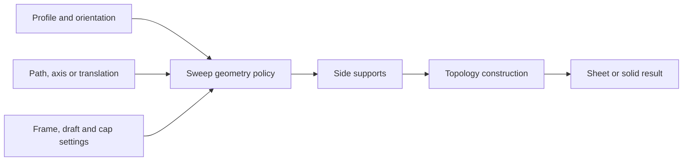

# Primitives, extrusion, revolution, and path sweeps

Source baseline: upstream `3fd5b9548d19aa8c12c29bc9637a96d42a06f8a5`.
The native fragment is checked against declarations only. Construction diagrams
are conceptual; they are not screenshots of executed SMLib results.

## 1. Geometry generation and solid construction

A primitive constructor establishes both support geometry and an initial topology.
A surface extrusion constructs a support; a solid sweep additionally establishes
profile incidence, side faces, end boundaries and, where appropriate, caps.
An open profile, closed profile, nested loops, and a pre-existing face are different
inputs even if their displayed outlines look similar.

The primary application headers are
[SmApiPrimitives.h](../../../source/SM_API/inc/SmApiPrimitives.h),
[SmApiSurfaces.h](../../../source/SM_API/inc/SmApiSurfaces.h), and
[SmApiBrep.h](../../../source/SM_API/inc/SmApiBrep.h). Choose the intended result type
before choosing a similarly named operation.

## 2. Extrusion and revolution theory

Translating a profile $\mathbf C(u)$ along a vector $\mathbf d$ creates

$$
\mathbf S(u,v)=\mathbf C(u)+v\mathbf d.
$$

If $v\in[0,h]$ and $\mathbf d$ is unit length, $h$ is the physical sweep distance.
For a planar closed region swept without self-overlap, the volume equals area
times the perpendicular component of the displacement, not necessarily area
times displacement length for an oblique direction.

Revolution around an axis through $\mathbf o$ has the form

$$
\mathbf S(u,\theta)=\mathbf o+R_{\mathbf a}(\theta)
(\mathbf C(u)-\mathbf o).
$$

The angle's units belong to the API contract. Points on the axis can create poles;
profiles crossing the axis can create overlapping or self-intersecting geometry.
A full revolution introduces a periodic seam, while a partial revolution needs
explicit end treatment when a solid is intended.

## 3. General sweeps need a moving frame

For a path $\mathbf P(v)$ and profile coordinates $(x(u),y(u))$, a typical frame
construction is

$$
\mathbf S(u,v)=\mathbf P(v)+x(u)\mathbf e_1(v)+y(u)\mathbf e_2(v).
$$

Different frame policies produce different twist. Frenet frames depend on
curvature and can fail at inflections or straight segments; transported or
user-constrained frames have different behavior. This equation explains the
design space, not a claim that every SMLib sweep uses one particular frame.



Draft and taper modify the section as it moves. A section can collapse, invert,
or meet another section before the requested end. Local validity of every frame
does not prove global self-intersection freedom.

## 4. SMLib construction components

[SmPrimitiveCreation.h](../../../source/SMLib/inc/SmPrimitiveCreation.h) coordinates
primitive and profile-based BRep creation. Geometry-specific responsibilities
appear in [SmSweepGeometryCreation.h](../../../source/SMLib/inc/SmSweepGeometryCreation.h),
[SmTransSweepGeometry.h](../../../source/SMLib/inc/SmTransSweepGeometry.h), and
[SmRotationalSweepGeometry.h](../../../source/SMLib/inc/SmRotationalSweepGeometry.h).
[SmTopologySweep.h](../../../source/SMLib/inc/SmTopologySweep.h) covers topology sweep
machinery. These layers explain why an operation needs more than a surface formula.

Analytic primitives can retain analytic supports; general sweeps may invoke
NURBS construction or approximation. Avoid the blanket claim that every sweep
is an exact NURBS construction with no approximation.

## 5. Traced linear-sweep wrapper

`SmApiCreateLinearSweep` in [SmApiBrep.cpp](../../../source/SM_API/src/SmApiBrep.cpp)
sets its output null, obtains the default context, and copies the supplied
curves with `SmApiCopyCurvesForConsumingSweep`. This is deliberate: the kernel
primitive constructor consumes its curve inputs, while this public wrapper
preserves the caller's originals.

It creates a new BRep under a cleanup owner, constructs `SmPrimitiveCreation`
from the infinite region, calls `CreateLinearSweep`, and releases the cleanup
owner only after successful construction. This is a concrete example of a
producer wrapper adapting a consuming kernel operation.

```cpp
#include "SmApiBrep.h"

SmApiStatus ExtrudeProfile(const SmTArray<SmCurve*>& profile, SmBrep*& result)
{
    result = nullptr;
    return SmApiCreateLinearSweep(
        profile, SmVector3d(0.0, 0.0, 1.0), 20.0, TRUE, result);
}
```

The caller initializes the API context, checks status, and owns the returned
standalone BRep. The example's `20.0` is in model units. It assumes the supplied
profile meets the operation's requirements for the intended capped result.

## 6. Surface-only paths and advanced variants

`SmApiCreateSweep` in [SmApiSurfaces.cpp](../../../source/SM_API/src/SmApiSurfaces.cpp)
calls `SmBSplineSurface::CreateSweepSurface` with a wrapper-selected tolerance.
It returns a surface, not a closed body. Similarly, a surface of revolution
does not by itself establish the application's desired material region.

The BRep API includes rotational, draft, pipe, planar-path, curve, repeated, and
non-manifold sweeps. Non-manifold sweep operations can mutate their source;
do not inherit the linear producer wrapper's ownership semantics merely from
the word “sweep.” Inspect each wrapper and its consuming constructor.

The representative wrappers in `SmApiBrep.cpp` make these distinctions concrete:

| Entry | Dispatch and policy | Result handling |
| --- | --- | --- |
| `SmApiCreateRotationalSweep` | Copies profiles; `SmPrimitiveCreation::CreateRotationalSweep` receives axis, angle in degrees, and cap flag | Cleanup-owned new body; originals preserved |
| `SmApiCreateDraftSweep` | Copies profiles; `CreateTaperExtrude` receives height, draft degrees, and a zero normal asking it to compute the profile normal | Corner flag selects linear extension or fillet corner; cap selector is 0 none, 1 source, 2 offset, 3 both |
| `SmApiCreatePipeSweep` | Rejects null path/nonpositive radius; `CreatePipeSweep` receives the path, radius, and cap setting | Deletes its newly allocated body on construction failure; publishes it on success |

The pipe wrapper's early input-rejection branch precedes output initialization,
so initialize the caller's output pointer before calling it. Do not generalize
another constructor's output-reset behavior to all creation APIs.

For a straight sweep, the theoretical volume and endpoint positions supply
simple checks. A rotated profile adds axis/seam checks; a drafted profile adds
corner-offset and section-collapse checks. Advanced frame and repeated-sweep
variants are identified here but their individual tuning options are outside
the representative walkthrough; consult the linked declarations for those paths.

## 7. CAD scenarios and checks

For an extruded bracket, verify profile closure, holes, orientation, cap policy,
and volume under a simple analytic case. For a turned shaft, inspect seam and
axis contact. For a pipe, inspect frame twist, tight bends, end orientation,
and whether the section radius is compatible with local and global clearance.

Ordering curves by input array position is unsafe unless the API requires and
validates that order. Joining endpoints, choosing a profile plane, and classifying
nested loops are geometric/topological tasks, not merely UI bookkeeping.

A useful failure sequence is profile validation → geometric sweep → self-contact
checks → cap construction → topology/region validation. Preserve the failing
profile/path before trying alternative parameters. A smaller radius or shorter
path can diagnose feasibility but changes the requested design.

## 8. Related reading

Use [geometry](geometry.md) for support types, [lofts](lofts-patches.md) for
section-to-section construction, [deformation](deformation.md) for mapping an
existing object, and [topology](topology.md) for cap and region structure.
This chapter traces representative entry points; it does not certify every
advanced sweep variant or frame policy by execution.
