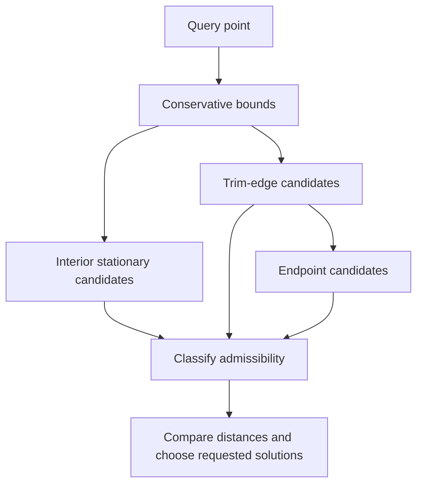
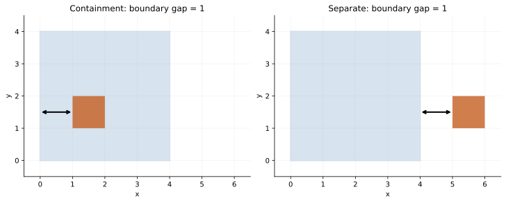

# Queries: distance, classification, bounds, and measurements

Source baseline: upstream `3fd5b9548d19aa8c12c29bc9637a96d42a06f8a5`.
The native fragment is signature-reviewed only. Mathematical formulas state
their assumptions; API behavior is tied to the linked implementation.

## 1. Four kinds of questions

Queries include direct topology lookup, evaluation at known parameters, geometric
search, and integration. They have very different costs and failure modes.
Asking for an edge's owner is not comparable to globally minimizing distance
between two trimmed bodies.

| Question | Main work |
| --- | --- |
| Which faces/edges belong to a body? | Graph traversal |
| Where is a point at UV? | Evaluation; see [evaluation.md](evaluation.md) |
| What is the nearest point? | Candidate search and constrained minimization |
| What is the volume or inertia? | Oriented geometric integration |

“Read-only” describes the modeled result: lazy caches or derived data may still
be built. It does not automatically establish thread safety or zero allocation.

## 2. Closest-point theory and boundary candidates

For a curve, minimize $f(t)=\frac12\|\mathbf C(t)-\mathbf P\|^2$. Interior
stationary points satisfy $f'(t)=0$, but endpoints must also be tested. For a
surface, interior stationarity is

$$
(\mathbf S-\mathbf P)\cdot\mathbf S_u=0,\qquad
(\mathbf S-\mathbf P)\cdot\mathbf S_v=0.
$$

A trimmed face adds boundary curves and vertices as candidates. The closest
point on the underlying surface may lie inside a removed hole. Multiple local
minima, periodic duplicates, and singular parameterizations require global
candidate handling rather than one Newton solve.



The implementation boundary is [SmApiQueries.cpp](../../../source/SM_API/src/SmApiQueries.cpp),
with geometry calls and `SmTopologySolver` paths selected by the query.
Use trim-aware face/edge operations when the question concerns modeled topology.

## 3. BRep distance is boundary distance here



This planar illustration shows why a distance value needs a relationship label.
It is an independent mathematical example, not SMLib query output.

`SmApiBrepRelationship` first calls `SmTopologySolver::BrepBrepSolve` with a
minimization objective. It then distinguishes separate boundaries from boundaries
that meet within the relevant tolerance. `SmApiBrepDistance` delegates to that
relationship function and returns its distance component.

This means a small solid nested inside a larger solid can have **positive boundary
clearance**, even though their material volumes overlap. This is not the set
distance between occupied solids, which would be zero in that configuration.

When boundaries are disjoint, the implementation classifies closest-approach
points to distinguish separation and containment, with a sampling fallback if
point extraction fails. When boundaries meet, its touching/interpenetrating
decision samples geometry and is explicitly heuristic in this revision. Do not
advertise it as a complete exact overlap-volume classifier.

## 4. Classification and material interpretation

Point-in-solid reasoning requires a valid oriented boundary and a meaningful
material-region model. Boundary points need a tolerance-aware classification
separate from strictly inside/outside. Ray-based methods must handle vertex hits,
tangencies and repeated crossings consistently.

For a face, UV classification is relative to its trim loops, not just the
rectangular support domain. For an edge, a valid support parameter can still be
outside the edge interval. Material census and manifold status answer different
questions: a manifold body can contain cavities and multiple material regions.

Read [SmApiQueries.h](../../../source/SM_API/inc/SmApiQueries.h) for the particular
classification/relationship result contract. Do not reinterpret integer labels
from one function as a universal classification enum.

## 5. Ordinary and tight bounds

`SmApiBrepBoundingBox` dispatches to `CalculateBoundingBox` or
`CalculateTightBoundingBox` according to `bTight`. Both are bounding queries, but
their cost and tightness differ. A tight box is not a prerequisite for a boolean.

```cpp
#include "SmApiQueries.h"

SmApiStatus GetDisplayBounds(const SmBrep* brep, SmPoint3d& minimum, SmPoint3d& maximum)
{
    return SmApiBrepBoundingBox(brep, FALSE, minimum, maximum);
}
```

This is appropriate for a framing request that accepts ordinary bounds. A
manufacturing or packing calculation might need a stronger specification; state
that requirement rather than globally changing all viewer calls to tight bounds.

## 6. Length, area, volume, and inertia

For regular parameterizations,

$$
L=\int\|\mathbf C'(t)\|dt,\qquad
A=\iint_D\|\mathbf S_u\times\mathbf S_v\|\,du\,dv.
$$

The surface domain $D$ must respect trimming. For a closed outward-oriented
boundary, the divergence theorem yields

$$
V=\frac13\int_{\partial\Omega}\mathbf x\cdot\mathbf n\,dA.
$$

Volume moments provide the centroid; for uniform density,
$\mathbf c=V^{-1}\int_\Omega\mathbf x\,dV$. Inertia about a specified origin is

$$
I=\int_\Omega\rho\left((\mathbf x\cdot\mathbf x)\mathbf 1-
\mathbf x\mathbf x^T\right)dV.
$$

Density assumptions and reference origin matter. A translation changes inertia
according to the parallel-axis relation even when volume and shape are unchanged.

[SmIntegrator.h](../../../source/SMLib/inc/SmIntegrator.h) and
[SmGauss.h](../../../source/SMLib/inc/SmGauss.h) are numerical integration entry points;
entity property implementations and query wrappers determine how they are used.
Adaptive integration error is distinct from the modeling error of an approximated
surface. More accurate quadrature cannot restore geometry lost during fitting.

For example, an $n$-point Gauss rule on $[a,b]$ has the form

$$
\int_a^b f(t)\,dt\approx\frac{b-a}{2}\sum_{i=1}^n
w_i f\!\left(\frac{a+b}{2}+\frac{b-a}{2}x_i\right).
$$

The rule is exact for polynomials through degree $2n-1$ in exact arithmetic.
A NURBS arc-length integrand contains rational functions and square roots, so
that polynomial property is not an exactness guarantee for arbitrary CAD
measurements. Domain subdivision and error estimation still matter.

### Public mass-property workflow

`SmApiBrepComputeArea` sums `SmApiFaceComputeArea` over trimmed faces and accepts
sheets/open shells. `SmApiBrepComputeMassProperties` instead requires a manifold
solid, finite accuracy/origin, and a finite density at least `SM_EFF_ZERO`.
It rejects per-entity `SM_AI_MASS_PROPERTIES` attributes because those could
override the requested uniform density.

The mass-property wrapper computes ordinary bounds, integrates once about their
midpoint with `sm_BrepComputePropertiesAbout`, rejects degenerate/non-finite
mass or volume, and shifts the moments to the caller's origin. Integrating near
the body reduces cancellation when the requested reference origin is far away.
The returned centroid is independent of that origin.

The returned products vector is **raw positive integrals in `(yz, zx, xy)` order**.
To build the conventional symmetric inertia matrix in the formula above, put
their negatives in the corresponding off-diagonal entries. This convention is
easy to lose when transferring values to dynamics or FEM software. For centroidal
inertia, request the returned centroid as the reference origin on the next call.

The wrapper documents that relative accuracy tighter than `1e-8` is not
recommended because roundoff can prevent convergence. That is guidance for this
numerical path, not a geometric tolerance for all modeling operations.

## 7. CAD measurement workflow

For a machined plate, retain an immutable design input or work on copies while
modeling. After each completed feature, query volume and relevant clearances;
defer costly full property reports until the application needs them. Separate
modeling time from bounds, integration, and display time.

Use a box with known dimensions for volume/centroid checks, a concentric nested
pair for boundary clearance, and a trimmed face with a hole for closest-point
domain checks. A single point inside a box is not enough to validate a general
distance implementation.

## 8. Failure and verification limits

Check statuses before outputs, and distinguish “no accepted solution” from invalid
input or solver failure according to the exact entry. Do not assume a query
returns an outward normal merely because it returns a support normal.

Validation should compare independent geometric quantities and include boundary
candidates. For irregular bodies, a plausible volume is not proof of correct
topology: differently oriented faces can cancel errors. Continue with
[solvers](solvers.md), [topology](topology.md), and
[validation-diagnostics](validation-diagnostics.md).
