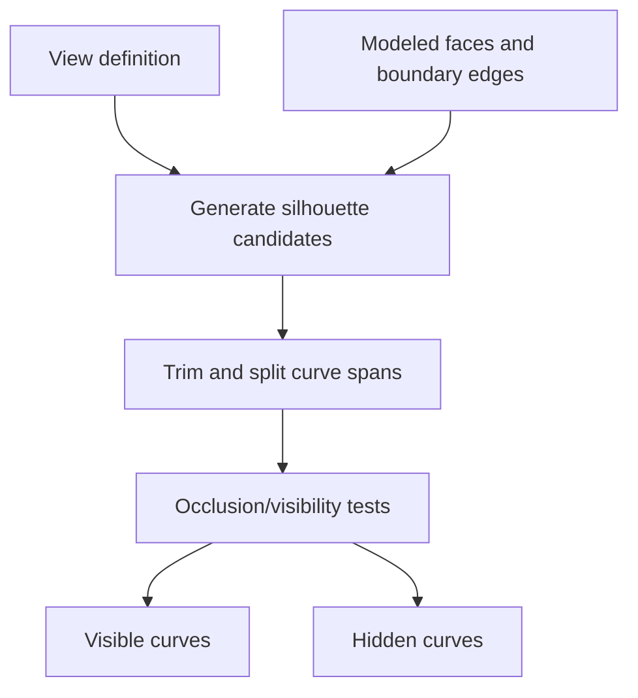

# Silhouettes, hidden curves, and ray-based visibility

Source baseline: upstream `3fd5b9548d19aa8c12c29bc9637a96d42a06f8a5`.
This chapter describes the kernel components and mathematical visibility problem.
It does not claim that the internal renderer is a complete Qt viewport integration.

## 1. Silhouette, section, and projection are different

A section lies on a cutting plane. A projected edge is the image of existing
boundary geometry. A smooth silhouette is a view-dependent locus on a surface
where the viewing direction is tangent to the surface. It can lie inside a face
without corresponding to an existing topological edge.

Visibility is another question: a silhouette or boundary edge can be hidden by
another part of the same body or another body. Extracting candidate curves is
not sufficient to produce a hidden-line drawing.

## 2. Silhouette equations

For orthographic direction $\mathbf d$, a regular support silhouette satisfies

$$
\mathbf n(u,v)\cdot\mathbf d=0.
$$

For a perspective eye position $\mathbf e$, the analogous condition is

$$
\mathbf n(u,v)\cdot(\mathbf S(u,v)-\mathbf e)=0.
$$

These equations describe candidates on the support. They must be restricted to
the modeled face and evaluated for visibility. At a pole or singular normal,
the naive dot-product equation needs specialized treatment.

Sharp boundary edges can contribute to an outline even when neither adjacent
smooth support produces an interior silhouette there. Smooth seams, sharp edges,
and ordinary face boundaries therefore need separate display policies.

## 3. Source architecture

[SmSurfaceSilhouette.h](../../../source/SMLib/inc/SmSurfaceSilhouette.h) derives from
`SmSurfaceTracer` and explicitly directs callers to the higher-level
`SmBSplineSurface::CreateSilhouetteCurves` interface. The internal class should
not be treated as a convenient stable application constructor.

[SmDirectedSilhouette.h](../../../source/SMLib/inc/SmDirectedSilhouette.h) represents
directed curve-span information. [SmHCR.h](../../../source/SMLib/inc/SmHCR.h) defines
Hidden Curve Removal, including scene/view transforms, visible/invisible curve
collections, spatial structures, and ray-tracing support. A stable BRep entry
is `SmApiCreateSilhouetteCurves` in
[SmApiBrep.h](../../../source/SM_API/inc/SmApiBrep.h).



The theory includes orthographic and perspective cases; verify which one a
particular public overload supports rather than inferring both from the equations.

### The public visibility wrapper, step by step

In [SmApiBrep.cpp](../../../source/SM_API/src/SmApiBrep.cpp),
`SmApiCreateSilhouetteCurves` normalizes the supplied plane normal, obtains a
bounding-box diagonal length $L$, and chooses approximation tolerance
$10^{-4}L$ and angular tolerance ten degrees converted to radians. It creates
`SmHCR`, calls `ComputeGlobalVisibility`, and copies the visible curves into
the caller's output array.

If copying fails, the wrapper deletes only the newly appended copies and
restores the original array size. Successful copies are standalone outputs;
they do not borrow their lifetime from the temporary `SmHCR` object.

Despite the parameter name, `rPlanePt` is used only for debug drawing in this
implementation. Do not assume changing it moves the returned curves onto a
different projection plane. This is a direction-based visibility path, not
a perspective-camera interface. The wrapper also dereferences the BRep without
an explicit null guard and does not propagate its bounding-box status; supply
a valid body and inspect output rather than expecting complete input validation.

## 4. Hidden-curve organization

The inspected `SmHCR` declaration retains an original BRep and a copied,
view-oriented scene BRep. It maintains maps/trees for silhouette vertices and
edges, output visible/invisible curves, and display choices for seams and smooth
edges. This makes view transformation and visibility policy explicit.

Its constructor documents approximation and angular controls. Angular arguments
in this kernel interface are not necessarily in the same units as public
tessellation angles; the declarations use radians for the named angular
tolerance. Inspect each layer before forwarding a UI value.

Do not assume every declared member is active: the header itself marks some
structures unused or disabled. The implementation in
[SmHCR.cpp](../../../source/SMLib/src/SmHCR.cpp) determines the actual path.

## 5. Ray tests and picking

A ray is $\mathbf r(t)=\mathbf o+t\mathbf d$, usually with $t\geq0$ for a forward
pick. The nearest accepted hit can identify a visible surface, but tangent hits,
coincident boundaries, tolerances and face trimming affect acceptance.

[SmRayTracer.h](../../../source/SMLib/inc/SmRayTracer.h) and
[SmRayTracer.cpp](../../../source/SMLib/src/SmRayTracer.cpp) provide internal ray
machinery. A scene pick also needs occurrence transforms and a policy for
selecting faces versus edges/vertices. A raw surface hit is not automatically
a persistent application selection.

```text
construct the view/ray in the same coordinate system as the target
obtain conservative candidates through supported spatial structures
solve and trim hits to the modeled geometry
sort/select by the intended forward-distance and visibility rules
map the hit back to the correct occurrence and current topology
```

## 6. CAD scenario: a technical drawing

Generate silhouette candidates for the chosen view, include intended sharp
boundaries, and classify visible/hidden portions. Decide explicitly whether
seams and tangent-smooth internal edges appear in the drawing. These are
presentation choices, not necessarily defects in the model.

A cylinder is a useful first example: its side silhouette differs from its
periodic seam. A sphere tests smooth silhouettes and poles. Two overlapping
parts test occlusion: their individual outlines cannot simply be concatenated
to obtain the assembly's visible outline.

## 7. Verification and scope

For regular silhouette samples, check the normalized residual of the dot-product
condition and trim membership. Independently test whether a closer occluder
exists for spans classified visible. Inspect endpoints where visibility changes;
sampling a long span only at its midpoint can miss an occlusion transition.

Preserve units, view transforms and approximation settings with any exported
drawing. These kernel facilities do not establish a complete drafting standard,
dimensioning engine, renderer, or Qt event/picking system. Related guides are
[evaluation](evaluation.md), [intersections](intersections.md),
[sections](sections.md), and [assemblies](assemblies-attributes.md).
