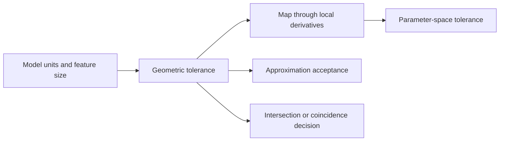

# Tolerances, scale, and numerical robustness

Source baseline: upstream `3fd5b9548d19aa8c12c29bc9637a96d42a06f8a5`.
Equations below explain error propagation; they are not claimed as the exact
formula used by every SMLib tolerance policy. No kernel execution is claimed.

## 1. Why one epsilon is insufficient

A CAD kernel compares several different quantities: distances, squared distances,
angles, parameter differences, residuals, and topological incidence. Giving all
of them the same number is dimensionally inconsistent. Tolerance also expresses
different intentions: deciding whether geometry is coincident, accepting an
intersection, bounding an approximation, or avoiding numerical division by zero.

An exact geometric representation does not make all computed operations exact.
NURBS circle data can describe an exact circle mathematically while evaluating,
intersecting, and storing it in finite precision.

| Quantity | Units | Example |
| --- | --- | --- |
| Positional gap | Model length | Edge endpoint versus vertex position |
| Squared residual | Length squared, when derived from Euclidean distance | Objective in a closest-point solve |
| Angular tolerance | Angle or a dimensionless trigonometric criterion | Normal/tangent alignment |
| Parameter tolerance | Parameter units | Accepting a solution near a domain endpoint |
| Relative integration accuracy | Dimensionless | Requested accuracy of a volume calculation |

## 2. Scale and conditioning

For floating-point arithmetic, a useful conceptual error model is

$$
|\operatorname{fl}(x)-x|\lesssim\epsilon_{\rm mach}|x|.
$$

Subtracting two large nearby coordinates can leave a small difference dominated
by rounding. Small features far from the origin are therefore challenging even
when the part's own dimensions look reasonable. Unit conversion changes the
numeric magnitude of both geometry and dimensional tolerances.

An absolute/relative comparison often has the form

$$
|a-b|\leq\varepsilon_{\rm abs}+\varepsilon_{\rm rel}\max(|a|,|b|).
$$

This is an explanatory pattern, not a replacement implementation for `SmTol`.
The right scale may be a feature size, object extent, local derivative, or
operation-specific residual; using world-coordinate magnitude blindly can
erase a small feature.



## 3. Parameter tolerances are local

For a regular curve, first-order propagation gives

$$
\|\Delta\mathbf C\|\approx\|\mathbf C'(t)\||\Delta t|.
$$

Thus a fixed world-space target corresponds approximately to
$\varepsilon_t=\varepsilon_x/\|\mathbf C'\|$. Near zero derivatives this estimate
is unreliable. For a surface,

$$
\Delta\mathbf x\approx J\Delta\mathbf q,
\qquad J=[\mathbf S_u\ \mathbf S_v].
$$

Different singular values of $J$ stretch UV directions differently. One scalar
UV tolerance cannot fully represent an anisotropic world-space error region.
At a pole, $J$ can lose rank, so tightening a UV threshold is not a universal cure.

This is why projection, trimming, and intersection chapters must distinguish
their 2D acceptance tests from final 3D gap checks.

## 4. SMLib's tolerance vocabulary

[SmTol.h](../../../source/SMLib/inc/SmTol.h) declares typed quantities including
`SmZoneTol3d`, `SmXSectTol3d`, `SmApproxTol3d`, `SmScaledZero`, `SmTol2d`, and
`SmTol1d`. It also defines `SmSmallTopoType`, including forced small/normal
policies. These names identify separate purposes; they do not imply each call
uses an identical threshold or stores one on each entity.

[SmTol.cpp](../../../source/SMLib/src/SmTol.cpp) centralizes policy calculations, while
callers supply objects, domains, or operation context. The header contains
build-dependent old/new tolerance-model paths. Read the active definitions and
callers before describing a universal storage or propagation rule.

Sentinel values such as “use default” are requests for policy selection, not
necessarily literal zero geometric error. In the current tessellation parameter
struct, zero disables the corresponding quality criterion. Never interpret a sentinel from its numeric
value without its argument contract.

## 5. Actual investigation workflow

For a suspicious gap or missed intersection:

```text
record operation, units, object scale and smallest relevant feature
identify the actual comparison in the consuming code
trace its tolerance argument into SmTol or caller policy
check whether the comparison uses distance, squared distance, angle or UV
measure the geometric discrepancy independently
check small-topology flags, defaults and active configuration
change one justified parameter and compare the same observables
```

This avoids a common error: changing a global epsilon when the failure is really
an incorrect parameter mapping or stale trim. [SmMath.h](../../../source/SMLib/inc/SmMath.h)
and [SmGap.h](../../../source/SMLib/inc/SmGap.h) provide additional numerical/gap
vocabulary; the exact predicate in the operation remains decisive.

## 6. Approximation error and accumulated error

Suppose an original curve is approximated by another within $\varepsilon_1$ and
the result is subsequently approximated within $\varepsilon_2$, under compatible
distance definitions. The triangle inequality gives a possible total bound

$$
\varepsilon_{\rm total}\leq\varepsilon_1+\varepsilon_2.
$$

It does not justify summing unrelated solver residuals, angle thresholds, and
display errors. A fit's sample residual is also not automatically its maximum
continuous geometric deviation. See [fitting.md](fitting.md).

Tolerance relaxation may allow an operation to finish but also merge distinctions
that matter to the design. If two intended walls are separated by a gap comparable
to the coincidence tolerance, the model is near the decision boundary. Report
that relationship instead of treating success as evidence of preserved detail.

## 7. CAD scenario: a small hole in a large part

Record overall extent, hole diameter, wall thickness, coordinate offset, and
model units. First check whether the geometry is actually represented at the
intended scale. Then inspect candidate pruning and intersection acceptance near
the hole; only afterward consider approximation and stitching tolerances.

Useful comparisons are dimensionless ratios:

$$
\rho_1=\varepsilon_x/\text{hole diameter},\qquad
\rho_2=\text{measured gap}/\text{local edge length}.
$$

There is no single universally safe cutoff for these ratios. They explain why
the same absolute tolerance can be harmless on a large fillet and destructive
on a microscopic slot.

## 8. Acceptance and limitations

Report structural validity, geometric quality, and derived-trim quality
separately. A graph can be valid but geometrically inaccurate; a tight gap test
can fail because the chosen threshold is stricter than the model's intended
accuracy. Conversely, increasing tolerance does not repair broken incidence.

Use independent analytic dimensions when possible, inspect seam/pole cases, and
compare outputs before and after a policy change. This chapter does not claim
exact arithmetic or universally robust predicates. Continue with
[solvers](solvers.md), [healing/stitching](healing-stitching.md), and
[validation](validation-diagnostics.md).
