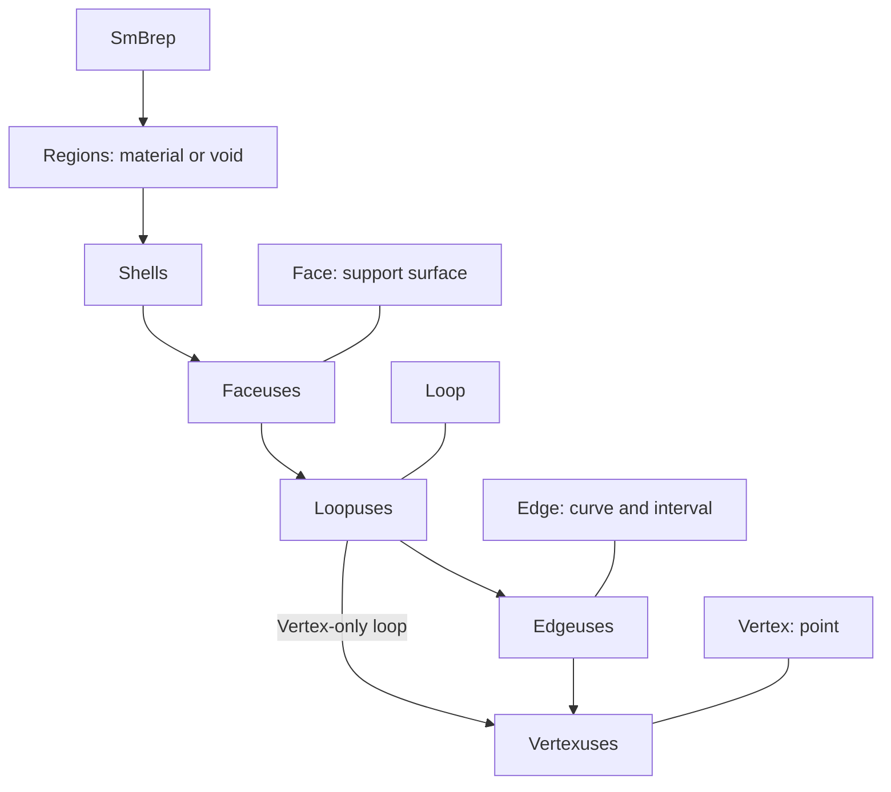
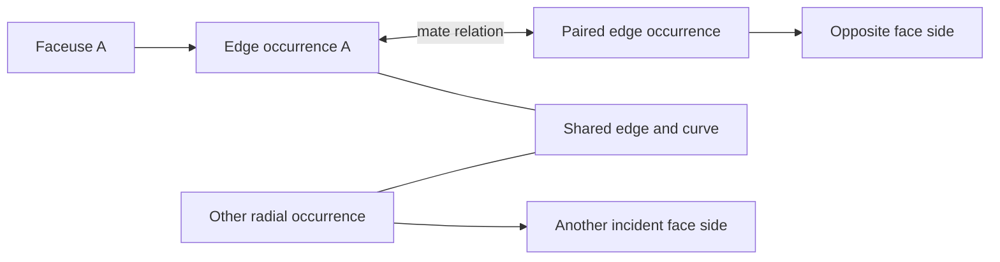
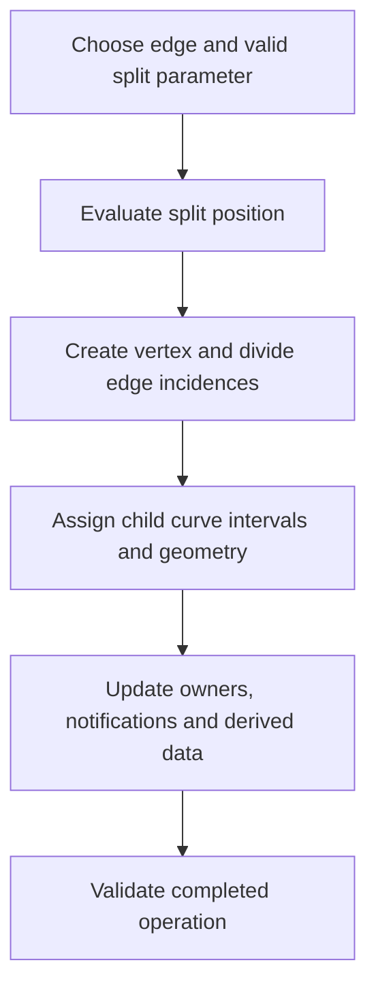

# Topology: the SMLib boundary-representation model

Source baseline: upstream `3fd5b9548d19aa8c12c29bc9637a96d42a06f8a5`.
This guide describes kernel topology and the stable traversal boundary. The C++
fragment is signature-reviewed, not compiled here. Diagrams are explanatory.

## 1. Geometry and connectivity solve different problems

A surface answers “where is the point at $(u,v)$?” Topology answers “which part
of that surface bounds which region, and which boundary is shared?” Two endpoints
with identical coordinates are not necessarily the same vertex. Conversely, one
vertex can have several incident curves whose computed endpoints agree only
within a modeling tolerance.

A BRep combines incidence, orientation, geometry, and tolerances. A useful
geometric consistency condition for an edge endpoint is

$$
\|\mathbf C(t_0)-\mathbf P_v\|\leq\varepsilon_v.
$$

This condition does not establish incidence: the edge must also reference the
correct vertex through its use objects. Sewing nearby coordinates and connecting
the graph are separate responsibilities.

The authoritative source trail is the [BRep reference](../../../.agents/skills/smlib-brep-model/references/brep-format.md),
[SmBrep.h](../../../source/SMLib/inc/SmBrep.h), and the individual entity headers.
The reference is an index to implementation evidence, not a substitute for it.

## 2. Entities and uses

SMLib stores an entity and its occurrences separately. A face has two oriented
faceuses; a loop has two loopuses; an edge can have several pairs of edgeuses.
This permits sheets, seams, and non-manifold junctions that a simple “two faces
per edge” representation cannot explain adequately.



This is an incidence diagram, not a complete memory-ownership tree. In particular,
the face logically owns a pair of faceuses while shell lists contain those uses.
The BRep also maintains global face, edge, and vertex lists.

| Object | Role and important distinction |
| --- | --- |
| `SmRegion` | Connected volume of space; bounded regions can be material or void |
| `SmShell` | Connected boundary component; directly owns faceuses, wire incidence, or an isolated vertex incidence according to its type |
| `SmFace` | Support surface and modeled domain; its two faceuses represent opposite sides |
| `SmLoop` | Logical boundary with a pair of loopuses |
| `SmEdge` | 3D curve and modeled parameter interval, shared by its occurrences |
| `SmVertex` | Position and incidence list, not merely a coordinate deduplication key |

See [SmRegion.h](../../../source/SMLib/inc/SmRegion.h), [SmShell.h](../../../source/SMLib/inc/SmShell.h),
[SmFace.h](../../../source/SMLib/inc/SmFace.h), [SmLoop.h](../../../source/SMLib/inc/SmLoop.h),
[SmEdge.h](../../../source/SMLib/inc/SmEdge.h), and [SmVertex.h](../../../source/SMLib/inc/SmVertex.h).

## 3. Orientation, mates, and radial incidence

An entity's geometric parameter direction is not necessarily the direction in
which a particular face boundary traverses it. Edgeuse orientation connects those
two conventions. The mate describes the paired occurrence on the other side;
radial relationships describe incidence around the geometric edge.



Do not replace this graph with a fixed pair of adjacent face pointers. At a seam,
the same face can use the same edge more than once. At a non-manifold junction,
more than two face sides can meet. Count **occurrences**, not just distinct faces.

Intrusive lists are generally circular and doubly linked. Their owner, head,
count, and reciprocal links must agree. Some heads have semantic meaning: the
first BRep region is infinite; a bounded region's first shell is outer; a face's
primary faceuse is SAME; a faceuse's first loopuse is outer. Sorting these lists
as if they were unordered application arrays can change their meaning.

Inspect [SmEdgeuse.h](../../../source/SMLib/inc/SmEdgeuse.h),
[SmFaceuse.h](../../../source/SMLib/inc/SmFaceuse.h), and
[SmTopology.cpp](../../../source/SMLib/src/SmTopology.cpp) for the stored relationships
and their checks. Use named traversal methods instead of guessing pointer order.

## 4. Regions, cavities, sheets, and singularities

A solid with an enclosed cavity has a material region and a bounded void region,
as well as the infinite exterior. A disconnected pair of solids needs multiple
material regions. Shell count alone is therefore not a material-body count.

An open sheet can have its two face sides in the same surrounding region. A wire
shell contains connected edge incidence without faces. A vertex shell represents
an isolated point incidence. Faceuse shells may additionally contain wire edges;
the shell's direct-use type still matters.

At a surface pole, a parameter boundary can collapse to a point. A vertex loop
can represent such a boundary without inventing a zero-length ordinary edge.
At a periodic seam, multiple UV values can map to the same 3D location. Neither
case should be “fixed” by coordinate deduplication alone.

`SmShell::IsClosed` in [SmShell.cpp](../../../source/SMLib/src/SmShell.cpp) uses faceuse
mate/shell relationships. It is not equivalent to a complete manifold-solid
validator. Distinguish graph closure, manifoldness, material classification, and
geometric agreement.

## 5. Euler-style edits and their limits

For the full theory, classical-to-kernel method map, source walkthroughs, and
before/after diagrams, see [Euler operations](euler.md). This section gives a
short introduction within the topology representation guide.

For a connected, closed, orientable surface represented by a suitable cell
decomposition,

$$
V-E+F=2-2g,
$$

where $g$ is genus. Boundaries, disconnected components, faces with holes, and
non-manifold complexes require the appropriate accounting. This equation is a
useful consistency check under its assumptions, not a universal BRep validator.

Splitting an ordinary edge by adding a vertex changes $(V,E,F)$ by $(1,1,0)$,
preserving the Euler characteristic. Yet a correct edit must also divide the
curve interval, replace every affected edge occurrence, maintain mates/radial
links, attach vertexuses, update tolerances, and invalidate dependent data.

The public kernel declaration `SmBrep::MakeVertexSplitEdge` in `SmBrep.h` is a
concrete starting point. Follow its implementation and callers rather than
implementing this edit by writing intrusive pointers yourself. New/deleted
entity identities need not correspond one-to-one with old identities.



This diagram states the responsibilities of a split, not an assertion that every
implementation performs them in exactly this order.

## 6. Defining geometry versus UV trimming data

An edge's 3D curve/interval, the face support, and the incidence relationships
define a boundary. Edgeuse UV curves are optional derived data in this model.
They are extremely useful for meshing and classification, but a missing cached
UV curve is not automatically a malformed topology graph.

For a generated UV trim $\mathbf c(t)$, compare

$$
\mathbf S(\mathbf c(t))\quad\text{with}\quad\mathbf C(t),
$$

allowing for any documented reparameterization. Diagnose reversed endpoints,
periodic branches, and approximation error separately. A bad UV orientation
plot alone cannot establish that the underlying edge was constructed backward.

## 7. Safe application traversal

The stable wrapper returns borrowed entity pointers from a BRep. This fragment
checks statuses and counts entities without taking ownership of those pointers:

```cpp
#include "SmApiQueries.h"

SmApiStatus ReadTopologyCounts(SmBrep* brep, ULONG& faceCount, ULONG& edgeCount)
{
    SmTArray<SmFace*> faces;
    SmTArray<SmEdge*> edges;
    SmApiStatus status = SmApiGetFaces(brep, faces);
    if (status != SM_SUCCESS)
    {
        return status;
    }
    status = SmApiGetEdges(brep, edges);
    if (status != SM_SUCCESS)
    {
        return status;
    }
    faceCount = faces.GetSize();
    edgeCount = edges.GetSize();
    return SM_SUCCESS;
}
```

For ordered boundaries use `SmApiFaceGetBoundaryLoops` rather than assuming an
unordered edge set forms one loop. Reacquire selections after topology-changing
operations; preserving the owning BRep pointer does not preserve all children.

## 8. CAD scenario and verification

Consider a drilled plate. The cutter adds cylindrical support geometry and new
incidences. A through-hole changes connectivity and genus; a blind hole also
needs a bottom face. An enclosed void changes region structure differently.
The same surface types can therefore participate in very different solids.

Check connectivity, material regions, boundary orientation, and geometric gaps.
For trusted runtime objects, run pointer validation before deep graph validation;
consult [validation-diagnostics.md](validation-diagnostics.md) for levels and
coverage. Passing one predicate does not prove all invariants. Do not validate
an arbitrary corrupted pointer graph as if it were an input parser.

Continue with [geometry](geometry.md), [booleans](booleans.md), and
[assemblies and attributes](assemblies-attributes.md). Kernel model assertions
and stable application queries serve different purposes and should remain distinct.
