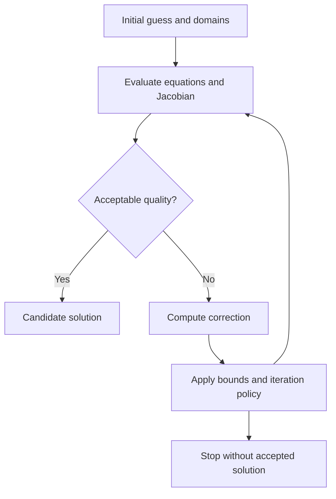
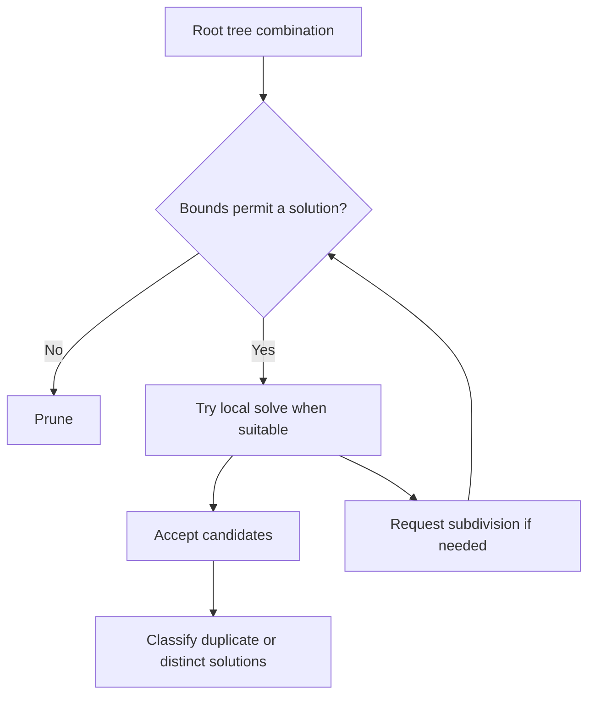

# Numerical solvers: local iteration and global search

Source baseline: upstream `3fd5b9548d19aa8c12c29bc9637a96d42a06f8a5`.
The equations are explanatory. Kernel interfaces and workflow hooks are traced
to source; no numerical solver test run is claimed in this documentation change.

## 1. A solver is a component, not a modeling operation

Intersection, closest-point, fillet, and classification operations formulate
different numerical questions. A solver supplies iteration or search machinery;
the caller supplies equations, domains, quality measures, and interpretation.
An operation's status can be successful while its result set is empty.

A local solver starts near a candidate and tries to refine it. A global solver
explores a bounded search space, rejects impossible regions, and invokes local
solves where appropriate. “Global” identifies search organization, not an
unconditional proof that every possible degenerate solution will be returned.

## 2. Local root finding

For $F(\mathbf x)=0$, Newton iteration solves

$$
J(\mathbf x_k)\Delta\mathbf x_k=-F(\mathbf x_k),\qquad
\mathbf x_{k+1}=\mathbf x_k+\Delta\mathbf x_k.
$$

This uses a local linearization. A small step does not establish a small residual;
a small residual may still be misleading if equations have incompatible scales.
A nearly singular Jacobian can produce large unstable corrections.

For nearest-point calculations on a curve, an interior stationary condition is

$$
f(t)=(\mathbf C(t)-\mathbf P)\cdot\mathbf C'(t)=0,
$$

$$
f'(t)=\mathbf C'\cdot\mathbf C'+(\mathbf C-\mathbf P)\cdot\mathbf C''.
$$

Roots include maxima and other stationary points, so the caller must compare
distances and include interval boundaries. A successful root solve is not yet
a globally nearest point.

## 3. SMLib's local abstraction

[SmLocalSolveNd.h](../source/SMLib/inc/SmLocalSolveNd.h) defines
`SmEvalNFunctionsObject`, whose derived evaluator supplies equation values and
optionally the Jacobian, and `SmLocalSolveNd`, whose `SolveIt` drives iteration.
The evaluator also carries `m_dSolutionSize` and `m_dScaledZero`, allowing the
caller to express quality independently of a generic equation norm.

The header documents a setup pattern: construct an equation evaluator, construct
the solver with domain/periodicity information, select boundary handling, supply
a nearby guess, call `SolveIt`, and inspect the returned found-solution result.
`SmLocalSolve1d` provides the scalar counterpart. Implementations are in
[SmLocalSolveNd.cpp](../source/SMLib/src/SmLocalSolveNd.cpp) and
[SmLocalSolve1d.cpp](../source/SMLib/src/SmLocalSolve1d.cpp).

Boundary policies include counting total boundary hits, detecting hits of all
bounds, or ignoring the count. These are iteration policies; none means that an
out-of-domain answer is automatically a valid point on the modeled face.



## 4. Global solving and subdivision

[SmGlobalSolver.cpp](../source/SMLib/src/SmGlobalSolver.cpp) contains `SolveIt`
and `SolveBranch`; its header exposes the operation-specific hooks
`IsSolvePossible`, `AreReadyForLocalSolve`, `FindBestSubdivisionNode`,
`Subdivide`, `LocalSolve`, and `IdenticalSolutions`.



The trees come from geometric caches; [spatial-indexing.md](spatial-indexing.md)
explains why UV decomposition and object spatial trees have different meanings.
The solver can work with combinations of trees rather than one point sequence.
Subclasses specialize problem equations and candidate interpretation.

`SmTopologySolver` adds topological context. It should not be replaced with an
unconstrained surface solve when a face trim or edge interval is part of the
question. Inspect [SmTopologySolver.cpp](../source/SMLib/src/SmTopologySolver.cpp)
alongside the caller to determine the actual objective and admissible domain.

### A complete caller path: point to curve

`SmApiCurveClosestPoint` in
[SmApiQueries.cpp](../source/SM_API/src/SmApiQueries.cpp) rejects a null curve
and creates a `SmSolutionArray`. It calls `SmCurve::GlobalPointSolve` over the
curve's natural interval with `SM_SO_MINIMIZE`, `SM_SR_SINGLE`, and
`SM_ZONE_TOL_3D`. Thus the operation asks for the minimum-distance candidate,
not merely an arbitrary root of the stationary equation.

After the solve, the wrapper checks both the status and whether at least one
solution exists. It reads the parameter from `m_vStart[0]`, evaluates the curve
there with checked status, then publishes the point, parameter, and solution
distance. Failure before publication does not establish valid output scalars.
`SmApiCurveClosestPointAll` instead requests `SM_SR_ALL` and appends results;
use initially empty arrays when a fresh result set is intended.

```cpp
#include "SmApiQueries.h"

// Signature-reviewed fragment, not executed for this guide.
SmApiStatus LocateOnCurve(const SmCurve* curve, const SmPoint3d& probe,
                         SmPoint3d& closest, double& parameter, double& distance)
{
    return SmApiCurveClosestPoint(curve, probe, closest, parameter, distance);
}
```

This path also explains why an edge query is distinct: the standalone curve's
natural interval can extend beyond the interval retained by a topological edge.
Selecting a numerical method cannot repair selecting the wrong modeled domain.

## 5. Tangency, singularity, and solution identity

At a transverse intersection, independent tangent/normal information usually
provides useful local directions. At tangency, equations can lose rank. A
coincident curve or surface contributes a continuum of solutions rather than
one isolated root. Periodic parameters can represent the same point more than
once, while nearby distinct roots may still matter geometrically.

A generic distance threshold alone is therefore insufficient for deduplication.
The kernel's `IdenticalSolutions` hook allows operation-specific decisions and
selection of a preferred solution. Collapsing all nearby XYZ points can erase
separate branches; keeping every periodic duplicate can create broken contour
assembly later.

The symbolic distinction is useful:

$$
\text{isolated root}\ne\text{tangent contact}\ne\text{overlap interval}
\ne\text{coincident region}.
$$

## 6. Supporting numerical methods

The kernel also includes matrix/linear-system support and polynomial root
machinery, such as [SmMatrix.h](../source/SMLib/inc/SmMatrix.h) and
[SmPolynomial.h](../source/SMLib/inc/SmPolynomial.h). Analytic special cases may
use polynomial equations rather than the general N-dimensional workflow.
Do not attribute QR, SVD, exact predicates, or a particular damping method to a
call path without inspecting its implementation.

Scaling coordinates or residual components can improve conditioning, but all
associated Jacobians, bounds, and convergence criteria must remain consistent.
See [tolerances.md](tolerances.md) for world-space versus parameter-space error.

## 7. A practical diagnostic record

For one failed geometric query, record:

1. The caller and its mathematical objective, including trim/domain constraints.
2. Initial parameters, periodicity, and tree branch or bounds.
3. Residual/quality measure, relevant tolerance, and derivative validity.
4. Returned status, found-solution flag, boundary events, and termination reason
   where the path exposes them.
5. Candidate acceptance or rejection and duplicate classification.

Locate the first wrong decision. A bad Jacobian requires different investigation
from an overaggressive bound, a wrong seam branch, or a discarded valid candidate.
Avoid logging only the final `SM_SUCCESS`/failure code.

## 8. CAD example and verification

For a point near a U-shaped curve, two local minima can exist. Starting Newton
near one branch may find that branch reliably while missing the closer one.
A global search must preserve both candidate regions long enough to compare
their distances, and must include endpoints. This example distinguishes local
convergence from global selection without requiring complicated topology.

Use analytic lines/circles for known answers, then add multiple minima, boundary
solutions, periodic seams and tangency. Compare geometric residuals rather than
only parameter values. This guide documents the machinery; the dedicated
[queries](queries.md), [intersections](intersections.md), and
[fillet](fillets-chamfers-blends.md) chapters explain how their callers use it.
