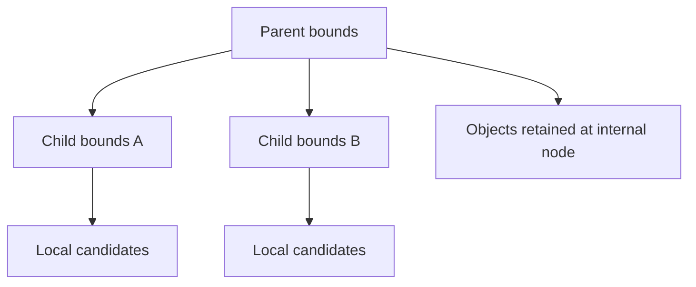
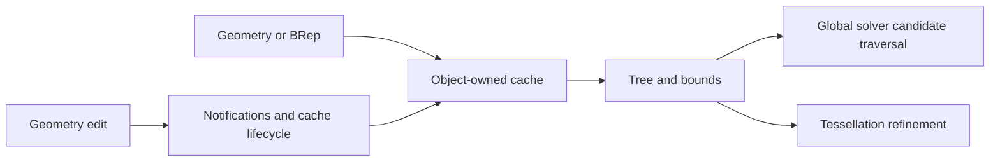

# Spatial indexing, decomposition trees, and geometric caches

Source baseline: upstream `3fd5b9548d19aa8c12c29bc9637a96d42a06f8a5`.
This guide explains the source architecture and mathematical pruning conditions.
Pseudocode is illustrative and is not an alternative implementation of `SmTree`.

## 1. Why geometric algorithms need bounds

Testing every face against every other face can require $O(nm)$ candidate pairs
before any expensive intersection solving. Bounding structures eliminate pairs
that cannot contribute. A successful bound rejects work conservatively; it does
not establish an intersection merely because two boxes overlap.

For an axis-aligned box $B=[\mathbf l,\mathbf h]$ and a point $\mathbf x$, a
lower bound on distance is

$$
d^2(\mathbf x,B)=\sum_{k=1}^3
\max(l_k-x_k,0,x_k-h_k)^2.
$$

If this exceeds the best confirmed distance to geometry, the box cannot improve
the nearest-point result. The correctness of that rejection depends on the box
actually containing the geometry and on consistent tolerance inflation.

## 2. Two tree meanings in SMLib

[SmTree.h](../source/SMLib/inc/SmTree.h) distinguishes decomposition trees from
spatial trees. Both are hierarchical, but their nodes mean different things.

| Tree kind | What is subdivided | Typical payload |
| --- | --- | --- |
| Parameter decomposition | Curve interval or surface UV domain | Bézier/control or approximation information for the represented piece |
| Object spatial tree | A collection of geometric/topological objects | Object lists and their bounding boxes |

For the documented rectangular surface decomposition, child parameter regions
partition the parent UV region. Their corresponding 3D boxes can still overlap
because the surface folds or bends. UV disjointness does not imply spatial
disjointness.

For object trees, objects can be stored at internal nodes when their boxes do
not fit a single child. A traversal that visits only leaves can therefore miss
valid candidates. The header documents maximum node population, minimum split
size, child overlap policy, and cases where population limits can be exceeded.



## 3. Bounds from spline geometry

With positive weights, a NURBS segment lies in the convex hull of its active
Euclidean controls. Subdivision/refinement can produce smaller control hulls and
therefore tighter bounds without changing the curve. This is one connection
between [NURBS algorithms](nurbs.md) and global geometric solving.

A chord alone is generally not a valid bound for a curved segment. A sampled box
also needs a conservative error allowance if it is used to prove exclusion.
The numerical representation, weights, domain restriction, and bound construction
must justify the containment claim.

For two boxes, a tolerance-aware rejection is conceptually

$$
\operatorname{dist}(B_1,B_2)>\varepsilon\ \Longrightarrow\
\text{no accepted intersection under that distance criterion}.
$$

Inflating boxes makes rejection less aggressive and can retain near-contact
candidates. It does not repair an invalid surface or a wrong local solver.

## 4. Cache ownership and consumers

The tree's owner field can point to curve, surface, tessellation-surface, or BRep
caches. Relevant declarations are
[SmCurveCache.h](../source/SMLib/inc/SmCurveCache.h),
[SmSurfaceCache.h](../source/SMLib/inc/SmSurfaceCache.h), and
[SmBrepCache.h](../source/SMLib/inc/SmBrepCache.h).
[SmTree.cpp](../source/SMLib/src/SmTree.cpp) implements tree behavior; consumers
determine which tree mode and auxiliary data are meaningful.



Do not equate object caches with the legacy global cache-manager facilities.
Their enablement and lifetime differ. Raw cached node pointers are not stable
application identifiers; an edit or rebuild can replace the tree.

## 5. Global-search workflow

The following pseudocode captures a general candidate search:

```text
start with root node or root-node combination
reject only when a conservative bound proves no acceptable result
inspect candidates stored directly on the node
if local geometry is suitable, attempt the operation-specific local solve
if uncertainty remains and refinement is allowed, visit child combinations
merge accepted solutions under the operation's identity rules
```

In SMLib, `SmGlobalSolver` exposes hooks such as `IsSolvePossible`,
`FindBestSubdivisionNode`, `Subdivide`, and `LocalSolve` rather than making every
operation share a single fixed search strategy. See
[SmGlobalSolver.h](../source/SMLib/inc/SmGlobalSolver.h) and [solvers.md](solvers.md).

The choice of subdivision node matters: refine the part responsible for poor
bounds or unstable local linearization, not necessarily every object equally.
More subdivision can improve localization but also increase memory and traversal
cost. There is no general logarithmic worst-case guarantee for arbitrary CAD
geometry with many overlapping bounds.

## 6. CAD scenario: repeated holes in a plate

A viewport needs quick framing bounds; a boolean needs candidate face pairs;
a measurement command may request tighter bounds. Calling an expensive tight-box
query after every cutter can dominate an otherwise reasonable modeling workflow.
The existing [native Boolean/bounds example](../Examples/SM_API/README.md)
demonstrates this distinction at the application boundary.

Separate timings for modeling, bounds, and tessellation. Warm caches and changed
geometry are different conditions. A speedup from caching should be measured on
the same operation and result requirements, not by omitting correctness checks.

For correctness, compare a tree-assisted query with an independent small case,
including an object that spans a split and is retained internally. Include
tolerance-scale near contacts and a highly curved segment whose chord misses
the true extremum. Those cases probe the assumptions behind pruning.

## 7. Diagnosing misses and stale results

If a candidate disappears, trace the first rejection: box construction,
tolerance inflation, node traversal, local solve, or result deduplication.
Re-running Newton from a different guess cannot recover a candidate discarded
before Newton is called.

After edits, inspect notification and cache invalidation paths before assuming
the mathematical bound is wrong. Rigid transforms, scaling, and representation
changes can have different reuse policies. Document the policy of the particular
cache rather than promising universal reuse.

This chapter traces the shared architecture and theoretical conditions. It does
not claim all tree policies are identical or benchmark them here. Continue with
[runtime](runtime.md), [intersections](intersections.md), and
[tessellation](tessellation.md).
