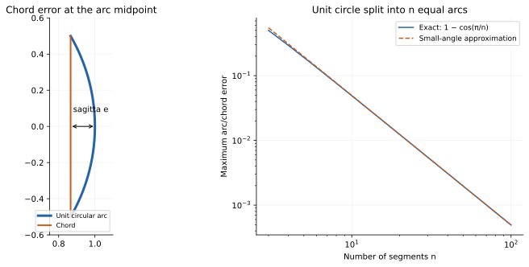
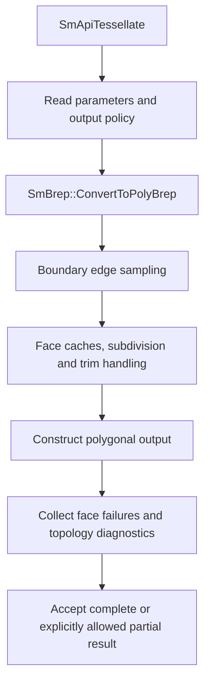
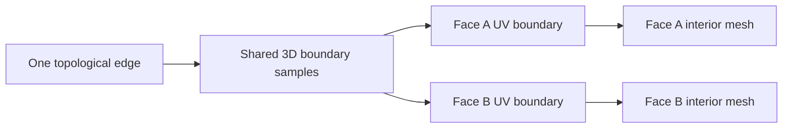

# Tessellation: trimmed BRep to polygonal display geometry

Source baseline: upstream `3fd5b9548d19aa8c12c29bc9637a96d42a06f8a5`.
The C++ fragment follows the current parameter-struct API and is signature-reviewed,
not compiled here. Geometric error examples are explanatory.

## 1. Approximation with topological constraints

Tessellation samples curves and surfaces and builds a polygonal representation.
It must respect face trims, shared edges, orientation, periodic seams, and poles.
Meshing each support independently can produce cracks or triangles across holes
even if each individual surface approximation looks smooth.

The result is `SmPolyBrep`, not a new exact BRep. Improving display density does
not improve the original model's fitting or intersection accuracy. Conversely,
a valid exact model can be displayed poorly by coarse or inconsistent sampling.

## 2. Chord error and angular refinement



This plot verifies the circular sagitta formula independently of the kernel.

For a circular arc of radius $R$ approximated by a chord spanning angle $\theta$,
the maximum radial sagitta is

$$
e=R\left(1-\cos\frac\theta2\right)\approx\frac{R\theta^2}{8}.
$$

For small chord length $h$, $e\approx h^2/(8R)$. Curvature therefore makes a
fixed edge length produce different errors in different regions.

This exact circular example explains chord control; it is not a proof that
every output triangle satisfies a global Hausdorff bound under every kernel
condition. Surface angular refinement and chord refinement also measure different
quantities. Adjacent mesh-normal angles are not necessarily the same quantity
as the surface-patch angular criterion.

## 3. Current parameter contract

[SmApiTessellationParams.h](../source/SM_API/inc/SmApiTessellationParams.h)
defines shared defaults and their semantics:

| Field | Default | Interpretation |
| --- | --- | --- |
| `dChordHeightTol` | 0 | World-space chord criterion; zero disables it |
| `dCurveAngleTolDeg` | 25 | Boundary-curve angular criterion; zero disables it |
| `dSurfaceAngleTolDeg` | 25 | Surface subdivision angular criterion; zero disables it |
| `dMaxEdgeLength` | 0 | Subdivision target, not a strict final-triangle edge cap |
| `dMaxAspectRatio` | 0 | Subdivision-cell quality target, not a final-triangle guarantee |

Enabled criteria contribute together. Negative maximum edge length requests a
model-relative target in the wrapper: `0.025 * abs(value) * bbox diagonal`, with
its documented guard for unsuitable size values. Do not treat negative input as
an ordinary physical edge length.

## 4. Actual code path



The wrapper is in [SmApiBrep.cpp](../source/SM_API/src/SmApiBrep.cpp). It resets
the output pointer and reports, validates that partial output has a diagnostic
destination, converts the body, then discards unusable or unrequested partial
results. A returned mesh and an all-faces-complete result are distinct outcomes.

[SmTess.cpp](../source/SMLib/src/SmTess.cpp) contains routines including
`TessellateEdge`, `CreateFaceTessCache`, `SplitFaceEdgesToUVSize`,
`CheckAgainstSurfaceCache`, and `CheckPolygonIntersections`. These show that
edge sampling, face subdivision, and trim/polygon checks are coordinated stages.
Do not attribute a specific named triangulation algorithm to all branches merely
from the final triangular appearance.

## 5. Shared boundaries and singular parameterizations

Two adjacent faces should agree on the samples along their common topological
edge, even when their UV curves and parameterizations differ. Position sharing
does not imply normal sharing: a sharp edge needs distinct face-side normals.



At a seam, one 3D edge may have multiple UV occurrences. At a pole, a parameter
row can collapse to one point. Naively merging all UV or normal indices by XYZ
can destroy orientation or shading discontinuities. Preserve the mesh's supported
face/corner data model during export.

## 6. Native call with diagnostics

```cpp
#include "SmApiBrep.h"

SmApiStatus MakeDisplayMesh(SmBrep* brep, SmPolyBrep*& mesh)
{
    SmTessellationParams parameters;
    parameters.dChordHeightTol = 0.01; // Example in the model's length units.
    parameters.dCurveAngleTolDeg = 10.0;
    parameters.dSurfaceAngleTolDeg = 10.0;
    SmTArray<SmTessellationFailure> failures;
    SmTessellationReport report;
    mesh = nullptr;
    return SmApiTessellate(brep, mesh, parameters, FALSE, &failures, &report);
}
```

The caller must check status and own the successful standalone mesh with the
complete type available for destruction. A production application should retain
and present the diagnostic arrays/report rather than discard them as this small
signature example does. Choose the chord value from actual model units and
display requirements; `0.01` is not a universal recommended tolerance.

Partial mode is useful for diagnosis or explicitly incomplete previews. It must
not silently become a supposedly complete manufacturing/export asset. Preserve
the original-face failure information so a user can locate missing regions.

## 7. CAD quality workflow

Use a coarse preview during interaction and a separately requested final-quality
mesh for export. Cache by geometry revision and tessellation settings. A rigid
display transform need not force the same work as a topological edit, but reuse
must follow the actual cache/ownership contract.

Inspect a cylinder for angular faceting, a planar face with a hole for trim
respect, and a sphere for poles and seams. Include a two-face shared-edge case to
detect cracks. Check topology diagnostics as well as visual appearance.

A display tessellator's aspect-ratio target is not a finite-element quality
certificate. Analysis meshing can require remeshing, element-order choices,
boundary conditions, and independent quality criteria outside this subsystem.

## 8. Verification and failure interpretation

Measure sampled point-to-surface distances, boundary agreement, normal orientation,
and requested-face coverage. Report that samples are empirical checks rather than
a global mathematical bound. Very thin triangles can be caused by trims even
when the underlying subdivision cells meet their target.

If output is missing, inspect per-face failures before treating it as a camera or
USD export issue. If output cracks, compare shared-edge sampling and topology
before globally tightening angles. Continue with [polygon-brep](polygon-brep.md),
[spatial-indexing](spatial-indexing.md), and [USD interchange](usd-interchange.md).
