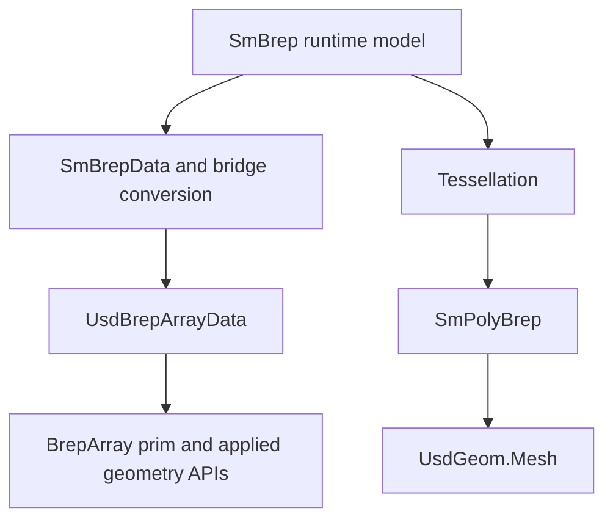

# USD interchange: runtime BRep, packed data, and mesh export

Source baseline: upstream `3fd5b9548d19aa8c12c29bc9637a96d42a06f8a5`.
Schema statements below come from the checked-in schema. Bridge behavior is
implementation policy. No USD round-trip or schema validator was run here.

## 1. Choose the representation the consumer needs

Exact/parametric CAD exchange and polygonal visualization have different outputs.
A `BrepArray` preserves supported topology and curve/surface representations;
a `UsdGeom.Mesh` carries polygonal geometry suitable for standard mesh consumers.
The latter does not preserve the original NURBS/analytic modeling semantics.



For generating a visualization asset, the repository's preferred workflow keeps
SMLib modeling in process, tessellates, and writes mesh data. A BRepArray round
trip is not needed just to obtain renderable polygons.

## 2. Authority and layer boundaries

The normative repository schema is
[schema.usda](../source/schema/omniSolid/resources/schema.usda). It defines the
proposed OmniSolid representation. Runtime SMLib rules come from the kernel;
serializer behavior and validator checks do not override either model's contract.

| Layer | Responsibility |
| --- | --- |
| `SM_API_USD` | Public file/stage-facing operations and output policies |
| `BREP_SM_USD` | Runtime SMLib to/from USD-oriented transfer data |
| `BREP_USD_DATA` | Packed data and USD property read/write |
| Schema resources | Prim/API declarations, tokens, array relationships and documented rules |

Start with [SmApiUsd.h](../source/SM_API_USD/inc/SmApiUsd.h),
[SmuConvert.cpp](../source/BREP_SM_USD/src/SmuConvert.cpp), and the
[schema contract reference](../.agents/skills/usd-brep-schema/references/schema-contract.md).

## 3. Packed topology is not the runtime pointer graph

The schema explicitly removes redundant runtime use data: there are no direct
vertexuse or loopuse arrays, and stored edgeuse entries represent pairs.
Objects belonging to one packed BRep occupy consecutive ranges. Per-owner
counts establish offsets into child arrays.

For counts $c_i$, an owner's starting offset is

$$
o_i=\sum_{j<i}c_j.
$$

The rule must be applied to the correct array and ownership level. An index into
faces is not an index into face occurrences. Reconstructing mates/radial links
requires interpreting the compact representation, not copying integer values
into pointer fields.

The schema includes `brep:regionCount`, `region:shellCount`, region types, and
faceuse orientation data. First-entry semantics such as outer/inner organization
must survive conversion. Do not collapse repeated occurrences merely because
they refer to the same geometric edge or face.

## 4. Geometry and parameter conversion

Geometry types are selected through schema-defined type tokens and applied APIs.
Analytic parameters, NURBS controls/knots/weights, domains, and orientations must
be interpreted together. A successful position conversion does not automatically
preserve derivative units or modeled intervals.

Ordinary SMLib NURBS parameters and analytic STEP parameters can differ. Units
and axis order must follow the specific bridge and schema fields. Do not assume
that every angle in every exchange path uses SMLib's STEP-evaluator degree
convention. Likewise, scene length metadata and numeric geometry scaling must
be handled consistently, not inferred from an application's display unit label.

## 5. Import policy and partial results

The current API header distinguishes strict and diagnostic/partial multi-BRep
import policies. Inspect the selected overload's per-result report and ownership
rules. Loading a single BRep prim can still encounter multiple packed members:
the documented single-result path requires successful conversion of all members,
returns the first, and deletes the others.

Healing is optional and can change topology, tolerances and derived data. Native
healer-version gates and the bridge's CAD-source marker behavior differ. The
current public bridge does not provide a reliable provenance-based guarantee
that SMLib-authored USD will skip healing when healing is enabled.

```text
open the stage and identify supported prims
validate packed sizes, tokens and indices under the schema
convert supported geometry and reconstruct runtime topology
apply only the requested normalization/healing policy
collect conversion diagnostics under strict or partial-output semantics
validate the reconstructed runtime model independently
```

## 6. Export can have model-side effects

The public header documents that BRep export may attach path attributes and
materialize derived state; it does not necessarily copy the input. Ownership
remains with the caller, but “export” should not be assumed byte-for-byte
read-only or safe concurrently with other access to the same mutable graph.

The `bBoundUnboundedFaceRanges` option concerns exported face ranges and is
documented separately from modifying the BRep's face domains. UV-curve export
also has its own option. Record these choices when comparing files or debugging
round-trip changes.

## 7. OCCT and native files are distinct paths

The OCCT bridge under `source/OCCT_BREP_IMPORT` and `source/OCCT_BREP_EXPORT`
translates another kernel's topology, orientation and parameter conventions.
It is not equivalent to native `.smb` loading, and OCCT `.brep` translation is
not by itself a claim of general STEP/IGES file import support.

See [native-io.md](native-io.md) for native persistence. Compare component and
occurrence structure, analytic types, intervals, tolerance policy, seams/poles
and orientation across each translator rather than treating “file opened” as
lossless conversion.

## 8. CAD scenario and validation

For editable exchange, retain supported BRep data and verify the receiving
consumer understands the schema. For a standard rendering pipeline, tessellate
and export mesh data with appropriate normals and units. Do not measure exact
CAD curvature from a coarse mesh export and attribute the difference to the
original model.

Validation has three independent layers: schema conformance, bridge preservation,
and runtime validity. Parse/type recognition alone is insufficient; a round trip
can hide matching bugs in both directions. Compare known geometric points,
material regions, orientations and supported attributes, and document intentional
normalization or representation loss.

The relevant follow-up guides are [topology](topology.md), [geometry](geometry.md),
[tessellation](tessellation.md), [polygon-brep](polygon-brep.md), and
[validation-diagnostics](validation-diagnostics.md). This chapter's source review
does not certify arbitrary assets or every external consumer's compatibility.
