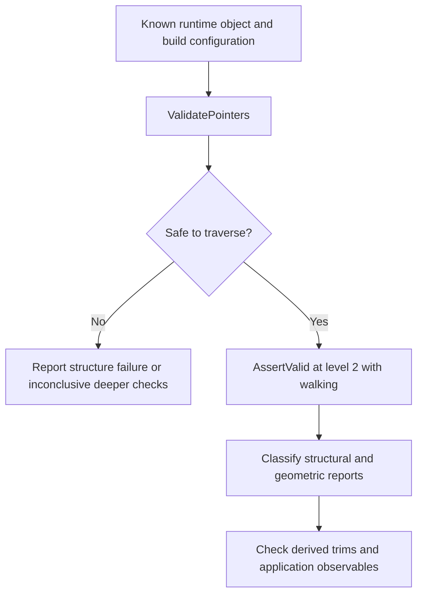

# Validation and diagnostics: what a successful check proves

Source baseline: upstream `3fd5b9548d19aa8c12c29bc9637a96d42a06f8a5`.
This guide describes source-backed validation stages and diagnostic practice.
It does not report that newly created test bodies were validated by the kernel.

## 1. Validity has several layers

Parsing a file, traversing pointers, satisfying incidence rules, matching geometry,
forming a manifold solid, and meeting a design dimension are different checks.
Passing one does not establish the others.

| Layer | Example question |
| --- | --- |
| Serialized representation | Are counts, indices and type discriminators valid before allocation? |
| Runtime graph | Are owners, reciprocal links and contexts consistent? |
| Geometry agreement | Do edge curves meet vertices and adjacent supports within the intended tolerance? |
| Topology class | Is this a solid, sheet, wire, or intended non-manifold complex? |
| Application correctness | Does the hole have the requested radius and clearance? |

An intentional sheet need not pass a manifold-solid predicate. A solid with the
wrong dimensions can pass structural validation. A low residual can coexist
with a wrong branch or wrong material side.

## 2. Source authority and evidence vocabulary

Use the [canonical BRep reference](../.agents/skills/smlib-brep-model/references/brep-format.md)
to separate model invariants, geometric invariants, constructor conventions,
validator enforcement, conditional checks, gaps, and translation policy.
`AssertValid` is executable evidence, but disabled checks and validator defects
must not redefine the intended model.

[SmBrep.cpp](../source/SMLib/src/SmBrep.cpp),
[SmTopology.cpp](../source/SMLib/src/SmTopology.cpp), and individual entity/use
implementations contain the actual predicates. Read the condition as well as
the message: a reassuring label does not prove the predicate checks what its
comment suggests.

## 3. Staged runtime validation

For a trusted in-process graph, the repository guidance is:



`SM_LEVEL_2` includes lower-level checks, so repeating all levels is normally
unnecessary. Capture `SmAssertArray` reports and classify their actual predicates.
`ValidatePointers` itself can report geometry/tolerance issues, so its name is
not a complete taxonomy of every finding.

Do not run these routines on arbitrary corrupt addresses as if they were a
secure deserializer. Serialized inputs need bounds/type/index checks before
constructing a runtime pointer graph. Some runtime checks can refresh marks,
caches or tolerance state; validation is not necessarily byte-for-byte read-only.

## 4. Numerical verification

For an intersection, measure $\|\mathbf S_1-\mathbf S_2\|$ under the actual
parameter correspondence. For an endpoint, compare the edge evaluation with
the referenced vertex. For a fit, distinguish sample residual from continuous
geometric deviation. For a derivative, compare finite differences in the same
parameter units.

$$
e_{\rm endpoint}=\|\mathbf C(t_e)-\mathbf P_v\|,
\qquad
e_{\rm lift}=\|\mathbf S(\mathbf c(t))-\mathbf C(t)\|.
$$

Record the tolerance source and local feature size alongside each error. An
absolute gap without units or scale is difficult to interpret. Do not combine
angular, parameter and positional residuals into one unexplained “accuracy.”

## 5. Status, result flags, and traces

Check `SM_SUCCESS`, but also inspect operation-specific flags and diagnostics:
found-solution flags, produced-solid flags, tessellation failed-face arrays,
partial-import reports, and output cardinality. Some simple intersectors report
an error for an empty result; some repair paths return success despite remaining
problems. A uniform “success means perfect model” rule is false.

The Python error reference is [errors.md](../.agents/docs/errors.md). Its
`Kernel trace:` interpretation is useful when a binding throws, but native
callers retain their own status/diagnostic responsibilities. Preserve the first
meaningful failure rather than replacing it with a generic downstream null error.

## 6. Minimal reproductions

A useful reproduction contains the smallest geometry that retains the failure,
exact operation arguments, units, source/build revision, and expected versus
observed behavior. Preserve inputs before consuming or mutating calls. Avoid
requiring a GUI camera state to understand a geometric problem.

```text
construct or load the minimal preserved inputs
record pre-operation topology class and key dimensions
execute one operation with explicit arguments
capture status, flags, outputs and diagnostic trace
measure the earliest observable mismatch
save only the artifacts needed to reproduce that mismatch
```

Do not simplify away the crucial seam, tangency, scale ratio or non-manifold
incidence. If a perturbation changes the result, record it as evidence about
conditioning or topology, not as an unreported fix.

## 7. CAD acceptance example

For a through-hole in a plate, check expected removed volume under nonoverlap
assumptions, hole position/radius, open passage, material regions and boundary
validity. A face count assertion alone is brittle because equivalent valid
representations can partition supports differently.

For a healed import, compare pre/post geometry and tolerances as well as validator
findings. A model can pass because tolerance was enlarged rather than because
the gap was closed. That may be an acceptable policy, but it must be described
accurately.

## 8. Validation scope for this handbook

Documentation checks include source links, named interfaces, equations, Markdown,
diagrams and explicit example status. Numerical illustration checks validate
their mathematics, not the kernel. Full kernel tests are unnecessary for prose
changes; compiled examples require their own focused execution before being
labeled tested.

For actual code changes, use the repository's
[test-selection guidance](../.agents/skills/usd-brep-test-selection/SKILL.md).
Related chapters are [topology](topology.md), [tolerances](tolerances.md),
[healing](healing-stitching.md), and [USD interchange](usd-interchange.md).
